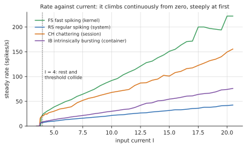
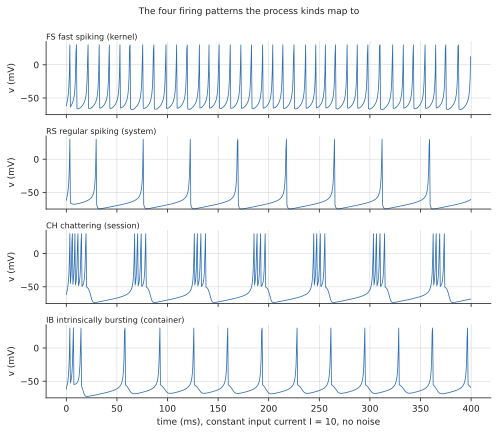

# Cortex: processes as spiking neurons

**View:** `cortex` · **Code:** `src/neurons.rs` (the simulation, no drawing), `src/cortex.rs` (layout and drawing) · **Prototype:** `docs/mockups/code/cortex.py`

## What you are looking at

| On screen | Measured quantity |
|---|---|
| A neuron per process | the process |
| Which layer, and the firing pattern | the process kind (kernel, system, session, container) |
| How often it fires | CPU use, through a calibrated current |
| Dendrites | threads, one to twelve of them: the count is the process's thread count clamped to 1..12 (`MAX_PRIMARIES`), so a process with 500 threads draws 12 and a count of zero draws one |
| An axon between two neurons | a socket or pipe link between the processes |
| Synaptic weight of an axon | traffic on the link in bytes per second; the socket count when traffic is unmeasured |
| The raster along the bottom | the last ten seconds of spikes |
| The synchrony in the legend | Golomb's measure over neurons that talk |

The neuron model is real and standard. The *mapping* from CPU to current is an engineering choice, covered below.

## History

**The neuron.** In the 1880s and 1890s Camillo Golgi's silver stain showed nerve cells in their entirety for the first time, and Santiago Ramón y Cajal used it to argue that the brain is made of separate cells that touch rather than a continuous net. Their opposed interpretations shared the 1906 Nobel Prize. Cajal's drawings of cortex, with its layers of pyramidal cells, are still reproduced. Korbinian Brodmann mapped the cortex into numbered areas in 1909.

**The equations.** Louis Lapicque (1907) modelled a neuron as a leaky capacitor that fires when it reaches a threshold, the *integrate-and-fire* model, which is crude and has survived 100 years because it is cheap. In 1952 Alan Hodgkin and Andrew Huxley worked out the actual ion currents in the giant axon of the squid and wrote them as four coupled equations, which won them a Nobel Prize in 1963 and is the standard of biophysical realism. McCulloch and Pitts (1943) abstracted the neuron to a threshold logic gate, which is the root of artificial neural networks. FitzHugh and Nagumo (1961 to 1962) found a two-variable reduction of Hodgkin-Huxley that exposes its geometry.

**The compromise.** Eugene Izhikevich published his *simple model* in 2003. It is as cheap as integrate-and-fire (a few arithmetic operations per step) yet can be tuned to reproduce the firing patterns of many cell types, and it let him simulate tens of thousands of cortical neurons in real time on a desktop machine. Wolfgang Maass (1997) had called spiking networks the "third generation" of neural network models; they are the ones that compute with *when* a spike happens as well as how many.

**The measure.** David Golomb and John Rinzel (1993) proposed the synchrony index used here to quantify how far a population of coupled neurons fires together, in their study of networks of mutually inhibiting neurons.

## Background theory

### Izhikevich neurons

A biological neuron integrates input current into a membrane potential; when the potential crosses a threshold it spikes and resets. Hodgkin-Huxley models do this faithfully with four coupled equations and are too expensive for thousands of cells. Izhikevich (2003) found a two-variable model that reproduces a large zoo of firing patterns for a few operations a step:

$$v' = 0.04\,v^2 + 5v + 140 - u + I \qquad u' = a\,(b\,v - u)$$

with a reset rule: if $v \ge 30\ \mathrm{mV}$, then $v \leftarrow c$ and $u \leftarrow u + d$.

- $v$ is the membrane potential in mV, $u$ a recovery variable (a lumped stand-in for potassium activation and sodium inactivation), $I$ the input current.
- $a$ is the recovery rate, $b$ its sensitivity to $v$, $c$ the post-spike reset potential, $d$ the post-spike jump in recovery.
- The quadratic is a fit to the shape of a real spike upstroke, not a derived quantity.

The model is a normal form near a saddle-node bifurcation on an invariant circle. Below the **rheobase**, the smallest current that makes the neuron fire repeatedly, it sits at rest. Above it, it fires, and the rate rises smoothly from zero. That is Type I excitability, and it is why a lightly loaded process fires rarely but not never.

### Fixed points and the rheobase

Set $v' = 0$ and $u' = 0$ with $u = bv$: the resting state satisfies $0.04v^2 + (5 - b)v + 140 + I = 0$. With $b = 0.2$ and $I = 0$ the roots are $v = -70$ mV and $v = -50$ mV. The first is stable (the resting potential) and the second is a saddle (the threshold). Raising $I$ brings them together; the discriminant $(4.8)^2 - 0.16\,(140 + I) = 0.64 - 0.16\,I$ vanishes at $I = 4$, where they collide and annihilate. That is a saddle-node bifurcation: the resting state ceases to exist and the neuron must spike. The model is of **Type I**, so its firing rate climbs smoothly from zero, unlike a Type II neuron which switches on at a finite rate. (The reset makes the real onset a little earlier than $I = 4$ because a spiking cycle and the resting state can coexist.)

Replaying the update rule at the noise-free current the code calibrates to gives these currents:

| Pattern | 1 spike/s (rheobase) | 40 spikes/s |
|---|---|---|
| FS | 3.87 | 5.16 |
| RS | 3.78 | 19.0 |
| CH | 3.78 | 6.54 |
| IB | 3.78 | 12.3 |

An RS cell needs nearly four times the drive of an FS cell to fire at 40 Hz, because its large $d$ makes it adapt. So 100% CPU does not mean the same current for a kernel thread and a system service, and that is what the calibration is for. All four rheobases sit just under 4.

*Steady firing rate against input current for the four types, from a replay of the update rule in `neurons::advance` (2 s settling, rate counted over the next 2 s). The onset sits just under $I = 4$ for all four, and the rate climbs continuously and steeply from zero.*

### Firing patterns

Four of the paper's patterns are used:

| Code | Pattern | $a$ | $b$ | $c$ | $d$ | Kind |
|---|---|---|---|---|---|---|
| FS | fast spiking | 0.1 | 0.2 | -65 | 2 | kernel |
| RS | regular spiking | 0.02 | 0.2 | -65 | 8 | system |
| CH | chattering | 0.02 | 0.2 | -50 | 2 | session |
| IB | intrinsically bursting | 0.02 | 0.2 | -55 | 4 | container |

Fast-spiking cells are inhibitory interneurons that follow strong drive with no adaptation. Regular-spiking cells are the cortex's main excitatory cell: a large $d$ makes them adapt, so inter-spike intervals lengthen. A high reset potential $c$ keeps chattering and bursting cells close to threshold after a spike, so they fire in bursts. The assignment of kind to pattern is a design choice (kernel threads are fast and relentless, services are steady, sessions are chatty).

*The four patterns at a constant current of 10 with no noise, 400 ms. The same equation, four sets of $(a, b, c, d)$.*

### Synaptic weights, worked

The weight rule $w = \min\left(2,\ \tfrac14\ln(1 + B/1000)\right)$ for $B$ bytes per second gives $w = 0.25 \ln 2 \approx 0.17$ at 1 kB/s, 1.73 at 1 MB/s, and reaches the cap of 2 at $B = (e^8 - 1)\ \text{kB/s} \approx 3\ \text{MB/s}$. The logarithm is the usual device for a quantity that spans many decades: four decades of traffic map onto about one unit of weight. The socket-count fallback gives $w = 0.25 \ln(1 + n)$, 0.35 for three sockets.

### Synapses and delays

When a neuron fires, a spike leaves along each axon and arrives after a conduction delay (at least one tick). On arrival the target takes a pulse of synaptic current $w$ that decays with a time constant of 5 ms:

$$I_{syn}(t + \Delta t) = I_{syn}(t)\,e^{-\Delta t/\tau}, \qquad \tau = 5\ \mathrm{ms}$$

Spikes in flight live in one priority queue ordered by arrival tick. Because every step is a whole number of 0.5 ms ticks, two runs that take the same steps give the same spikes, whatever the frame rate that asked for them.

### Synchrony

Golomb and Rinzel's synchrony measure asks how much of each neuron's variance over time is shared with the population mean:

$$\chi = \sqrt{\frac{\mathrm{Var}_t\big(\langle V \rangle\big)}{\big\langle \mathrm{Var}_t(V_i) \big\rangle_i}}$$

$\chi = 0$ for neurons that never agree and $\chi = 1$ for neurons that always do. `Network::synchrony` computes it from exponential running averages of $V$ and $V^2$ with a time constant of 2 s, so it needs no stored history. It reports "unknown" for fewer than two neurons or for neurons that hardly vary, instead of 0.

## How isotop implements it

**Integration.** `advance` takes one explicit Euler step of 0.5 ms, clamps $v$ at 30 mV, and applies the reset when it sees $v \ge 30$ at the start of the next step.

**CPU to current.** The same CPU should not mean the same current for an FS and an IB cell, because they have different rheobases. `neurons::calibration` therefore *measures* two currents per firing type at startup, without noise: the one that gives 1 spike/s (`rheobase`) and the one that gives 40 spikes/s (`forty_hertz`), by scan then bisection to 0.001. `current` then interpolates piecewise-linearly between landmarks:

| CPU | current |
|---|---|
| 0 % | 0 |
| 0.5 % | 0.62 × rheobase (well below firing) |
| 5 % | 0.98 × rheobase (just short of firing) |
| one core | the 40 Hz current |
| three cores or more | twice as far above the 40 Hz current as 40 Hz is above rheobase |

An active neuron also gets a little Gaussian current noise per step (standard deviation 1.2), seeded from process identity, which keeps neurons from firing in lockstep when their inputs are equal.

**Wiring.** Axons come from the sample's socket links and pipes. A socket link's `weight_of_rate` gives its synapse $w = \min(2,\ \tfrac14 \ln(1 + \text{bytes/s} \,/\, 1000))$, and when traffic is not measured, `weight_of_sockets` gives the same log of the socket count; the legend says which is in use. A pipe link is different: it always gets the fixed `PIPE_WEIGHT` of 1.0, so a pipe axon says that two processes are connected and nothing about how much flows through it. Both directions are offered when a link is two-way.

**Layout.** A process's seat in its layer is fixed for its life (`layout::Seats`). A layer that outgrows the slice widens it by 1.25× and the slice never narrows again, so a seat never changes with the population. The one exception is structural growth: when an arriving process makes a layer exceed its capacity the slice widens, and every neuron's position is recomputed against the new width (seats stay the same, positions scale). Exits never shrink it.

**Event queue.** Because spikes are rare events and delays are whole ticks, a spike in flight is a small tuple of ticks and a synapse index in a binary heap ordered by arrival. A step pops what is due, adds the weights to the targets' synaptic current, and fires whichever neurons crossed 30 mV. The queue is capped at 262,144 spikes. A spike beyond that is lost, as a saturated machine would lose one, and the simulation does not grow without bound. At 2,000 ticks per second a 20 ms axonal delay is 40 ticks.

## Faithful, stylized, invented

- **Faithful:** the Izhikevich equations and parameters, Euler stepping at 0.5 ms, the reset rule, conduction delays, exponential synaptic decay, Golomb's $\chi$.
- **Stylized:** one synapse type (excitatory, current-based), logarithmic weights, kinds as cell classes, the specific CPU landmarks above.
- **Invented:** that a process is a neuron at all. No claim is made that CPU load is a current, or that a pipe is an axon. The picture shows what *would* happen if it were, and synchrony then measures real structure in the process graph: two busy processes that talk fire together.

## Reading the picture

- A kernel thread under load fires fast and regularly; a container fires in bursts; a quiet system service is silent or fires on noise.
- Pulses travelling along an axon are spikes in flight; the delay is why a downstream neuron lags.
- Synchrony near 0 means the talkers are independent. A rise says that busy processes joined by traffic are firing together.
- Vertical stripes in the raster are population events: many neurons firing within a few ticks.

## Further reading

- Izhikevich, E. M. (2003), "Simple model of spiking neurons", *IEEE Trans. Neural Networks* 14(6), 1569.
- Izhikevich, E. M. (2007), *Dynamical Systems in Neuroscience*, MIT Press.
- Golomb, D. & Rinzel, J. (1993), "Dynamics of globally coupled inhibitory neurons with heterogeneity", *Phys. Rev. E* 48, 4810.
- Hodgkin, A. L. & Huxley, A. F. (1952), *J. Physiol.* 117, 500.
