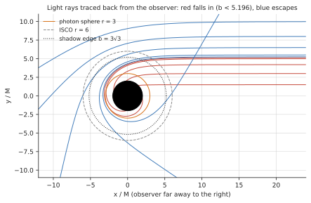
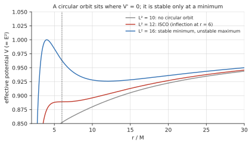

# Horizon: the OOM killer as a Schwarzschild black hole

**View:** `horizon` · **Code:** `src/horizon.rs`, `src/horizon/{lens,orbits,disk}.rs` · **Prototype:** `docs/mockups/code/horizon.py`

## What you are looking at

| On screen | Measured quantity |
|---|---|
| Orbital radius of a process | its rank by `oom_score` (rank 1 sits on the ISCO; memory footprint where the platform has no score) |
| A band far out | processes with `oom_score_adj` = -1000, which the OOM killer will not touch |
| A body that leaves the ISCO and plunges | the kernel's OOM kill counter rose and a process vanished |
| Overall brightness of the disk | memory pressure (`snapshot.pressure[1]`): the disk's gain runs from 0.45 to 1.35 as pressure goes from 0 to 100 |
| The disk's pattern of colour and brightness | decorative physics: the Page-Thorne flux, lensed and Doppler-shifted. It carries no process data. |

The shadow, the photon ring and the stars are scenery. The *ordering* of the bodies is the data.

## History

**Dark stars.** The idea that something could be too heavy for light to leave is older than relativity. In 1783 John Michell, and in 1796 Pierre-Simon Laplace, reasoned with Newtonian gravity and light as fast particles: a body with enough mass packed into a small enough radius has an escape velocity above $c$. The argument was dropped when light was shown to be a wave, and it was right for the wrong reasons.

**Schwarzschild.** Einstein published the field equations of general relativity in November 1915. Within weeks Karl Schwarzschild, serving in the German army on the Russian front, found the exact solution for the space around a non-rotating mass and sent it to Einstein. He died of an autoimmune disease in May 1916. For decades the surface at $r = 2M$ was treated as a true singularity. Arthur Eddington (1924) and later David Finkelstein (1958) showed that it is only the coordinates that misbehave there, and that an infalling observer crosses it without noticing.

**Collapse.** In 1939 Robert Oppenheimer and Hartland Snyder computed the collapse of a pressureless cloud and found both pictures at once: the infalling matter reaches the centre in finite proper time, while a distant observer sees it slow and freeze at the horizon. That is exactly the plunge this view draws. The phrase "black hole" was popularized by John Wheeler in a 1967 lecture, replacing "gravitationally completely collapsed object".

**Disks.** Matter falling into a compact object has angular momentum and settles into a disk. Shakura and Sunyaev (1973), Novikov and Thorne (1973) and Page and Thorne (1974) worked out what a thin relativistic disk radiates, and Cygnus X-1, a bright X-ray binary, became the first strong black-hole candidate in the early 1970s.

**Pictures.** In 1978 the French astrophysicist Jean-Pierre Luminet computed what a thin disk around a Schwarzschild hole looks like to a distant observer, on an IBM 7040 at the Paris-Meudon Observatory. The machine had no display, so he plotted the picture by hand with India ink, putting dots more densely where the numbers were brighter. It was published in 1979, and it contains the crescent-and-ring structure that this view reproduces. The Event Horizon Telescope imaged the shadow of M87\* in 2019 and of Sagittarius A\* in 2022.

**The OOM killer.** Linux can promise more memory than it has (overcommit), so when it runs out it must choose a process to kill. Each process has an `oom_score`, higher meaning likelier to be chosen, and the administrator can bias it with `oom_score_adj`, which runs from -1000 (never kill) to +1000. That interface arrived in Linux 2.6.36 (2010) in place of the older, coarser `oom_adj`, which was a power-of-two bit shift. So the ranking this view draws is a policy that a kernel developer chose and has revised.

## Background theory

### Units

Everything is in $G = c = M = 1$, so one world unit is one gravitational radius $GM/c^2$. The horizon is at $r = 2$, the photon sphere at $r = 3$ and the innermost stable circular orbit (ISCO) at $r = 6$.

### Why an ISCO

A massive particle in the Schwarzschild metric obeys

$$\left(\frac{dr}{d\tau}\right)^2 = E^2 - \left(1 - \frac{2}{r}\right)\left(1 + \frac{L^2}{r^2}\right)$$

with conserved energy $E$ and angular momentum $L$ per unit mass. The bracketed term is an effective potential. Newtonian gravity has a centrifugal barrier that always wins at small $r$. Here the $-2L^2/r^3$ term from general relativity pulls the other way, so for $r < 6$ the potential has no minimum and no circular orbit survives a nudge: the particle spirals in. That is the ISCO, and `ISCO = 6.0` is the edge of the disk and the position of the next victim.

### Light bending

Photons follow null geodesics. With $u = 1/r$ and the azimuth $\varphi$ as the parameter, the orbit equation is

$$\frac{d^2u}{d\varphi^2} + u = 3u^2$$

(Newtonian light would have no right-hand side and travel in straight lines.) A photon arriving at a distant observer with impact parameter $b$ has $du/d\varphi = 1/b$ at $u = 0$. There is a critical value

$$b_c = 3\sqrt{3} \approx 5.196$$

Below it the photon crosses the horizon. Above it the photon turns round and escapes. The disc of $b < b_c$ is the **shadow**: its radius on the screen is `SHADOW_RADIUS`. Photons with $b$ just above $b_c$ wind around the photon sphere before leaving, which is the thin bright **photon ring**.

A disk behind the hole is bent over the top of the shadow (the *primary* image) and a second, fainter, thinner image of its far side appears under it (the *secondary* image, from rays that swing the other way round the hole, $2\pi - \psi$ instead of $\psi$).

*Photons traced back from a distant observer on the right (the same equation and Runge-Kutta step as `lens::trace_photon`). Rays with impact parameter below 3√3 spiral into the horizon; those above are bent and escape, and the ones just above wind round the photon sphere.*

### Derivations and worked numbers

**The ISCO.** Write $V(r) = (1 - 2/r)(1 + L^2/r^2)$ for the effective potential. Circular orbits sit at $V' = 0$ and are stable if $V'' > 0$. Setting $V' = 0$ gives $L^2 = r^2/(r - 3)$, which exists only for $r > 3$. Setting $V'' = 0$ as well, so that the minimum is about to disappear, gives $r^2 - 6r = 0$, so $r = 6$. There $L^2 = 12$ and $E^2 = 8/9$. A particle falling from rest at infinity to the ISCO has radiated $1 - \sqrt{8/9} \approx 5.7\%$ of its rest mass: the efficiency of an accretion disk around a Schwarzschild hole, against well under 1% for nuclear fusion.

*The effective potential $V(r)$ for three angular momenta. A circular orbit sits at a flat point of $V$. For $L^2 = 16$ there is a stable minimum and an unstable maximum; as $L^2$ falls to 12 they merge into the inflection at $r = 6$, and below that no circular orbit exists.*

**The photon sphere.** Light has the same equation without the "1": $V_\gamma = (1 - 2/r)/r^2$, whose maximum is at $r = 3$. A photon placed there on a tangent stays in an unstable circular orbit. Its impact parameter is $b = L/E = r/\sqrt{1 - 2/r}$ evaluated at $r = 3$, which is $3\sqrt3 \approx 5.196$. That is the radius of the shadow.

**Orbit periods in this view.** The period at radius $r$ is $2\pi r^{3/2}$ in units of $M$. At the ISCO that is 92.3 $M$. The view runs time at 10 $M$ per second, so a body on the ISCO goes round in 9.2 s, and one at the outer edge of the ranked disk ($r = 23.5$) in 71.6 s: the inner bodies visibly outrun the outer ones, by a factor of $(23.5/6)^{3/2} \approx 7.8$.

**A dim edge.** The gravitational and transverse-Doppler factor $(1 - 3/r)^{-1/2}$ is $\sqrt2 \approx 1.41$ at the ISCO. Intensity goes as $g^4 = (1+z)^{-4}$, so even before the line-of-sight Doppler shift, light from the inner edge arrives at $(1/1.41)^4 = 25\%$ of its emitted brightness.

**An e-fold of the plunge.** Near the horizon the redshift of a falling emitter seen from far away goes as $1 - 2/r$, which falls by a factor of $e$ every $4\,M$ of the observer's time. At 10 $M$ per second that is one e-fold in 0.4 s, so a plunge fades quickly: the light is down by an order of magnitude after about a second.

### The disk

For a thin disk in the Novikov-Thorne model, the flux radiated at radius $r$ is zero at the ISCO, peaks near $9.5\,M$, and falls as $r^{-3}$ far out. `lens::flux` evaluates the closed form (after Luminet 1979); see its doc comment for the integral, and the test that pins the coefficient. Note that the prototype's coefficient is wrong (the flux rises linearly from the ISCO instead of quadratically), which is why the Rust port is derived from the integral and not copied.

### Redshift and beaming

Light from a patch of disk at radius $r$ reaches the observer shifted by

$$1 + z = \left(1 - \frac{3}{r}\right)^{-1/2}\left(1 + \Omega\, x \sin i\right), \qquad \Omega = r^{-3/2}$$

The first factor is gravitational redshift together with the transverse Doppler effect of the orbital motion. The second is the line-of-sight Doppler shift: $x$ is the horizontal screen position of the image and $i$ the inclination. Matter on one side approaches and is blueshifted, on the other recedes. The observed bolometric intensity goes as $F\,g^4$ with $g = 1/(1+z)$. Liouville's theorem makes $I_\nu/\nu^3$ invariant along a ray, which gives $g^3$ at each frequency, and integrating over the shifted frequencies gives one more factor of $g$. That $g^4$ is why the approaching side is so much brighter.

### A body falling in

For a body that leaves the ISCO, the coordinate time $t$ (what a distant observer's clock reads) and the proper time $\tau$ (the body's own clock) disagree. As $r \to 2$, $dt/d\tau = E/(1 - 2/r)$ diverges, so the body never reaches the horizon in finite $t$. Add the climb time of the light, the tortoise coordinate $r_* = r + 2\ln(r/2 - 1)$, and the observer sees:

- the image freezes just outside the horizon;
- it dims as $1.5\,(1 - 2/r)$, falling by a factor of $e$ every $4\,M$ of the observer's time;
- it reddens.

This is the classical "frozen star" picture. The image never crosses, but it fades below visibility. `PLUNGE_FLOOR = 2.0006` is where the drawn image stops.

## How isotop implements it

**Lensing is done on vertices, not pixels.** A per-pixel ray tracer is out of the question for a terminal frame loop that also has to run on the CPU rasterizer. Instead `LensTable` is built once (about a fifth of a second on every core) by tracing about 1,800 photon paths backwards from the observer with fourth-order Runge-Kutta on the orbit equation above, at $h = 0.002$ rad. For each of 360 log-spaced radii it records the sweep angle at which each photon crosses that radius, inbound and (for photons that turn round) outbound. Inverting that gives the impact parameter $b$ of the ray that connects a disk point at radius $r$ and sweep angle $\psi$ to the observer, for the primary and the secondary image. The view then draws ordinary triangles between the images of mesh vertices, so both rasterizers draw the same frame. The disk is re-lensed only when inclination or scale changes and recoloured every frame.

**The camera's pitch maps to inclination** (from face-on): 86° at the lowest pitch, 80° at the default isometric pitch and 0° (face-on) at top-down, linearly between.

**Rank, not value, sets the radius.** `orbits::Ranking` orders processes by `oom_score` with a swap margin so near-ties do not flicker, and `rank_radius` spaces the top 28 ranks from the ISCO outward ($r = 6 + 17.5\,(k/27)^{0.8}$). A body's radius eases to its rank's with a 1.5 s time constant. Its orbital speed is the circular-orbit angular velocity $\Omega = r^{-3/2}$ (the same as Kepler's), run at 10 $M$ of coordinate time per second of wall clock, so inner bodies visibly outrun outer ones.

**A kill needs corroboration, and the victim is inferred.** A plunge starts when the kill counter (`/proc/vmstat` `oom_kill`, otherwise the sum over cgroups) *rises* and a process vanishes near it in time. The counter says that a kill happened, never whose. The counter comes from the background thread, so the exit and the rise need not land in the same sample: `Orbits::classify` keeps vanished processes as fading ghosts and matches a rise before or after an exit within `GHOST_WINDOW` (2.5 s) + `BACKGROUND_PERIOD` (2 s) + one sample interval. The best-ranked ghost in that window becomes the victim, so an unrelated exit close to a real kill can be the one shown plunging. A process that simply exits, with no rise, does not plunge.

**Why a table.** The deflection angle of light is an elliptic integral: it has no elementary closed form. Rather than evaluate it per pixel, the view traces photons once and stores the answer in a table indexed by radius and sweep angle (360 radii, log-spaced from 2.0005 to 150, by 721 sweep angles from 0 to $\pi$, a step of 0.25°). A lookup is a bilinear interpolation. The table is also why the picture is the same on every machine: it is built from fixed constants, with no dependence on the sample.

## Faithful, stylized, invented

- **Faithful:** the photon equation, $b_c$, the ISCO, Page-Thorne flux, the $1+z$ formula, the plunge integrated in proper time.
- **Stylized:** the blackbody colour ramp (`DISK_KELVIN = 7200`, exponent 1.55) is chosen to look right, not to match a real disk spectrum. The disk is cut off at $30\,M$ and tapered. The secondary image is drawn at 0.6 of its radius.
- **Approximate:** the primary image agrees with the Beloborodov (2002) closed form to a few percent at $r \ge 6$ (a test checks this); nothing here is spinning (no Kerr), so there is no frame dragging.
- **Not modelled:** the disk's own light bending beyond the secondary image, any higher-order images, polarization, and emission from the plunging region inside the ISCO.

## Reading the picture

- A bright, blue crescent on the left, dim and red on the right: the left side is approaching.
- The disk wraps over the top of the shadow even at 80° inclination. That is the primary image of the far side, not a drawing error.
- Bodies nearest the ISCO are the OOM killer's next choices. Bodies in the far band are exempt.
- A plunging body that stretches, reddens and freezes before the shadow just before it disappears is the view's inferred victim of an OOM kill: the counter rose and this was the best-ranked process to vanish nearby.

## Further reading

- Luminet, J.-P. (1979), "Image of a spherical black hole with thin accretion disk", *Astron. & Astrophys.* 75, 228.
- Page, D. N. & Thorne, K. S. (1974), "Disk-accretion onto a black hole", *ApJ* 191, 499.
- Beloborodov, A. M. (2002), "Gravitational bending of light near compact objects", *ApJ* 566, L85.
- Misner, Thorne & Wheeler, *Gravitation* (1973), the chapters on the Schwarzschild geometry and on gravitational collapse.
