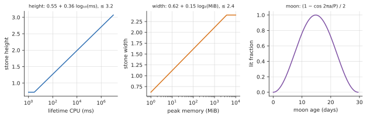

# Necropolis: a cemetery for dead processes

**View:** `necropolis` · **Code:** `src/necropolis.rs`, with the death events from `platform/linux/events.rs` (proc connector and taskstats) and `platform/macos/events.rs` (kqueue)

## What you are looking at

| On screen | Measured quantity |
|---|---|
| A headstone | one exited process |
| A row of stones | the processes that died in one UTC minute, the newest row in front |
| Stone height | the lifetime CPU time of the process, on a log scale |
| Stone width | the most memory it ever held, on a log scale |
| Stone tint | its kind (kernel, system, session, container) |
| The epitaph | how it died, and how long it lived |
| A mass grave | more than 8 deaths from one parent within 1 s (a fork bomb, a build, a crashed supervisor) |
| A mausoleum | a unit with no process left and at least three graves: on Linux a cgroup ending in `.service`, elsewhere any group; its graves move into the mausoleum |
| A zombie in an open pit | a process that has exited but whose parent has not yet reaped it |
| A ghost | a new process that has taken the pid of a buried one |
| The fog | memory pressure |
| The moon | the real phase of the real moon, from the clock. This one carries no process data. |
| Unmarked markers | processes that lived and died between two samples, known only from fork and exit events and so with nothing to engrave (at most 120 drawn, all counted) |

## History

*Necropolis* is Greek for "city of the dead", and the oldest ones were laid out as cities for the same reason cities are: the dead were a community the living meant to stay in relation to.

**The Valley of the Kings** is the famous one. For roughly five centuries of the New Kingdom (about 1539 to 1075 BCE) the pharaohs were buried in rock-cut tombs in a desolate wadi on the west bank at Thebes, the opposite shore of the Nile from the living city. The move away from pyramids was a bet on concealment: a pyramid announces where the treasure is, a cleft in the hills does not. The bet mostly lost, and nearly every tomb was robbed in antiquity. Tutankhamun's, KV62, survived largely by accident: a minor king whose small tomb was buried under the rubble from later, grander digging. Howard Carter's team found its steps in November 1922. KV5, the tomb of the sons of Ramesses II, had been noted in 1825 but its real extent (well over a hundred chambers) was only established by Kent Weeks's team from 1995, and it is the largest in the valley.

**Banditaccia, at Cerveteri in Italy,** is an Etruscan city of the dead that is literally laid out as a city, with streets, squares and neighbourhoods. From the 9th century BCE to about the 3rd, the Etruscans of ancient Caere built tumuli, mounds over rock-cut chambers, many of which imitate the interior of a house, with carved beams, couches and hearths. We know a good deal about Etruscan domestic architecture because their dead were housed so much better than their living. The name has nothing to do with bandits: it comes from the *bando*, the lease under which local landowners let the land to families for burials.

**Pantalica in Sicily** is a limestone plateau cliff-face pierced by thousands of small rock-cut chamber tombs. Most date from the 13th to the 7th century BCE; the traditional count is over 5,000, and the most recent estimate is just under 4,000. It is in the UNESCO listing with Syracuse. A cliff of empty doorways, each a family's.

**The Alyscamps at Arles in France** began as a Roman burial road lined with tombs outside the walls, and became a Christian pilgrimage cemetery because the martyr Genesius was believed to be buried there. Medieval Europe wanted to be buried there so badly that the dead were reputedly shipped down the Rhône to it. Dante puts its tombs in the *Inferno*, and Van Gogh and Gauguin both painted the avenue of sarcophagi in 1888.

**Cairo's City of the Dead** (the Qarafa) is a necropolis people live in, a whole district of mausoleums with families in the courtyards. It is the clearest case where the living and the dead share one neighbourhood.

**Brookwood, in Surrey,** is the Victorian answer to a plain logistics problem. London's churchyards were full and dangerous, so in 1852 a private company laid out a vast cemetery 25 miles out and ran the dead there by rail. The London Necropolis Railway ran its first funeral train in November 1854, from a private terminus near Waterloo, with coffins and mourners carried in separate classes of carriage. A German bomb destroyed the terminus and its rolling stock on the night of 16 April 1941, and the line never reopened. The cemetery still takes burials. Glasgow's hilltop Necropolis (1833) and Paris's Père Lachaise (1804) belong to the same movement, the garden cemetery, which turned the graveyard into a park for the living.

What these have in common is the design problem the view inherits: a place that has to *index* the dead (who, when, how, how big a life) so that someone can find one again.

## Background theory

### What it means for a process to die

A Unix process ends by `exit(status)` or by a signal. The kernel packs both into a **wait status**: the low 7 bits are the number of the killing signal (0 for a normal exit), bit 7 says a core was dumped, and the next byte is the exit status. `Cause::of_status` decodes it. The epitaphs follow, by the first rule that matches:

1. **OOM killer:** it received SIGKILL while its cgroup's OOM-kill count rose in the same or the next sample.
2. **Dumped core:** killed by a signal that normally produces a core file (SIGSEGV, SIGABRT).
3. **Another signal** (SIGTERM, SIGKILL not from the OOM killer, SIGINT ...).
4. **Forked and never exec'd:** exited 0 with the `AFORK` accounting flag set, a child that forked and exited without ever becoming another program.
5. **Exited with a nonzero status.**
6. **Exited 0**: "peacefully".
7. **Unknown:** sample diffing or kqueue saw it go but not why.

The OOM rule has to be a rule about *timing* because the kill counter is read by a background thread every 2 s, so the exit can be seen a sample before the counter moves. That is why the rule accepts the same or the next sample, and why the view waits a second (`BURIAL_DELAY`) before burying anyone.

### Zombies and reaping

A process that exits does not vanish. The kernel keeps a small record (its exit status and resource usage) until the parent calls `wait()`. In that state the process is a **zombie** (state `Z`): it holds no memory and runs no code, only a slot in the process table. A zombie that nobody reaps stays until its parent dies, when `init` adopts and reaps it. A zombie is therefore the one dead thing that is still in the process list, which is why the view stands it in an open pit rather than burying it.

### Pid reuse and the ghost

Pids are small integers, 32,768 by default (`pid_max`, raisable to about 4 million on 64-bit Linux), handed out cyclically. After a wrap, a new process can have the pid of a long-dead one. A pid alone is therefore not an identity, and isotop keys everything on `(pid, start time)`. The ghost is what you see when that distinction matters: the new process has the old number.

### How long things live

Process lifetimes are heavy-tailed. Harchol-Balter and Downey measured Unix process lifetimes and found them close to a $1/T$ distribution: a process that has lived $T$ seconds has roughly even odds of living another $T$. That makes most processes very short-lived (a few milliseconds is common) and a few enormous. Stone sizes are therefore logarithmic, which is the scale that tames a heavy tail: height is $0.55 + 0.36\log_{10}(\text{CPU ms})$, capped at 3.2, with a floor at 3 ms, and width is $0.62 + 0.15\log_2(\text{peak MiB})$, capped at 2.4. A thousand times more CPU time buys about one more unit of height, and every doubling of memory about a sixth of a unit of width. A linear scale would flatten every grave but one.

### The moon

The phase is a pure function of the date. The synodic month (new moon to new moon) is 29.530588853 days, the reference new moon is 2000-01-06 18:14 UTC, and the lit fraction of the disc at age $a$ days is

$$\frac{1 - \cos(2\pi a / 29.530588853)}{2}$$

This treats the moon's orbit as a circle at constant speed. The real synodic month varies by about half a day around its mean because the orbit is an ellipse and the sun perturbs it, so the drawn phase can be off by up to roughly half a day, which is invisible in a picture. `moon_phase` names the quarter and crescent states from the same number.

*The scales behind the picture: stone height and width are logarithmic in lifetime CPU and peak memory with caps, and the lit fraction of the moon follows the synodic month.*

## How isotop implements it

1. **Recording.** `record` runs on every sample, whichever view is shown, and takes in `Snapshot::life`: fork, exec and exit events from the proc connector and taskstats (Linux) or kqueue (macOS), merged with sample diffing so that a death is recorded exactly once per `Identity`.
2. **Burial.** Each death waits `BURIAL_DELAY` (1 s), long enough to know whether it belongs to a mass grave and whether an OOM kill claims it, and is then dug in the row of its UTC minute.
3. **Layout.** A row is `ROW_LENGTH` (26 units) long with two lines of graves; overflow is counted on the row's label. Families are kept together; rows ease back one spacing (`ROW_EASE`) when a new minute opens. The cemetery holds `CAP` (600) graves; above 75% of that the two oldest rows sink into the fog, and whole oldest rows are dropped past the cap.
4. **Stones** are built once, in their own coordinates, when the grave is dug. A frame only moves, fogs and culls them.
5. **Gaps.** When a source cannot be read the view degrades and the status strip names it: without exit records the causes come from the exit status and sizes are as observed; without fork events there are no unmarked markers; without memory pressure the fog stays at its base density.

## Faithful, stylized, invented

- **Faithful:** the wait-status decoding, the epitaph rules, the zombie and pid-reuse mechanics, the moon's phase to within half a day, the OOM correlation, stone height and width as measurements.
- **Stylized:** one stone per death, with the family grouping, the 600-grave cap and the unmarked-marker field being scale devices. Fog thickness is a bounded map of memory pressure.
- **Invented:** the cemetery. A process has no body to bury and no moon shines on a datacentre. The moon carries no data at all.

## Reading the picture

- A long row of identical short stones is a build or a script launching children. A mass grave is the same thing at higher speed.
- A tall, narrow stone is a long CPU-bound life with little memory; a wide, squat one is a process that held a lot and did little.
- Stones marked "taken by the OOM killer" cluster when memory pressure is high, and the fog is thick at the same time.
- A zombie standing in a pit for more than a moment is a parent that is not calling `wait()`: a bug or a hang in the parent.
- A ghost on a grave is a pid that was recycled.

## Further reading

- *The Valley of the Kings*: Reeves & Wilkinson, *The Complete Valley of the Kings* (1996); Kent Weeks, *The Lost Tomb* (1998) for KV5.
- On Brookwood and the Necropolis Railway: John M. Clarke, *The Brookwood Necropolis Railway* (various editions).
- Harchol-Balter, M. & Downey, A. B. (1997), "Exploiting process lifetime distributions for dynamic load balancing", *ACM TOCS* 15(3).
- Stevens & Rago, *Advanced Programming in the UNIX Environment*, on `wait`, zombies and exit status.
- Meeus, *Astronomical Algorithms*, ch. 49 (the real moon-phase computation, if the half-day error ever matters).
