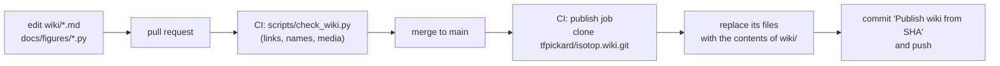

# Guide: Contributing to the wiki

This wiki is source code. Its pages live in the `wiki/` directory of the main repository, are reviewed in pull requests like any other change, and are published to the GitHub wiki by CI when they reach `main`. Nothing typed into the wiki's web editor survives the next publish. This page is the style guide and the review checklist: how a page is named, linked and illustrated, which claims it may make, and what a reviewer looks for.

The standard the wiki sets itself is the one the project sets for its code: every statement about what isotop does is checked against the source, and what the code does is kept apart from what the theory says and from what a picture lets a viewer infer. See [Philosophy](Philosophy) for why the project exists at all, and [Guide: Writing a View](Guide-Writing-a-View) for the code-side equivalent of this page.

## History

The word comes from the Hawaiian *wiki wiki*, "quick". Ward Cunningham put the first wiki, the WikiWikiWeb, on the
web in 1995 as the Portland Pattern Repository, a place where programmers could edit one another's pages in a
browser; its premise was that anyone should be able to edit any page.
Wikipedia, begun in 2001, applied the premise at a far larger scale. A wiki whose pages are files in
a version-control repository, reviewed in pull requests like code, is a later and narrower idea, and is the one this
page documents: it keeps the wiki's habit of linking everything to everything and gives up the habit of editing
anything in place. The pages are corrected by review instead of by whoever arrives next.

This is the only page in the wiki whose subject is the wiki.

## How the wiki is built and published



What `.github/workflows/wiki.yml` does, in the order it does it:

* It runs on a push to `main` that touches `wiki/**` or the workflow itself, on a manual dispatch, and on pull requests that touch `wiki/**`, `scripts/check_wiki.py` or the workflow.
* The `check` job runs `python3 scripts/check_wiki.py` and nothing else. It runs on pull requests too, so a broken link fails the review, not the publish.
* The `publish` job runs only for pushes and manual dispatches, after `check` passes. It clones the wiki's own repository (`tfpickard/isotop.wiki.git`) with the workflow token, deletes every file in that clone except `.git`, copies the whole of `wiki/` over it, and commits with the message `Publish wiki from <sha of the source commit>`. If nothing changed it exits without committing.
* Because the clone is emptied first, a page deleted from `wiki/` disappears from the published wiki, and a page created in the web editor is deleted by the next publish.
* One-time setup: GitHub creates a wiki's git repository only when a first page is saved in its web UI. The publish job fails with an explicit error until someone has done that once.

The source of truth is the main repository. Reviewers, issues and `git blame` all work on the source files; the published wiki is a build artefact.

## Names and layout

`wiki/` is one flat directory. The **file name is the page title with hyphens**: `View-City.md` is the page "View City", and a link to it is written `View-City`.

| Prefix | For | Example |
|---|---|---|
| `Theory-` | How isotop works: sampling, the scene, the rasterizer, determinism | `Theory-Stable-Layout` |
| `Math-` | A technique that stands apart from any one view | `Math-Fourier-Epicycles` |
| `View-` | A view that exists in `views::REGISTRY` | `View-Strata` |
| `Planned-` | A view that is specified but not implemented | `Planned-Mold` |
| `Guide-` | Tutorials, recipes, project conventions | `Guide-Recipes` |
| none | `Home`, `Philosophy`, `Gallery`, `Glossary` | `Home` |

`_Sidebar.md` and `_Footer.md` are GitHub wiki specials: the sidebar is the navigation, so a new page is not reachable until it is listed there. Every other page starts with a `# ` heading on its first line (the checker requires it) and opens with one paragraph that says what the page is about, followed by the picture for a view.

When a planned view is implemented, its page is renamed from `Planned-X` to `View-X`, its banner is removed, its sections are rewritten from design into description, and every link to the old name is updated. The checker catches the links you miss.

## Truth rules

These outrank style.

1. **Check every statement about isotop against the source.** Open the code. Use exact names (files, types, functions, constants, flags, keys) and their real values. Cite by file path and symbol, never by line number, because lines move. If the code and `README.md` or `docs/` disagree, the code wins, and the disagreement goes into the pull request description so it can be fixed at its source.
2. **Keep three things apart, visibly.** What the *theory* says (standard physics and mathematics, independent of isotop). What the *code* does. What the *picture* lets a viewer infer. The view skeleton below builds the separation into its section order.
3. **Check the mathematics.** Derive when a derivation fits in a few lines. Check units. Compute numerical examples (a short standard-library Python script is enough) instead of estimating them. If you are not certain of a formula, constant, date or attribution, leave it out or mark it `(unverified)`.
4. **Cite only works you are certain exist**: author, year, title, venue. No URLs or DOIs you have not verified. A short honest list beats a long invented one.
5. **Implemented versus planned.** A page about a view that is only specified starts with this banner and describes the design as a design ("will", "is specified to"), never as behaviour:

```
> **Planned, not yet implemented.** Specified in [docs/briefs/views-2026-10.md](https://github.com/tfpickard/isotop/blob/main/docs/briefs/views-2026-10.md) and tracked in issue #N.
```

6. **There is no plugin system.** Views are compile-time modules (`views::ViewModule` plus one row of `views::REGISTRY`). Say so where it matters and never imply dynamic loading. [Guide: Writing a View](Guide-Writing-a-View) explains what is true and what is speculation.
7. **Name the platform.** isotop runs on Linux and macOS. Where behaviour differs, say which.
8. **Mark what you did not run.** A recipe or claim you could not verify says so (the recipes page uses the labels *verified here* and *not verified*).
9. **Every page has a `## History` section.** It is the history of what the page is about: the technique, the physics, the animal, the standard, the practice. It is specific and checkable (names, dates, places, venues), it is verified against a source you have actually read, and where sources disagree or a story rests on one person's recollection the text says so. A short true history beats a long shaky one, and a date you cannot confirm is left out or marked `(unverified)`.

## Easter eggs

The wiki is an art project, and a page may carry one or two Easter eggs. They obey the same truth rules as everything else.

* **Deadpan, never winking.** The register is the one the rest of the page is in: dry, academic, matter of fact. No "fun fact", no exclamation marks, no emoji, no explaining the joke. A reader who notices is rewarded; one who does not loses nothing.
* **True, or plainly in-world.** An egg is a true oddity from the history told straight; or a non-fiction treatment of something fictional, where the subject is fictional or fiction-adjacent (the [Matrix](View-Matrix) history is the model); or a formal trick (an unusually specific caption, a decorative element declared decorative). It is never a false claim about the code or about the real world.
* **Never in a truth-bearing sentence.** Put it in a History section, a caption, a reference, a closing line, or "Variations and open questions".
* **Not listed.** Do not mark the egg or collect the eggs on a page.

## Links

Link to another wiki page with the page name and no `.md`, no path, no leading slash. Link into the repository with an absolute URL, because wiki pages have no relative path to the source tree. Issues are absolute URLs too.

```
[Stable layout](Theory-Stable-Layout)
[src/cells.rs](https://github.com/tfpickard/isotop/blob/main/src/cells.rs)
[issue 97](https://github.com/tfpickard/isotop/issues/97)
```

A link to a page that does not exist fails the check. If a page you need does not exist, create it with the right prefix and add it to the sidebar. The checker reads link syntax even inside inline code spans (it skips only fenced blocks), so show example links inside fences, as above.

## Mathematics

GitHub renders `$inline$` and display blocks with `$$` on their own lines:

```
$$
\hat{x}_{n+1} = \hat{x}_n + \alpha\,(z_n - \hat{x}_n)
$$
```

Keep the LaTeX simple. Do not put `\\` line breaks inside `$...$`. In a table cell, do not put `|` inside maths; write `\lvert x \rvert` for an absolute value. Define every symbol where it first appears and give its unit. When the code uses a constant, give its real value and the constant's name.

## Media

All media is referenced by absolute URL on the repository's raw host, so it resolves once the branch is merged. The three kinds:

| Kind | Where it lives | URL base |
|---|---|---|
| Stills and recordings of the views | `docs/media/` and `docs/media/renders/` | `https://raw.githubusercontent.com/tfpickard/isotop/main/docs/media/` |
| Mockups of planned views | `docs/mockups/` | `https://raw.githubusercontent.com/tfpickard/isotop/main/docs/mockups/` |
| Figures that plot the mathematics | `docs/media/figures/` | `https://raw.githubusercontent.com/tfpickard/isotop/main/docs/media/figures/` |

`docs/media/<view>.webp` are the README images and `<view>-motion.webp` are animations; `docs/media/renders/<view>.webp` are stills rendered for the wiki. The checker verifies that every `raw.githubusercontent.com/tfpickard/isotop/main/docs/...` link names a file that exists in the working tree, so a page can never point at a render that was not committed. Always write alt text that says what the picture shows, not what it is called.

## Figures: the script convention

A figure is generated by a script, never drawn by hand and never a screenshot of a plot. Each figure has a script `docs/figures/<slug>.py` that writes `docs/media/figures/<slug>.svg` when run from the repository root:

```sh
python3 docs/figures/strata-window.py
```

The rules:

* **Standard library only** and **deterministic**: no third-party imports, no clock, no environment, no randomness without a fixed seed. Running a script twice must write the same bytes, so a figure change shows up in review as a real change.
* **The SVG carries its own dark background** (a rect filled `#0e1116`) with light strokes and text (`#c9d1d9`), so it reads on both GitHub themes. It has a `viewBox`, a `<title>`, axis labels with units, and `font-family="system-ui, sans-serif"`.
* **Prefix the slug with the page group** (`strata-`, `fourier-`, `model-`, `mold-`) so names never collide.
* **Plot the page's mathematics, not decoration.** Two to five figures that teach beat one on every page: spectra, phase portraits, response curves, dispersion relations, windows against sampling intervals.
* **Look at it.** Convert it (`convert docs/media/figures/<slug>.svg x.png` with ImageMagick) and view the PNG before committing. Commit the script and the SVG together.

Several scripts share a small helper module in `docs/figures/` (`figkit_w4.py`, `svgkit_w6.py`, `svgkit_w8.py`, `sampling_plot.py`), each a standard-library SVG plotting kit. Reuse the one nearest your topic instead of writing a fifth. Reference a figure as:

```

```

Before drawing a new figure, list `docs/media/figures/`: the thing you want to plot may already exist, and a second figure of the same curve is a second thing to keep correct.

## The skeleton of a view page

Every `View-*` and `Planned-*` page has these sections, in this order. The order is the argument: first what the real system is, then the equations, then the table that ties each visual element to a measurement, and only then the code.

1. **Lede and image.** One paragraph, then the render.
2. **The system being modelled.** The real-world physics, biology or history, and why it is a good metaphor for process data.
3. **History.** The history of the thing the view draws (rule 9). Where the repository holds a longer account in `docs/theory/`, link to it here.
4. **Theory.** Equations, derivations, regimes, parameters, known behaviours (stability, scaling, fixed points).
5. **Mapping.** A table: visual element, measured quantity (and its platform source), transform (log, square root, smoothing constant, quantum). Every element maps to a measurement or is declared decorative; this is the realness contract.
6. **How isotop realises it.** Algorithm, data structures, constants with their real values, stable layout, seeding and determinism, `stage.dt` or `FixedStep`, CPU and GPU notes, picking, what degrades when a source is missing.
7. **Reading the picture.** What a viewer can and cannot infer: measured versus derived versus decorative, resolution limits, aliasing, what is invisible.
8. **Try it.** Exact commands (`--demo --view X`, `--time`, `--output`, keys). Run them.
9. **Where in the code.** Files and symbols.
10. **Variations and open questions.** Concrete experiments and unanswered questions. This is the seed for the next recipe or the next view.
11. **References.**

`Theory-` and `Math-` pages choose their own skeleton but keep the three-way separation, carry a History section, and end with "Where in the code" (Theory) and "References". `Guide-` pages are organised by task.

## Checking a page before you push

From the repository root:

```sh
python3 scripts/check_wiki.py
```

It checks that every page name has a known prefix (or is `Home`, `Philosophy`, `Gallery`, `Glossary`, `_Sidebar`, `_Footer`), that every page starts with a `# ` heading, that every link to another wiki page names an existing page (an anchor after `#` is allowed), and that every media link into `docs/` names a file in the tree. It prints `N pages, M problems` and exits 1 on any problem.

It does not check mathematics, code facts, spelling or that a command works. Those are yours and the reviewer's. A good habit: run every command you print, with the release binary, and paste the output you got rather than the output you expect.

## Review checklist

For the author before requesting review, and for the reviewer:

- [ ] `python3 scripts/check_wiki.py` reports no problems.
- [ ] The page has a `## History` section whose dates and attributions were checked, with disagreements and unverifiable claims said so.
- [ ] Every name (file, type, function, constant, flag, key) was found in the source, and cited by path and symbol, not by line.
- [ ] Every number in the page is either a constant quoted from the code, a value computed by a script, or marked `(unverified)`.
- [ ] Theory, code and picture are in separate sections; nothing in "Reading the picture" claims what the code does not measure.
- [ ] A planned view carries the banner and speaks in the future tense; an implemented view has no "will".
- [ ] The mapping table covers every visible element or lists it as decorative.
- [ ] Platform differences (Linux versus macOS) are stated where they exist.
- [ ] Every figure comes from a deterministic script in `docs/figures/`, was viewed after rendering, and has alt text.
- [ ] Every command was run, or is labelled as not run.
- [ ] No sentence claims a plugin system, a network lookup, or privilege escalation. isotop has none of them.
- [ ] Any disagreement between the code and the README or `docs/` is written down in the pull request description.
- [ ] New pages are in `_Sidebar.md`; renamed pages have no stale links.
- [ ] Prose: no emojis, no "In this page we will", no padding. A derivation that fits in a few lines is in the page.

## Where in the code

| Item | Path |
|---|---|
| Publishing workflow | `.github/workflows/wiki.yml` |
| The checker | `scripts/check_wiki.py` |
| Page sources | `wiki/` |
| Figure scripts and kits | `docs/figures/` |
| Figure output | `docs/media/figures/` |
| View stills and recordings | `docs/media/`, `docs/media/renders/` |
| Mockups of planned views | `docs/mockups/` |
| The specification of the planned views | `docs/briefs/views-2026-10.md`, `docs/ROADMAP.md`, `docs/VIEW_CONVENTIONS.md` |
