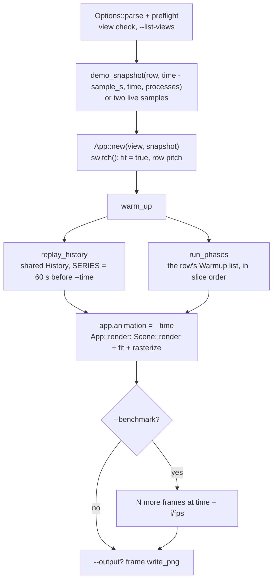

# Guide: Headless and reproducible renders

`isotop --demo --view orbit --time 12 --renderer cpu --output orbit.png` writes the same file on every run, on every machine of one architecture, byte for byte. That property is not an accident of the demo being simple: it is held in place by a synthetic workload that is a pure function of time, by seeded randomness keyed to process identity, by a fixed pipeline from sample to pixels, and by a test that compares every view's frame with a stored hash on every change. This page walks the headless pipeline, says exactly what `--time` means, lists what makes a render reproducible and what silently breaks it, and shows how the golden test and CI render every view. Commands here were run on the build machine (Linux x86_64, no GPU) unless marked otherwise; see [Guide: Recipes](Guide-Recipes) for task-sized uses.

## What "headless" means

A run is headless when it has `--output` or `--benchmark` (`Options::headless`). Headless runs never touch the terminal: `preflight` handles `--list-views`, `--verbose` and the view checks first, and `run` then builds the frame in memory.

| Flag | Effect in a headless run |
|---|---|
| `--output <PATH>` | Render one frame and write it as an 8-bit RGB PNG. Prints `Wrote PATH (WxH, N visible)` |
| `--benchmark <N>` | Render one frame, then `N` more, timing the loop. Prints `N frames \| WxH \| V visible \| X ms/frame \| Y renderer fps on R (excludes terminal transport)` |
| `--width <W>` | Frame width in pixels, 160 to 2560, default 1920. The height is `W * 9 / 16`: headless frames are always 16:9 (`Options::headless_height`) |
| `--time <T>` | The synthetic time of the frame, in seconds, default 12. Negative values are refused (the argument parser rejects `-1`; `run` also rejects non-finite or negative values) |
| `--demo` | Use the synthetic workload. Without it, a headless run samples the real machine |
| `--processes <N>` | Number of synthetic processes, 1 to 10000, default 192 |
| `--limit <N>` | Most processes admitted into the scene, 1 to 10000, default 1024 |
| `--sample-ms <MS>` | Sampling interval, 100 to 10000, default 1000. In headless demo runs it sets how far back the previous sample is and the cadence of warm-up replays |
| `--renderer cpu\|gpu\|auto` | Rasterizer. `cpu` is the reference; `gpu` fails with exit status 1 and a message if there is no hardware adapter; `auto` falls back to the CPU and the benchmark line says why |
| `--fps <N>` | In a benchmark, the spacing of the frames (frame `i` is drawn at `--time` plus `i / fps`) |
| `--view <NAME>` | The view to draw (default `city`; or the first of `--views`). An unsupported view makes a headless run exit 1 |

The PNG is the scene image only. Labels, popups, the inspector and the status strip are terminal text drawn over the image by `terminal.rs`; they are not in the file. (Matrix is the exception: its text is drawn into the frame as glyph items.) The camera is the row's default camera, fitted: a headless run has no way to move it, and `--output` of a view always shows the whole of what the view reports as its bounds.

The complete flag list, as `isotop --help` prints it, is at the end of this page.

## The pipeline



In order, from `run` in `main.rs`:

1. **The first sample.** With `--demo`, `demo_snapshot(view.info(), time - sample_seconds, time, processes)`. The "time of the sample before" is one `--sample-ms` back, because a view with churn needs the life events in between. Without `--demo`, the collector takes one sample, sleeps `--sample-ms`, and takes a second, because CPU use is a rate and needs two readings.
2. **The app.** `App::new` calls `switch(view)`, which sets `fit` and the row's `pitch` on the camera goal. The first `App::render` fits the camera to `Scene::bounds` (or the positions) and draws again from the fitted camera.
3. **`warm_up`**, described below: it makes the scene look the way a long-running session would at that moment.
4. **The captured frame.** `app.animation = --time`, then `App::render`: `Scene::render` records the display list, the CPU (or GPU) rasterizes it. The golden test calls the same `warm_up` and `App::render`, so the hashes it checks are the PNGs' frames.
5. **Benchmark and PNG.** A benchmark reuses the frame buffer and renders `N` more frames at `--time + i / --fps`; `--output` writes the first frame's pixels.

## What `--time` means

`--time T` is the **demo clock**, in seconds. The synthetic workload is a pure function of it: `model::demo_with(time, count, options)` computes each process's CPU as `((sin(phase) * 0.5 + 0.5)^4 * scale + bonus` with `phase = 0.55 * time + 1.71 * index`, its memory, state, I/O and so on, with no state and no randomness. It follows that:

* Two calls with the same `time` give the same snapshot, in any order, including negative times (the options are documented as "pure functions of `time`, with no state").
* `Snapshot::elapsed` is `time`, and `Snapshot::wall` is `model::DEMO_EPOCH + time`, where `DEMO_EPOCH` is 2026-10-10T04:12:00Z. Calendar-dependent drawing (the necropolis moon, the minute of a death) reads `wall`, never the system clock, so it is repeatable too.
* The **animation clock** is also `--time` in a headless run. Anything that moves with scene time (the orbits, the globe's turn, the ripples) is therefore a function of `--time`: rendering at 12.0 and 12.2 gives two moments of one motion. This is how the recipe for an animated file works: render consecutive times and join the frames.
* Interactively, demo time starts at 0 and follows the wall clock of the session; `--time` only fixes headless runs.
* The default reference time is 12. A view whose history window is not full at 12 seconds uses a later one: Ptolemy's planets need 30 samples and its reference renders use `--time 300`; the harness takes the time from the row's `contract.time`.

Verified: `--time 12` twice produces files with the same MD5; `--time 13` produces a different file.

## Demo options: what the workload adds for a view

`model::demo(time, count)` must stay byte-identical, because every older view's pixels depend on it. A view that needs more asks on its registry row (`ViewInfo::demo`, a `DemoOptions`), and every demo snapshot taken while that view is shown follows it, whether it is the first sample, a warm-up replay or a live-looking one:

| Option | What it adds | Rows that ask |
|---|---|---|
| `churn` | Transient processes after the base population (families forking children that run 3 to 12 s and exit, with some killed by signals), pids reused with a new `Identity::start`, and the life events between two sample times (`demo_life`, `demo_events`) | ptolemy, tesseract, necropolis |
| `exact_cpu_time` | `cpu_time` as the exact integral of the process's `cpu` (`demo_cpu_seconds`), and `threads` large enough that no single-threaded process exceeds one core | tesseract |
| `observer` | `Snapshot::observer`, isotop itself: pid 999, below every demo pid, 40 +/- 10% CPU and 96 +/- 4 MiB | ptolemy |
| `mortality` | With `churn`, cycles 3.5 times as long and tuned to bury about 40 processes a minute at 192: mass graves, an OOM victim, a stopped unit, pid reuse | necropolis |

`demo_snapshot` (in `main.rs`) is the single entry point: it calls `demo_with` with `row.demo`, and for a churn row it fills `Snapshot::life` with `demo_events(previous, time, ...)` and, when the row demands `Source::LifeEvents`, the demo's source list. Nothing else may call `demo_with` for a view, or the headless frame and the interactive one would diverge.

## Warm-up: a frame as if the session had been running

A single `--time 12` frame of Strata, with no history, would show an empty landscape. `warm_up` repairs that in two steps.

**1. `replay_history`.** For demo headless runs, it records the demo samples of the `history::SERIES` (60) whole seconds before `--time` straight into `scene.history`, skipping times before 0. It bypasses `Scene::record`, so no view's own record hook sees these samples. It is skipped when the row has a due `Phase::History`, which fills the history while it rasterizes. Views read the shared per-process history through `Stage::history` (see [Theory: History](Theory-History)), so Ptolemy, Strata and Tesseract have their past without a hook.

**2. `run_phases`.** For each `Warmup` of the shown row, in slice order, if `due(warmup, options)` holds. A `Warmup` is a `Phase` and a `When`.

| `When` | Runs in |
|---|---|
| `DemoOutput` | `--demo` with `--output` |
| `Output` | `--output`, live or demo |
| `Headless` | `--output` or `--benchmark`, live or demo |
| `DemoHeadless` | `--demo` with `--output` or `--benchmark` |

| `Phase` | What it does |
|---|---|
| `History { seconds }` | For each whole second back from `seconds` to 1 before `time`, makes that second's demo sample the whole history and rasterizes a frame; then leaves the history at the sample of `time` |
| `Record { seconds }` | Feeds the demo samples of the `seconds` whole seconds before `time` to `Scene::record` (every view's record hook), skipping those before 0, without rasterizing |
| `Replay { seconds, before_start }` | The same, with the samples `--sample-ms` apart, as a live run takes them; with `before_start`, times before 0 are replayed too (the demo workload is defined there), so a view that keeps minutes is settled at 12 s |
| `Settle { frames, step, lead }` | Rasterizes `frames` frames `step` seconds apart, starting `lead` seconds before `time` |
| `Journal { frames, step, lead }` | As `Settle`, in `f64`, handing the journal lines that arrived since the previous frame to the scene first |

The rows that exist today (from `views::REGISTRY`):

| View | Warm-up | Why |
|---|---|---|
| strata | `History { 60 }`, `DemoOutput` | A full minute of ridges |
| ripple, flow, cores, reef | `SETTLE`: `Settle { frames: 80, step: 0.05, lead: 4.0 }`, `Output` | Four seconds for the water, particles, marbles and creatures to settle |
| coop | `Record { 30 }` (`DemoOutput`), then `SETTLE` | CPU variation over 30 samples and fox baselines, then the flocks |
| matrix | `Journal { 161, 0.05, 8.0 }`, `Headless` | Eight seconds of rain |
| ptolemy | none | The shared history replay is all it needs; its planets need 30 samples, so use `--time 300` |
| tesseract | `Replay { 60, before_start: false }`, `DemoHeadless` | A minute of worldlines at `--sample-ms` |
| necropolis | `Replay { 600, before_start: true }`, `DemoHeadless` | Ten minutes of deaths, so `--time 12` shows ten rows |
| city, orbit, cells, globe | none | Their state is built inside `draw` from one snapshot |

Two consequences worth knowing. First, `SETTLE` is `When::Output`, so `--benchmark` alone does not run it; the benchmark of ripple measures an unsettled scene unless you also pass `--output`. The rows that a new view adds use `Headless` and `DemoHeadless` instead, so a benchmark measures a settled scene. Second, a `Replay` phase replays `seconds / sample_seconds` samples, so `--sample-ms 250` makes the tesseract warm-up take four times as many samples and renders a different frame from the default (verified: the two files differ).


## What makes a render bit-reproducible

Reproducibility is a product of discipline in four places.

**Inputs.** A frame is determined by: the isotop binary, the view, `--time`, `--width`, `--processes`, `--limit`, `--sample-ms`, `--demo`, and `--renderer`. Nothing else: not the clock, not the current directory, not the environment, with one exception noted below.

**Time.** Simulations advance on the demo clock, never per frame; calendar data comes from `Snapshot::wall`; `stage.dt` is computed by the scene (zero on the first frame, while paused and on rewind, at most 0.5 s) and creature simulations step on a `FixedStep` fed from `stage.time`. See [Theory: Determinism](Theory-Determinism) and [Theory: Simulation Toolkit](Theory-Simulation-Toolkit).

**Randomness.** Per-process randomness is `simulation::Rng::for_identity(id, SALT)`, seeded from the pid and the start time through the splitmix64 finaliser, with one salt per view. Demo-wide randomness is a pure function of `--time` and indices. Stateless variation (flicker, jitter) is a hash of a stable id and an event index, never a per-frame generator that advances. No `HashMap` iteration order may reach the pixels: where a view draws from a map it sorts first (the links, for instance, are drawn from sorted keys because overlapping beams blend in drawing order).

**Layout.** A process keeps its place when CPU, memory or the population change ([Theory: Stable Layout](Theory-Stable-Layout)). The view harness checks it for every registered view.

What still varies:

* **The matrix greeting.** Matrix draws `$USER` into the frame, so its PNG depends on the environment. Verified: `USER=alice` twice gives identical files, `USER=bob` gives a different one. The golden test and the harness set the name to `Neo`.
* **The architecture.** `sin`, `exp` and `powf` are not guaranteed to round the same way across libm implementations and CPUs. The checked-in golden hashes are those of Linux on x86_64, and only that platform compares them.
* **The rasterizer.** The GPU path draws the same frame, but not the same bytes: hardware line rasterization and floating-point details differ from the CPU. Use `--renderer cpu` for anything you intend to compare byte for byte, and the PNG comparison script (below) for CPU against GPU. See [Theory: GPU and Parity](Theory-GPU-and-Parity).
* **Live runs.** Without `--demo` the input is your machine. Two samples are taken, so a live Strata shows only its newest slice and the CPU smoothing has barely started.

## The golden test

`every_view_matches_its_golden_hash` (in `main.rs`) renders every registered view the way `isotop --demo --time 12 --renderer cpu --width 480 --output golden.png --view NAME` does: `Options::parse_from` with those arguments, `App::new` with `demo_snapshot`, `warm_up`, `app.animation = options.time`, `App::render`. It hashes three buffers of the frame with FNV-1a 64: the colour bytes, the pick buffer and the depth buffer. `tests/golden.txt` stores one line per view:

```
# view pixels picks depth: FNV-1a 64 of `--demo --time 12 --renderer cpu --width 480`
city ed3a2fc287f6ccc8 59e9f029bd27c667 5ded0966b58b8ea6
```

* Each view renders on its own thread; the renders are shared with `every_view_renders_the_same_frame_twice`, which renders every view a second time and requires equal hashes.
* The comparison runs only on Linux x86_64 (`cfg!(all(target_os = "linux", target_arch = "x86_64"))`). Elsewhere every view still renders, which catches panics.
* `ISOTOP_BLESS=1 cargo test every_view_matches` rewrites `tests/golden.txt`. A pull request that changes a hash says why in its description and carries the renders.
* On another platform, `ISOTOP_GOLDEN_FILE=<path> ISOTOP_BLESS=1 cargo test every_view_matches` blesses a local baseline before a change, and running the test again without `ISOTOP_BLESS` compares against it afterwards. Blessing the checked-in file from a non-x86_64 platform is refused.
* A view in the file that is no longer a registry row fails as "no longer a view"; a registry row with no line fails as "no golden hash". A new view therefore cannot land without a hash.

The view harness (`harness.rs`) goes further. For every row it makes two runs from the same inputs and compares pixels and picks, then perturbs the sample after the first frame (CPU scaled by 0.25 to 4, memory by 0.5 to 2; a tenth of the processes exiting and as many starting) and requires every surviving process to stay within the row's tolerance. Its runs are headless runs: `Session::start` calls `warm_up` and `App::render` at the row's `contract.time`, at width 160 with 192 processes, on the CPU.

## What CI renders

`.github/workflows/ci.yml` runs on Linux and macOS (`macos-15`, Apple Silicon):

* **Every view, headless.** For each name `--list-views` prints on the runner: `isotop --demo --view NAME --renderer cpu --width 960 --time 12 --output NAME-OS.png`. The PNGs are uploaded as artifacts.
* **The live machine.** `--view orbit --width 960 --output live-OS.png` and the same for `cells`, which exercise the collector's real readers (layout and permission errors the demo cannot show). On macOS, orbit is also rendered as root.
* **CPU against GPU, macOS only.** For every view, a CPU and a GPU render at the same arguments, compared by `scripts/compare_png.py`; the job never blocks the build, and uploads `parity.txt` and the PNGs. Linux CI has no hardware GPU, and `Gpu::new` refuses software adapters.
* **The smoke test**, `scripts/smoke_terminal.py`, through a pseudo-terminal, once in demo mode over shared memory and once in live mode over inline zlib frames (verified here: both pass).
* **The code report**, `scripts/code_report.py --check`, which keeps `docs/METRICS.md` and the README block in step with the tree.

## Try it

```sh
# The reference render, twice, and proof that it is the same file.
./target/release/isotop --demo --view city --width 480 --time 12 --renderer cpu --output a.png
./target/release/isotop --demo --view city --width 480 --time 12 --renderer cpu --output b.png
cmp a.png b.png && echo identical

# A different moment.
./target/release/isotop --demo --view city --width 480 --time 13 --renderer cpu --output c.png
python3 scripts/compare_png.py a.png c.png      # mean 7.3395 | share 58.4360 % | max 242 | size 480x270

# Ptolemy needs a full window of history.
./target/release/isotop --demo --view ptolemy --time 300 --width 960 --renderer cpu --output ptolemy.png

# The cost of a frame (4-core build machine, CPU rasterizer, 960 px wide).
./target/release/isotop --demo --view city --width 960 --renderer cpu --benchmark 30
#   30 frames | 960x540 | 192 visible | 16.41 ms/frame | 60.9 renderer fps on cpu (excludes terminal transport)
./target/release/isotop --demo --view city --width 960 --renderer cpu --processes 1000 --benchmark 30
#   30 frames | 960x540 | 1000 visible | 20.26 ms/frame | 49.4 renderer fps on cpu (excludes terminal transport)
```

The exit statuses: `0` after a successful render; `1` when `--view` names a view this platform does not support in a headless run, when `--views` leaves no available view, when `--renderer gpu` finds no adapter, or when `--time` is not finite and nonnegative; `2` for a usage error (an unknown view name lists the valid names).

## Where in the code

| Item | Symbol |
|---|---|
| Flags | `Options` (`main.rs`) |
| Startup checks | `preflight`, `Preflight` |
| The headless path | `run`, `Options::headless`, `Options::headless_height` |
| The demo entry point | `demo_snapshot`; `model::demo_with`, `DemoOptions`, `demo_life`, `demo_events`, `DEMO_EPOCH` |
| Warm-up | `warm_up`, `replay_history`, `run_phases`, `due`; `views::Warmup`, `Phase`, `When` |
| Row data | `views::REGISTRY`, `ViewInfo::{demo, warmup, contract}` |
| The golden test | `every_view_matches_its_golden_hash`, `golden_render`, `check_golden`; `tests/golden.txt` |
| The harness | `harness::Session`, `check`, `every_view_satisfies_the_view_contract` |
| PNG comparison | `scripts/compare_png.py` |
| CI | `.github/workflows/ci.yml` |

## Variations and open questions

* Fix the camera. A headless run cannot rotate or tilt; a `--camera` flag (or reading the row's pitch and a rotation) would let a renderer produce the quarter-turn views directly. Today the only way is to edit the call.
* Make a benchmark settle like a render. `SETTLE` is `When::Output`; changing it to `Headless` would make `--benchmark` measure the settled scene for the older views, and would change their benchmark behaviour, which the view conventions say stays as it is.
* Record animation natively. Rendering consecutive `--time` values and joining the frames with ffmpeg works (see [Guide: Recipes](Guide-Recipes)), but every frame pays the warm-up again. [Issue 100](https://github.com/tfpickard/isotop/issues/100) specifies the real thing, planned and not implemented: `--record-media out.png --seconds N` writing an APNG headlessly through the existing `png` crate, advancing simulation time at the export frame rate so that two exports at the same `--time` are byte-identical. Until it lands, there is no such flag.
* Make Matrix reproducible across machines by default, not only in the tests: the greeting could come from a flag or be omitted under `--demo`.

## The complete flag list

As printed by `isotop --help` (version 0.1.0). The two lists of view names are the registry's, in Tab order.

```
Usage: isotop [OPTIONS]

Options:
      --demo                     Use a deterministic synthetic workload instead of /proc
      --view <VIEW>              Initial visualization (city, or the first of --views)
      --views <VIEWS>            The views Tab and Shift+Tab cycle, as a comma-separated list such as
                                 reef,city: a name repeated or not supported on this platform is dropped.
                                 Without it, every supported view
      --list-views               Print the views this platform supports, one per line, and exit
      --verbose                  Print startup notes to stderr, such as each view this platform does not support
      --processes <PROCESSES>    Number of synthetic processes [default: 192]
      --limit <LIMIT>            Maximum processes admitted into a scene [default: 1024]
      --width <WIDTH>            Maximum internal rendering width (height follows terminal aspect ratio) [default: 1920]
      --fps <FPS>                Target animation frame rate [default: 10]
      --sample-ms <SAMPLE_MS>    Process sampling interval in milliseconds [default: 1000]
      --history <HISTORY>        Number of snapshots retained for pause/rewind [default: 120]
      --tour <TOUR>              Seconds without input before the guided tour starts (0 disables it) [default: 20]
      --output <OUTPUT>          Render a single PNG and exit (no terminal required)
      --time <TIME>              Synthetic time for PNG output and benchmark [default: 12]
      --benchmark <BENCHMARK>    Render this many frames headlessly and report renderer performance
      --force-graphics           Bypass the terminal graphics capability query
      --direct                   Send frames inline (zlib + base64) even when the terminal can read shared memory
      --renderer <RENDERER>      Rasterizer: the GPU when one is available, falling back to the CPU
                                 [default: auto] [possible values: auto, gpu, cpu]
      --gpu-power <GPU_POWER>    Which GPU to prefer on machines with more than one
                                 [default: high] [possible values: low, high]
      --duration <DURATION>      Exit after this many seconds and report end-to-end presentation throughput
      --geoip <GEOIP>            City-level GeoIP database (MaxMind format, such as DB-IP Lite or GeoLite2 City)
                                 for the globe; found in ~/.local/share/isotop and /usr/share/GeoIP when not given
      --home <HOME>              This machine's location as LAT,LON for the globe; defaults to the system time zone's city
  -h, --help                     Print help (see a summary with '-h')
  -V, --version                  Print version
```

Ranges enforced by the parser: `--processes` and `--limit` 1 to 10000, `--width` 160 to 2560, `--fps` 1 to 60, `--sample-ms` 100 to 10000, `--history` 2 to 3600, `--tour` 0 to 3600, `--benchmark` 1 to 10000. `--view` and `--views` accept the registry names: city, orbit, ripple, flow, cores, cells, strata, globe, reef, matrix, coop, ptolemy, tesseract, necropolis.
