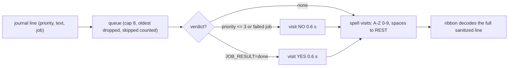

# Planned: Ouija

> **Planned, not yet implemented.** Specified in [docs/briefs/views-2026-10.md](https://github.com/tfpickard/isotop/blob/main/docs/briefs/views-2026-10.md) and tracked in issue [#53](https://github.com/tfpickard/isotop/issues/53).

A dark wooden talking board at an angle in candlelight, and a heart-shaped planchette with a glass window that glides from letter to letter, spelling the newest line of the system journal. The letter under the window glows and the spelled text decodes into a ribbon below the board. Before an error line the planchette swings to NO; when a unit's job finishes it touches YES; when isotop quits it glides to GOODBYE. The spirit, of course, is `journald`. This page is the design of that view, with the history of the board and of the effect that makes it move, the stroke font its letters are drawn with, and two small pieces of mathematics the design implies: the shape of a glide and the behaviour of its pacing rule under a flood of lines.


*`docs/mockups/ouija.jpg`, from the prototype `docs/mockups/code/ouija.py`. A visual target, not an isotop render. The mockup's `f` and `p` keys (follow a unit, filter by priority) are out of scope in the issue.*

## 1. The system being modelled

### 1.1 The ideomotor effect

The talking board works, as far as the evidence goes, because of the **ideomotor effect**: small, involuntary muscle movements produced by an expectation or an idea, without the person's awareness of willing them. William Carpenter named and described it in 1852 ("On the influence of suggestion in modifying and directing muscular movement, independently of volition", *Proceedings of the Royal Institution of Great Britain*), explaining table-turning and divining rods. In 1853 Michael Faraday tested the table-turners of the day with an indicator that registered the small lateral push of the sitters' hands against a loosely coupled table top, and found that the hands moved first and the table followed; once the sitters could see the indicator the effect stopped (published as "Experimental investigation of table-moving", *The Athenaeum*, July 1853; a letter to *The Times* of 30 June 1853 preceded it; the details of the indicator are from memory). Spiritualist circles of the 1850s to 1890s used talking boards and **planchettes** (French for "little board": a small, heart-shaped board on casters carrying a pencil, or a pointer) as machines for amplifying and publishing exactly those unconscious motions. "Ouija" is a trademark of the company that now owns it; the view draws a generic talking board (two arcs of A to Z, a row of 1 to 0, YES and NO in the top corners, GOODBYE at the bottom, sun and moon ornaments) and never the wordmark or a specific commercial board's art.

### 1.2 Why a journal on a board

The metaphor is the cheapest in the whole roadmap: the system journal is a stream of terse messages the machine "says" about itself, the sitters' unconscious hand is the stream of events, and the planchette is how a slow, ceremonial medium renders it one letter at a time. The design adds two small semantic hooks: errors announce themselves by visiting NO, and finished jobs touch YES.

## History

Table-turning was a parlour craze in 1853, and it became a scientific problem. William Carpenter had already proposed, in a paper of 1852, that expectation alone can direct muscular movement without the sitter's awareness, and he coined the term ideomotor for it. Michael Faraday took the question to the table. His results appeared in a letter to *The Times* dated 30 June 1853 and, at greater length, in *The Athenaeum* in July: the sitters' hands moved before the table did, and when they could see an indicator that registered their own push, the table stopped moving. Most spiritualists were not persuaded.

The apparatus that followed was a refinement of the same effect. The planchette, a small board on wheels or casters that carries a pencil, was a spiritualist instrument by the middle of the nineteenth century; a lettered board with a pointer is a way of letting the same involuntary motion choose among symbols instead of drawing a line. The commercial Ouija board dates from 1890 and 1891: Charles Kennard, Elijah Bond and William H. A. Maupin are named in one account as the people who patented a talking board as a game, the patent being granted in 1891, while another account gives Bond the patent with the help of his sister-in-law, a medium named Helen Peters Nosworthy. Kennard left the firm in 1891, and from 1901 William Fuld, once an employee of Bond, made the boards under the Ouija name. The accounts disagree about who thought of it first; they agree that it sold.

The board's explanation has been stable since 1853 and requires a sitter. The journal, which is the medium here, has none: no hand is involved, and the ideomotor effect has nothing to say about it.

The strokes the view draws its letters with have a separate history, told in section 2.5: Hershey's *Calligraphy for Computers* (1967) was written for plotters, not for boards.

## 2. Theory

### 2.1 The journal as text

On Linux the journal is read by `journalctl --output=export`, which emits key=value entries (binary-safe, with a length-prefixed form for values containing newlines); the existing reader requests the fields `PRIORITY`, `SYSLOG_IDENTIFIER`, `_COMM`, `_PID` and `MESSAGE` and formats a line as `source[pid]: message`. Priorities are the syslog severities 0 (emergency) to 7 (debug), with 3 = error. systemd marks the end of a job with a `JOB_RESULT` field (`done`, `failed`, `timeout`, `canceled`, `dependency`, ...), which the view adds to the requested fields. macOS has no such field: the unified-log follower already supplies lines with severities, so spelling and NO visits work, but live data never produces a YES.

### 2.2 What the board can say

Only A to Z and 0 to 9 are on the board. A line is uppercased, every other character is **dropped** (no transliteration), and a run of spaces becomes one visit to a REST point at the board's centre. For the mockup's demo line `kernel: nvme0: I/O 42 QID 6 timeout` the filter leaves 26 letters and digits and 6 visits to REST: **32 visits** (K, E, R, N, E, L, REST, N, V, M, E, 0, REST, I, O, ...). At most 40 board characters are spelled per line; the ribbon decodes the rest at once. Using the prototype's board geometry (two arcs around a centre below the board, radius 1520 and 1300 texture pixels on a 2400-pixel-wide board, digits on a row, REST at the centre) the 32-visit path for that line is **8.0 board widths long**, with a mean hop of 0.25 board widths (adjacent letters on an arc are 0.047 to 0.059 board widths apart, A to M 0.67, YES to NO 0.575). At the idle period of 0.25 s per visit that is 8.0 s per line at a mean speed of one board width per second. These figures come from my transcription of the prototype's `letter_layout()`; the real layout is the issue's B10 strokes.

### 2.3 The shape of a glide

The design moves the planchette between letters by a **smoothstep** glide: position $x(u) = x_0 + (x_1 - x_0)(3u^2 - 2u^3)$ with $u = t/T$, plus a sideways bow of $0.12 \times$ distance at mid-glide (a sinusoidal arc, as in the prototype). A letter period is 60 % glide and 40 % dwell. Smoothstep starts and stops at zero speed and arrives exactly, so the lens lands on the letter and the letter can glow, and it is a closed-form function of time (no integration, so frame rate cannot change the path, as the view conventions ask). Its speed is $6u(1-u)D/T$, peaking at $1.5\,D/T$, but its acceleration is $\pm 6D/T^2$ at the ends and zero outside the glide, so the acceleration jumps (a jerk impulse) at the start and the stop.

What would a physical planchette do? A hand pulling it is closer to a damped spring chasing a moving target: $m\ddot x + c\dot x + k(x - x_t) = 0$, with $\omega = \sqrt{k/m}$ and $\zeta = c/2\sqrt{km}$. From rest at $x_0$ with a target at $x_1$ the critically damped solution ($\zeta = 1$) is

$$
x(t) = x_1 - (x_1 - x_0)(1 + \omega t)\,e^{-\omega t},
\qquad \dot x = (x_1 - x_0)\,\omega^2 t\, e^{-\omega t},
$$

which has zero initial speed, peaks at $t = 1/\omega$ at speed $(x_1 - x_0)\,\omega/e$ and approaches the target only asymptotically. Choosing $\omega T = 4.744$ makes it reach 95 % in $T$ (solve $(1+z)e^{-z} = 0.05$); then its peak speed is $1.745\,D/T$. An underdamped spring with $\zeta = 0.5$ overshoots by $e^{-\pi\zeta/\sqrt{1-\zeta^2}} = 16.3\,\%$. Human reaching movements are better described by the **minimum-jerk** trajectory $10u^3 - 15u^4 + 6u^5$ (Flash and Hogan 1985), which has zero speed and zero acceleration at both ends and peaks at $1.875\,D/T$.


*`docs/figures/ouija-glide-queue.py`. Panels a and b: the specified smoothstep (aqua) against minimum jerk, a critically damped spring tuned to 95 % at $T$ and an underdamped spring (the last one's speed peak, 4.37 $D/T$, is clipped by the axis). Panel c: the pacing rule of section 2.4.*

The comparison is the page's point, and an honest one: **the specified design is smoothstep; the spring is not specified anywhere.** The spring is what the metaphor suggests and has natural coarticulation (a moving target means no dwell, overshoot and curved paths); smoothstep trades that for exact landings, determinism and a plain code path. A spring is a variation (section 9), and a planchette that overshoots its letter slightly would look more like a hand.

### 2.4 The pacing rule as a queue

The design paces the planchette by the backlog: letter period $p(q) = \max(0.06,\ 0.25/(1 + q/4))$ seconds, $q$ being the number of queued lines, and when more than 8 are queued the oldest are dropped down to 8 and counted as skipped. A line of $L$ visits takes $L\,p(q)$, so the service rate is $\mu(q) = (1 + q/4)/(0.25 L)$ lines per second. For an arrival rate $\lambda$ the equilibrium queue satisfies $\mu(q^*) = \lambda$:

$$
q^* = L\lambda - 4 \quad (0 \le q^* \le 8),
$$

so with $L = 30$ visits the queue starts to build at $\lambda = 4/L = 0.133$ lines per second (one line per 7.5 s), saturates at 8 queued lines when $\lambda = 12/L = 0.4$ lines per second, and above that every line beyond $\mu(8) = 12/L$ per second is skipped and counted. Two consequences of the **specified constants**, computed above:

1. The floor of 0.06 s **never binds**. With $q \le 8$ the shortest period is $0.25/(1 + 8/4) = 0.0833$ s; the floor would act only for $q \ge 12.7$. As specified the floor is dead (unless "queued" counts something other than lines, which the issue does not say).
2. At full queue the glide lasts $0.6 \times 0.0833 = 0.05$ s, three frames at 60 fps, so a hop of 0.25 board widths at that speed reads as a jump, not a glide.

A real journal produces tens of lines per second during boot and a few per minute at idle, so the board sits in three regimes: leisurely (idle), accelerating (a queue of a few lines), and skipping (a flood). The legend's `N queued, M skipped` makes the third visible.

### 2.5 Hershey vector strokes

The board's letters are not a bitmap or an outline font but **strokes**: polylines. A. V. Hershey of the US Naval Weapons Laboratory (Dahlgren, Virginia) designed a large repertoire of Roman, Greek, Cyrillic, Gothic and symbol glyphs as stroke coordinates for plotters and vector displays, published as "Calligraphy for Computers", NWL Report No. 2101 (1967); N. M. Wolcott and J. Hilsenrath's NBS Special Publication 424 (1976) tabulated the coordinates. The data circulates as `.jhf` files (James Hurt's distribution): each glyph is a record of a glyph number, a vertex count, then coordinate pairs encoded as characters offset from `R`, with a left and right bound first and ` R` as the pen-up marker (format as I recall it; verify against the data before relying on it). OpenCV's `FONT_HERSHEY_SIMPLEX` is the "Roman simplex" of the same repertoire. The brief's block B10 ships this data with its notice verbatim (the Usenet distribution misattributes the work to NBS) and draws the glyphs as lines in the scene, at the board's angle, so the letters foreshorten with the board.

Strokes have no width. The CPU and GPU rasterizers draw one-pixel lines slightly differently (the GPU's diamond-exit rule), and thin text at 1080p would be a fainter stroke than the mockup; so the design widens each stroke into a **world-space ribbon** (S3), pure triangles that both rasterizers fill alike. Widening quads per segment leaves a notch on the outside of every corner unless the quads are joined or overlapped; whether S3 handles joins is not stated in the issue (see section 9).

## 3. Mapping

| Visual element | Measured quantity (source) | Transform |
|---|---|---|
| Planchette target | the newest journal line (`journal::Line`, reader thread) | filtered to A-Z, 0-9, spaces to REST; at most 40 visits per line |
| Spelling speed | the backlog (queued lines) | period $0.25/(1+q/4)$ s, floor 0.06 s, 60 % glide (smoothstep, 0.12 bow) and 40 % dwell |
| NO visit (0.6 s, once per line) | syslog `PRIORITY` $\le$ 3, or `JOB_RESULT` in {failed, timeout, canceled, dependency} | visited before spelling |
| YES visit (0.6 s) | `JOB_RESULT=done` | visited before spelling |
| Planchette jitter | CPU pressure, `Snapshot.pressure[0]` (some avg10) | amplitude $0.025 \times \text{pressure}/100$ board widths; 0 when `"cpu pressure"` is in `Snapshot.missing` |
| Ribbon text | the full sanitized line with its source | `terminal::clean_text`; decoded characters amber, undecoded ones scrambled violet seeded by line hash and time (**decorative scramble**) |
| Skip count, queue count | journal backlog | on the legend: `N queued[, M skipped]` |
| GOODBYE glide | quitting | about 1.0 s, interactive runs only |
| Board, velvet, wood grain, candles, flame flicker, sun and moon | none | **decorative** |

## 4. Design: how isotop will realise it

* **Module and row.** `src/ouija.rs`, a `#[derive(Default)]` state struct implementing `views::ViewModule`, and one `ViewInfo::new(name, title, backdrop, build)` row at the end of `views::REGISTRY`, status name `OUIJA`, `Backdrop::Void`, pressure haze off. The view draws no processes: `visible = 0`, `inspected()` returns `None`, the tour is inert. A pure state `Seance { queue, planchette, skipped }` with `push(journal::Line)` and `advance(time)`; `dt` is wall-clock time clamped to 0.5 s and frozen while paused. `Farewell` is a separate pure state machine.
* **Journal.** Nothing new is needed to receive the lines. `feed()` in `main.rs` already attaches the follower's lines to the newest sample as `Snapshot.journal` (a `journal::Delivery` of `journal::Line`s with counts of lines through and dropped), and the follower runs while the demand contains `Source::Journal`, which a row declares in its `sources` (the Matrix row does today), and for `JOURNAL_LINGER` (30 s) after. The Ouija row declares the same source and reads `snapshot.journal` in `draw`; no view is special-cased. `JOB_RESULT` is added to the Linux `--output-fields` in `src/platform/linux/journal.rs`, and `Line` gains `job: Option<JobResult>`. On the first drain after start (the `--lines=200` backlog) only the newest line is kept and no skips are counted.
* **Verdict logic.** A line gets at most one visit. **GOODBYE** is a quit effect, not a rebinding: only in an interactive run (never `--duration`, `--output`, headless or `--benchmark`), the first `q` while the view is shown starts a 1.0 s glide to GOODBYE and the loop exits when it ends; a second `q` exits at once and Ctrl-C always exits at once. The view conventions list `q` as global, and this is not a rebinding of it.
* **Rendering.** The board and the velvet are P3 colour grids (`Field`, `Frame::field`) with wood grain and candle falloff baked in; only the flicker gain is recomputed per frame. Letters, YES, NO, GOODBYE, sun and moon are B10 strokes widened with S3 ribbons. The planchette is an opaque heart with a raised rim, the lit letter a `Glow` under its window, candles prisms with flame glows (radius capped at 0.12 of the frame height), the ribbon and caption `Item::Glyph` text (`src/glyphs.rs`, a 7 x 14 bitmap font) after `terminal::clean_text`. The board geometry is constant; `Stage.bounds` fits it (board plus candles). Owner grid absent, so picks return `NONE`.
* **Status.** Line 1 ` > {latest}`; legend ` Planchette = newest journal line, letter by letter | NO = error or failed job | YES = job done | jitter = cpu pressure | N queued[, M skipped]`, with ` | no cpu pressure: planchette steady` and, on macOS, ` | no job results on macOS` appended when they apply.
* **Demo.** `journal::demo` text stays unchanged; a new `journal::demo_jobs(from, to)` emits every 7 s alternately `systemd[1]: Finished backup.service - Nightly backup.` (done, priority 6) and `systemd[1]: Failed to start mount-nas.service - NAS mount.` (failed, priority 3); the demo CPU pressure already varies; the headless warm-up replays 8 s of journal so `--time` lands mid-spelling.
* **Cost.** Independent of process count: about 3k quads plus two fields.
* **Dependencies** (ROADMAP index): P1, P2, S1, P3, B10, S3. In the current tree: P1, P2, S1, P3 (`src/render/field.rs`) and S3 (`Frame::ribbon` in `src/render/strokes.rs`) are merged; **B10 (the stroke font) is not**.
* **Platforms.** Linux: full. macOS: **degraded**, no `JOB_RESULT` (so no YES) and no CPU pressure (so a steady planchette), both named in the legend.
* **No plugin system.** Compile-time module and `REGISTRY` row.



## 5. Reading the picture

* **Measured:** the text of the journal lines, their priority, and where present the job result; CPU pressure (as the jitter amplitude); the backlog (queued and skipped counts).
* **Derived:** which letter is under the window at a moment (a function of the queue and the clock), the hop path, the order NO/YES/spelling.
* **Decorative:** the candles and their flicker, the grain, the sun and moon, the scrambled violet characters in the ribbon, and the planchette's glide shape.
* **What the planchette cannot tell you:** lines that were skipped (only counted), characters outside A-Z and 0-9 (dropped, so the board's version of `I/O` is IO), the real time of each message (the board's clock is its own), or the lines before the one being spelled (the backlog at start is discarded but for the newest).
* **Latency.** Spelling a 32-visit line takes 8 s at the idle period, so at idle the board lags the journal by up to that much plus queue time; the ribbon header shows the line's source.
* **Jitter is an indicator of CPU pressure, not of load:** "some avg10" is the 10-second average share of time that some task was stalled for CPU, which can be near zero on a busy machine with enough cores.
* **Resolution:** a glide of 0.05 s at a full queue is 3 frames at 60 fps; the lit letter changes faster than the eye can follow.

## 6. Try it

Nothing runs in isotop yet. When the view lands:

```sh
./target/release/isotop --demo --view ouija --time 12 --width 1600 --output /tmp/ouija.png --renderer cpu
```

(Tab and the `v` picker reach it; `q` in an interactive session glides to GOODBYE.) Today you can regenerate the figure with `python3 docs/figures/ouija-glide-queue.py`, and see the journal the reader would follow with `journalctl --output=export --lines=3 --output-fields=PRIORITY,SYSLOG_IDENTIFIER,_COMM,_PID,MESSAGE`.

## 7. Where in the code

Existing: `journal::Journal`, `journal::Line { priority, text }`, `journal::Delivery` (on `Snapshot.journal`), `BACKLOG` and the demo entries in `src/journal.rs`; the `journalctl` follower and parser (`--lines=200`, `--output-fields`) in `src/platform/linux/journal.rs`; the unified-log follower in `src/platform/macos/journal.rs`; `JOURNAL_LINGER` and the `feed()` in `src/main.rs`; the bitmap font in `src/glyphs.rs`; `terminal::clean_text` in `src/terminal.rs`; `Source::Journal` in `src/platform/mod.rs`; `simulation::smoothstep` in `src/simulation.rs` (the same ease as the specified glide). Also existing: S3 ribbons (`Frame::ribbon`, `src/render/strokes.rs`) and P3 fields (`src/render/field.rs`). Planned: `src/ouija.rs`, the B10 stroke font, `journal::demo_jobs`. The prototype is `docs/mockups/code/ouija.py` (numpy, cv2, Pillow; reference only).

## 8. Disagreements and gaps I found

* The issue gives the jitter sinusoids as 13.1, 29.3, 11.7 and 31.9 **Hz**; the prototype writes `math.sin(t * 13.1)` and so on, which are **radians per second** (2.1, 4.7, 1.9 and 5.1 Hz). Taken literally in Hz, 29.3 and 31.9 Hz exceed half of a 60 fps frame rate and alias. I have assumed radians per second is intended; the issue should say.
* The letter-period floor of 0.06 s never binds with a queue cap of 8 (section 2.4).
* The mockup shows `f` and `p` keys, which the issue declares out of scope.

## 9. Variations and open questions

* A **spring planchette** (critically damped chasing the current target) with a velocity carried across targets: no dwells, overshoot, and the lit letter chosen by nearest letter at a moment. Compare its readability against smoothstep.
* A **minimum-jerk** glide as a drop-in for smoothstep (same endpoints, no acceleration discontinuity).
* Whether S3's ribbons join at corners; measure the notch on the Hershey `N` and `M` at 1080p.
* Spell journal lines in order of arrival with an optional "unit follow" mode (the mockup's `f`).
* Use `PRIORITY` to scale the planchette's speed or the candle flicker for emergencies.
* Replace the REST visit by an honest pause (a breath) and compare the board's readability.

## 10. References

* W. B. Carpenter, "On the influence of suggestion in modifying and directing muscular movement, independently of volition", *Proceedings of the Royal Institution of Great Britain* 1 (1852) 147-153.
* M. Faraday, "Experimental investigation of table-moving", *The Athenaeum* (July 1853).
* A. V. Hershey, *Calligraphy for Computers*, NWL Report No. 2101, US Naval Weapons Laboratory, Dahlgren, Virginia (1967); N. M. Wolcott and J. Hilsenrath, *A Contribution to Computer Typesetting Techniques: Tables of Coordinates for Hershey's Repertory of Occidental Type Fonts and Graphic Symbols*, NBS Special Publication 424 (1976).
* T. Flash and N. Hogan, "The coordination of arm movements: an experimentally confirmed mathematical model", *Journal of Neuroscience* 5 (1985) 1688-1703.
* Issue [#53](https://github.com/tfpickard/isotop/issues/53); `docs/briefs/views-2026-10.md` section 14 and building block B10; [docs/VIEW_CONVENTIONS.md](https://github.com/tfpickard/isotop/blob/main/docs/VIEW_CONVENTIONS.md). See also [View-Matrix](View-Matrix), [Theory-Journal](Theory-Journal), [Theory-Text-Safety](Theory-Text-Safety), [Theory-Determinism](Theory-Determinism).
