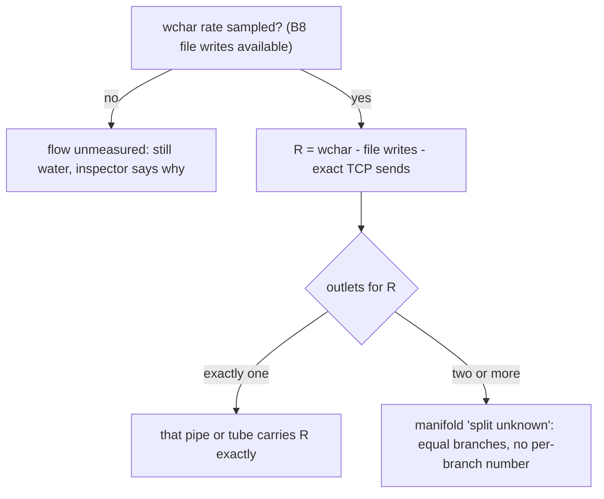

# Planned: Plumbing

> **Planned, not yet implemented.** Specified in [docs/briefs/views-2026-10.md](https://github.com/tfpickard/isotop/blob/main/docs/briefs/views-2026-10.md) and tracked in issue [#49](https://github.com/tfpickard/isotop/issues/49).

A Victorian boiler room in which every process that talks to another is a riveted tank sized by its memory, with a pressure gauge, and the real inter-process channels are pipework: copper runs with glass sections for pipes and FIFOs, brass pneumatic tubes with capsules for Unix sockets, green garden hose for loopback TCP. A writer blocked on a full pipe has its gauge in the red and its pipe bulging; a pipe whose reader has gone bursts and sprays. The page is the design of that view, framed by what a Unix pipe actually is, what the kernel does and does not let an observer measure, and the one place where the view has to say "split unknown" instead of inventing a number.


*`docs/mockups/plumbing.jpg`, from the prototype `docs/mockups/code/plumbing.py`. A visual target, not an isotop render. Where it disagrees with the issue the issue wins; two such places are listed in section 5.*

## 1. The system being modelled

### 1.1 Unix pipes

Doug McIlroy argued in a 1964 Bell Labs memo that programs should be coupled "like garden hose", screwing in another segment when data needs massaging another way. Ken Thompson added the `pipe` system call and pipes in the shell to Unix in 1973 (Version 3); sources disagree about when the `|` notation itself appeared. The shell pipeline `cat access.log | grep 500 | sort | uniq -c` is a chain of processes joined by kernel pipes, each stage a filter.

A pipe is a bounded byte queue in the kernel with a write end and a read end (`pipe(2)`, or a named FIFO made by `mkfifo`). The semantics are what makes plumbing a good metaphor:

* **Backpressure.** A `write` to a full pipe blocks (or returns `EAGAIN` for a non-blocking descriptor); a `read` from an empty pipe blocks. A fast writer is throttled to the speed of its slowest downstream reader without any protocol, which is the whole point.
* **End of file and broken pipe.** When every write end is closed a reader sees end-of-file; when every read end is closed a writer gets `SIGPIPE` (which kills it by default) or, if the signal is ignored, `EPIPE`.
* **Capacity.** On Linux a pipe holds 16 page-sized buffers, 64 KiB by default (it was one page, 4 KiB, before kernel 2.6.11); `fcntl(F_SETPIPE_SZ)` resizes it up to `/proc/sys/fs/pipe-max-size` (1 MiB by default for unprivileged processes). Writes up to `PIPE_BUF` (4096 bytes on Linux) are atomic.
* **Observability.** `/proc/<pid>/fd/N` of a pipe is the symlink `pipe:[inode]`, so the two ends can be paired by inode across processes; `/proc/<pid>/fdinfo/N` has `flags:` in octal whose access-mode bits (`O_ACCMODE`) say read, write, or both (a FIFO opened `O_RDWR` has no direction, so it is drawn two-way). `/proc/<pid>/wchan` names the kernel function a blocked task sleeps in (`pipe_read`, `pipe_write`), readable only where permitted (it reads `0` when restricted; and symbol names can change between kernel versions, so an unrecognised name is parsed as "other"; whether recent kernels renamed these is unverified). **Linux exposes no buffered byte count for another process's pipe.**

### 1.2 Sockets

A Unix-domain socket has a receive queue. The `sock_diag` interface gives it as `UNIX_DIAG_RQLEN`: for a connected **stream** socket the receive figure is unread bytes; for a **datagram** socket it is only the size of the next packet (so it means "a datagram is waiting"); the send figure is allocated buffer including overhead, not payload (so the view never uses it). Loopback TCP is two sockets joined through the `lo` device; `tcp_info` gives `bytes_acked` and `bytes_received` per socket, from which exact byte rates follow, and TCP's own backpressure is the receiver's window and the sender's buffer.

### 1.3 Where the metaphor stops

Water in a pipe obeys Bernoulli's principle, $p + \tfrac12\rho v^2 + \rho g h = \text{const}$, and in a narrow tube Hagen-Poiseuille, $Q = \pi r^4 \Delta p/(8\mu L)$, so flow is driven by a pressure difference and rises steeply with radius. A kernel pipe has no pressure and no radius. **None of that physics is in the view.** The view uses plumbing for its look (tanks, gauges, pipes, bulges) and keeps strictly apart what is measured and what is a display convention, as the mapping table in section 3 says.

## History

Moving fluids have long stood in for things that cannot be seen. Georg Ohm's treatise of 1827 gave the relation between voltage and current in wires of different lengths, and it is formally parallel to Fourier's law of heat conduction, a flux proportional to a gradient; electricity, like heat, was commonly pictured as a fluid. The water analogy for circuits became a teaching staple, and also a target: the "drain-pipe theory" as a name for taking it too literally is credited to Oliver Lodge in some accounts and to Oliver Heaviside in others, and I have not settled which.

Economists built the machines. Irving Fisher's Yale doctoral thesis of 1891, published in 1892 as *Mathematical Investigations in the Theory of Value and Prices*, described a hydraulic apparatus of cisterns, valves and levers for computing equilibrium prices in ten linked markets; the original and a second model of 1925 are both lost. Bill Phillips, a New Zealander studying at the London School of Economics, built the Phillips Machine, later called the MONIAC, in 1949, in the garage of his landlady in Croydon (the usual account, with a cost of about 400 pounds). It was shown to economists at the school on 29 November 1949 and won him a teaching post. Water, in tanks of perspex, stood for money; the first machine is said to have used parts from a Lancaster bomber. Accounts differ on how many were built: twelve, or twelve to fourteen.

The pipe that this page is about is a younger invention. Doug McIlroy's memo of 11 October 1964 asked that programs be coupled "like garden hose". Thompson implemented the idea in Unix in 1973, in one night by McIlroy's later account, and McIlroy then rewrote the programs in `/bin` to read standard input and write standard output. The idea had waited nine years for a kernel. Some accounts place the first pipes in 1972; 1973 is the date most sources give.

The mockup's tanks are therefore the third generation of one picture: a flow of something measurable drawn as a flow of water.

## 2. Theory: a pipe is a bucket between two rates

Let a writer produce $\lambda_w$ bytes per second and a reader consume $\lambda_r$, with capacity $C$. The fill $q$ obeys $\dot q = \lambda_w - \lambda_r$ clipped to $[0, C]$, so the time to fill from empty is

$$
t_{fill} = \frac{C}{\lambda_w - \lambda_r} .
$$

For 64 KiB and a mismatch of 1 MB/s the pipe fills in 65 ms; for 100 MB/s in 0.65 ms. Pipes therefore spend nearly all their time either full or empty: there is almost no stable middle, which is why a pipe's fill is a binary-looking quantity (the view will show blocked or dry, not a level). In steady state the writer's rate is forced to equal the reader's rate (**backpressure**), and the fill level locates the bottleneck: a **full** pipe sits just upstream of the slowest stage; **empty** pipes sit downstream of it. Little's law gives the same picture as a delay: bytes buffered equal throughput times residence time, so a full 64 KiB pipe at 2.2 MB/s holds about 30 ms of data.


*`docs/figures/plumbing-backpressure.py`: a fluid model of `cat | grep 500 | sort | uniq -c`. cat can write 48 MB/s, grep consumes at most 20 MB/s and passes 5 %, sort reads at most 2 MB/s and, like the real `sort`, writes nothing until its input ends. The cat-to-grep pipe is full within 4 ms (97 % after the stage's own read, since grep consumes a block each step), grep runs at its own 20.0 MB/s ceiling, the grep-to-sort pipe stays near empty (0.15 %) and `uniq` starves in `pipe_read` for the whole run. This is a model with made-up stage rates, not a measurement.*

### 2.1 The attribution problem

isotop can read a process's `wchar` (bytes passed to `write` and relatives, in `/proc/<pid>/io`, as `Process.syscall_io.write_chars`, filled on Linux; macOS reports it missing) but not where they went. The view's rule, as made exact in issue [#49](https://github.com/tfpickard/isotop/issues/49) and its amendment (comment of 2026-10-10):

$$
R \;=\; \text{wchar rate} \;-\; \text{regular-file write bytes (B8)} \;-\; \text{exact loopback TCP send rates} .
$$

Then count the outlets that remain for $R$: pipes, FIFOs, Unix sockets, undrawn targets such as ttys, and, by the amendment, **every writable regular-file descriptor** (`O_WRONLY` or `O_RDWR`), because `pwrite`, AIO and `io_uring` move no file offset, so B8's `pos`-delta attribution cannot rule them out.



A writer with one pipe and no writable file is exact. With a pipe and a writable file the pipe becomes "split unknown" (test `a_writable_file_makes_a_lone_pipe_split_unknown`). The equal branches are animated at speed$(R/n)$ **as a display convention**; the inspector says "unknown share of $R$". Two caveats not in the issue: `wchar` counts only bytes of `write`-family calls, so `sendfile`, `splice` and `mmap` stores are invisible to it, and a connection to a remote host (not loopback) has no measured rate, so whether it counts as an outlet is not stated (see section 9).

## 3. Mapping

| Visual element | Measured quantity (source) | Transform |
|---|---|---|
| Tank | one process with at least one drawn link, plus the selected one | stays 10 s after its last link closes; at most 256 ranked by link count, then traffic; the rest collapse |
| Tank radius and height | `Process.memory` | $r = \text{clamp}(0.30 + 0.085\log_2(\text{MiB}/2),\ 0.3,\ 0.9)$ cells, height $1.6r + 0.55$; band colour `kind_color` |
| Gauge needle | the tank's attributed outflow (`wchar` after the rule of 2.1) | log scale, 1 KiB/s to 64 MiB/s; **not** pipe fill |
| Red gauge, bulging pipe | `/proc/<pid>/wchan` reads `pipe_write` (enum `PipeWrite`) | needle pinned in the red, gauge glows |
| Dry reader inlet | `wchan` reads `pipe_read` (`PipeRead`) | glass section drawn empty |
| Copper run | a pipe or FIFO between a writer and a reader process | one run per distinct (writer, reader) pair; the inspector gives the pipe count; pipes within one process are skipped; O_RDWR FIFO drawn two-way |
| Water in a glass section | the writer's attributed rate | speed $0.6 + 0.45\log_{10}(\max(\text{rate}, 10^3)/10^3)$ cells/s, 0 when the rate is 0, advanced on wall-clock `dt`; **unmeasured** shows still water |
| Manifold "split unknown" | a writer with two or more outlets for $R$ | equal branches, no per-branch number |
| Brass tube, capsules | Unix socket queue (B2) | stream: one capsule per 4 KiB unread, at most 12, overflow in the label; datagram: one capsule while a packet is queued |
| Green hose | loopback TCP rates (B2) | the exact rates, both directions |
| Burst spray | the last reader end gone while a writer remains | 6 s or until the writer exits; label `reader gone: EPIPE next` |
| Bay on the floor | cgroup | rectangular bay on a floor grid of 2-unit cells |
| Rivets, glass, copper, brass, brick walls, the steam | none | **decorative** |

Two consequences of the constants, both computed from the formulas above:

* **Tank size saturates at about 267 MiB.** $r$ reaches its cap 0.9 where $\log_2(\text{MiB}/2) = (0.9-0.3)/0.085 = 7.06$, that is at $2\cdot 2^{7.06} \approx 267$ MiB, and stays at the floor 0.3 below 2 MiB. Every process above 267 MiB looks the same size; the dynamic range is seven doublings (2 to 267 MiB). (The prototype's formula has no clamp, so the mockup's tanks keep growing.)
* **Water speed compresses four decades into a factor of four.** From 0.6 cells/s at 1 KB/s it only reaches 1.95 cells/s at 1 MB/s and 2.4 at 64 MB/s. The viewer sees faster or slower water, not a rate.

## 4. Design: how isotop will realise it

* **Module and row.** `src/plumbing.rs`, a `#[derive(Default)]` state struct implementing `views::ViewModule`, and one `ViewInfo::new(name, title, backdrop, build)` row at the end of `views::REGISTRY` (`Backdrop::Dusk`, `build` a closure returning the boxed module). Its `draw(...) -> usize` puts every tank in `stage.positions`; no view-local keys, no digit. Processes without a drawn link count as collapsed.
* **Layout.** Each cgroup is a rectangular bay on a floor grid of 2-unit cells, placed with disc packing snapped to the grid (the issue says `pack::Discs`; in the tree this is `layout::Discs` in `src/layout.rs`), with lifetime seats inside a bay (`layout::Seats`). Layouts are stable ([Theory-Stable-Layout](Theory-Stable-Layout)).
* **Copper runs.** Manhattan A* on a half-cell grid with cost $1$ per step, $+2.5$ per turn and $+7$ for reusing a used cell (from the prototype); routes are computed in sorted (writer, reader) `Identity` order and cached, and recomputed only when an endpoint moves or a new tank blocks. Unix tubes run overhead as L-shapes at $z = 3.5$ with a 0.25 lane offset; hoses are Catmull-Rom curves on the floor. The Manhattan distance is an admissible heuristic because every step costs at least 1.
* **Wchan.** New platform work inside this PR on the background thread of `platform/linux`: read `/proc/<pid>/wchan` only for pids holding pipe or FIFO descriptors, at most 256 per pass, only while a view that declares it is shown; stored as an enum `PipeWrite`, `PipeRead`, `Other`, `Unreadable` (`0` means unreadable), never displayed raw. On macOS `"wait channel"` goes into `Snapshot.missing`.
* **Rendering.** Pipes, tubes and hoses use S3's `Frame::tube` and `Frame::ribbon` (`src/render/strokes.rs`, triangles only); tanks and walls are shaded triangle meshes of 8 to 16 sides in this module; rivets are drawn only on tanks wider than 24 px; the burst is Beams and Glows seeded from `Rng::for_identity(writer, inode)`. No new rasterizer primitive.
* **Demo** (through the P1 row's demo options, deterministic from `(time, i)`): a 4-stage pipeline, a writer with 3 outlets, a blocked writer and a dry reader, a burst every 20 s (the reader end is dropped, no process is removed), queued stream and datagram sockets, hose rates.
* **Dependencies** (ROADMAP index): P1, P2, S1, P5, B2, B8, B9, S3, S6. In the current tree: P1, P2, S1, P5 (`Process.syscall_io`), S3 (`src/render/strokes.rs`), S6, B9 and B2 (`Snapshot.unix_queues`, `Snapshot.pipes` paired by `model::pair_pipes`, `src/platform/linux/pipes.rs`, `src/platform/linux/fdinfo.rs`) are merged; B8 (file-write attribution) and the wait-channel reader are not. `Snapshot.link_traffic` is still only loopback TCP rates with both directions summed.
* **Platforms.** Linux: full; the sources it declares are wait channel, io split, file-write attribution, Unix queues and loopback rates. macOS: **available but degraded, not skipped**: tanks, Unix-socket tubes and whatever pipe and queue data B2 provides there are drawn; `wchan`, `wchar`/`rchar` and loopback byte rates are not available, so there are no red or dry gauges, water and hoses show as unmeasured, and the status strip says so.
* **No plugin system.** Compile-time module and `REGISTRY` row.

## 5. Reading the picture

* **Measured:** which processes are joined by which pipes, FIFOs and sockets (pairing by inode, direction from `fdinfo`); whether a writer is blocked in `pipe_write` or a reader in `pipe_read` where `wchan` is readable; unread bytes on Unix stream sockets; exact loopback TCP byte rates; the memory of each process.
* **Derived:** the writer's attributed outflow (a subtraction of three measurements), the single-outlet flow (exact only for `write`-family bytes, with the outlet-count rule), the gauge needle, the water speed.
* **Unmeasured, said so:** pipe fill (the mockup's "64 KiB full, writer blocked" label is **not** what the issue specifies: the gauge shows outflow, and blocked is read from `wchan`); the per-branch split at a manifold (the mockup's "1/3 each" is **not** drawn: "no invented per-pipe numbers"); any per-pipe byte rate.
* **Decorative:** everything in the last row of the mapping table; the exact route of each run; the equal-branch animation.
* **Resolution limits:** `wchan` is sampled on the background pass, so a blocked/dry state is a snapshot at most every 2 s and a pipeline that alternates blocked and running faster than that shows whichever state it was in at the sample; short pipelines that finish between samples are never seen.
* **The burst is dramatic and brief in reality.** A writer whose reader is gone usually dies of `SIGPIPE` at its next write; the spray lasts up to 6 s or until the writer exits.
* **Cannot infer:** which byte went to which pipe, how full any pipe is, whether the data are what a pipeline name suggests.

## 6. Try it

Nothing runs in isotop yet. When the view lands:

```sh
./target/release/isotop --demo --view plumbing --time 12 --width 1600 --output /tmp/plumbing.png --renderer cpu
```

(Tab and the `v` picker reach it.) To see the raw material on a Linux box:

```sh
cat /dev/zero | head -c 100M | cat > /dev/null &   # a short pipeline
ls -l /proc/$!/fd | grep pipe                      # pipe:[inode] links
cat /proc/$!/fdinfo/1                              # flags: octal access mode
cat /proc/$!/wchan; echo                           # where it sleeps
python3 docs/figures/plumbing-backpressure.py      # the fluid model of section 2
```

## 7. Where in the code

Existing: `Process.syscall_io` (`SyscallIo { read_chars, write_chars, reads, writes }`) and `Snapshot.link_traffic`, `Snapshot.links`, `Snapshot.unix_links` in `src/model.rs`; the loopback `tcp_info` read in `src/platform/linux/net.rs` (`bytes_acked` at offset 120, `bytes_received` at 128) and its rate in `model::traffic`; `layout::Seats` and `layout::Discs` in `src/layout.rs`; `palette::kind_color`; `Thing`, `Card` in `src/render.rs`; `terminal::clean_text`; `simulation::Rng::for_identity`. Also existing since this page was first written: `Snapshot.pipes` and `Snapshot.unix_queues` with `model::pair_pipes`, `Pipe` and `Queue`; `src/platform/linux/pipes.rs` (`PipeScan`, behind `Source::Pipes`) and `src/platform/linux/fdinfo.rs` (`parse_fdinfo`); `Frame::tube` and `Frame::ribbon` in `src/render/strokes.rs`. Planned: `src/plumbing.rs`, a wchan reader in `src/platform/linux`, B8's file-write attribution. The prototype is `docs/mockups/code/plumbing.py` (numpy, cv2; reference only).

## 8. Variations and open questions

* **Per-direction hose rates.** The issue wants "exact loopback rates in both directions", but the existing `Snapshot.link_traffic` is the sum of both directions per pair, and B2's issue says to keep it as it is. Per-direction rates are derivable from each socket's own `bytes_received` but the model does not keep them separately today; the plumbing issue does not say where they come from.
* **Measure the fill.** Opening `/proc/<pid>/fd/N` of a pipe and calling `ioctl(FIONREAD)` might report buffered bytes, but opening a read end changes the pipe's reader count and so the semantics of the very `EPIPE` case the view draws; I would not do it (unverified).
* Does a connection to a non-loopback remote host count as an outlet for $R$? Its send rate is not measured, which argues for yes (more manifolds, fewer false exact flows).
* Replace the log-gauge by a rate-of-change gauge, so a pipeline speeding up or slowing down is visible.
* Show pipeline structure: link the tanks of one shell pipeline in a straight row regardless of cgroup bay.
* The tank radius saturates at 267 MiB; a different clamp or a sqrt law would show gigabyte processes as larger.
* Colour the water. The Phillips Machine is reported to have used tinted water so that separate flows could be told apart; the view tints by writer, which is the same decision seventy-seven years later.

## 9. References

* M. D. McIlroy, internal Bell Labs memorandum, 1964 (the "garden hose" passage); D. M. Ritchie, "The Evolution of the Unix Time-sharing System", *AT&T Bell Laboratories Technical Journal* 63 (1984), for the history of pipes.
* Linux manual pages `pipe(7)`, `pipe(2)`, `fcntl(2)` (`F_SETPIPE_SZ`), `proc(5)` (`wchar`, `wchan`, `fdinfo`), `sock_diag(7)`, `unix(7)`.
* J. D. C. Little, "A proof for the queuing formula $L = \lambda W$", *Operations Research* 9 (1961) 383-387.
* I. Fisher, *Mathematical Investigations in the Theory of Value and Prices* (Yale, 1892).
* L. Kleinrock, *Queueing Systems, Volume 1: Theory* (Wiley, 1975), for queues and blocking.
* Issue [#49](https://github.com/tfpickard/isotop/issues/49) and its amendment comment; [#29](https://github.com/tfpickard/isotop/issues/29) (B2); `docs/briefs/views-2026-10.md` section 10; [docs/VIEW_CONVENTIONS.md](https://github.com/tfpickard/isotop/blob/main/docs/VIEW_CONVENTIONS.md). See also [Theory-Text-Safety](Theory-Text-Safety), [Theory-Picking](Theory-Picking), [Theory-Stable-Layout](Theory-Stable-Layout).
