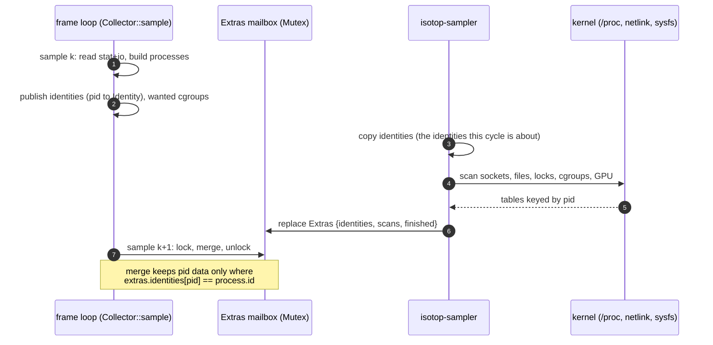

# Theory: The background sampler and demand

A frame has a budget of a hundred milliseconds at the default ten frames a second. Some of what isotop measures
costs far more than that: listing every descriptor of every process, dumping the kernel's socket tables over
netlink, reading a cgroup tree, asking a GPU driver. So the sampler is split in two. The **frame loop** reads the
cheap, essential things (`stat` and `io` per process) every `--sample-ms`; a second thread, `isotop-sampler`, reads
the slow ones every couple of seconds and leaves them in a mailbox; and a *join* on process
[`Identity`](Theory-Model-and-Rates#the-data) glues the two together so that a measurement never lands on the wrong
process. On top of that, a **demand** mechanism lets the view on screen say which optional sources it wants, so a
source nobody is looking at costs nothing. This page is how those three pieces work and what they guarantee.

## History

*In this project.* The `isotop-sampler` thread is in the repository's first commit (2026-10-07): from the start the slow scans ran off the frame loop on a fixed period. What the thread read was not a question until 2026-10-11, when the architecture batch that added the view registry (#120) also added source demand, so that a view says which optional sources it draws. The typed `Source` set and "unknown is not zero" had come earlier the same day in #113.

*The idea.* Demand-driven reading is an old pattern with two well-known names.

* **Lazy evaluation.** Peter Henderson and James H. Morris, "A lazy evaluator" (POPL 1976), and Daniel P. Friedman and David S. Wise, "CONS should not evaluate its arguments" (1976), proposed computing a value only when something asks for it. (Venues from memory; not re-checked for this page.) `Demand::read_if` is the same rule at the scale of a system call: the closure runs only if the source is in the set.
* **Pay only for what you use.** Bjarne Stroustrup's zero-overhead principle, "what you don't use, you don't pay for", is attributed to his 1994 *The Design and Evolution of C++*. In a 2024 paper to the C++ committee (P3406R0) he writes that the principle was conceived as applying to run time only. isotop's version is the run-time one, applied to the operating system rather than to the language: a source nobody draws leaves no trace in `sources` or `missing`, and no file is opened.

## 1. The problem, and the design it forces

* **Cost.** On [Linux](Theory-Sampling-Linux) the slow sources are `/proc/net`, `sock_diag`, `/proc/<pid>/fd`
  with a `statx` per descriptor, `/proc/locks`, cgroup files and NVML; on [macOS](Theory-Sampling-macOS) sockets and
  open files, one `proc_pidfdinfo` per descriptor. Anything slower than a `/proc/<pid>/stat` read belongs off the
  frame loop (AGENTS.md's rule, and the reason this thread exists).
* **Staleness is the price.** A slow source is read at one instant and merged into samples taken later, so it is
  always somewhat old. The design bounds the age, and makes the age *visible* rather than hiding it.
* **Correctness is the hard part.** The scan reads pids; the frame loop tracks identities. Between the two, a
  process can exit and another take its pid. A naive join by pid would attribute the dead process's sockets, files
  and GPU memory to the newcomer.

## 2. The thread

`Background::spawn` starts a thread named `isotop-sampler`. It calls a setup closure once (loading NVML, opening
the GeoIP database lazily, creating the file scan), then loops:

1. run one *cycle* (a closure returning an `Extras` value);
2. stamp it `finished = now`;
3. lock the shared slot and **replace it whole** (`*slot = measured`);
4. sleep `BACKGROUND_PERIOD`, 2 seconds.

It exits when it is the only holder of the mailbox (`Arc::strong_count(&writer) == 1`, which is how a dropped
`Collector` stops it) or when the lock is poisoned. Two consequences follow from the loop shape:

* The gap between cycle *starts* is the cycle's own duration **plus** 2 s, not 2 s: the sleep follows the work.
* The lock is taken only after a cycle has finished, never during it. A scan that hangs (a stale network mount) can
  therefore never block the frame loop on the mutex; the frame loop just keeps merging the last complete `Extras`.
  Because the slot is replaced whole and never written in parts, even a poisoned lock still holds the last complete
  cycle.

The first cycle starts only after the first sample has published what to scan (the cgroup paths and the identities),
so it has something to join against.

### What a cycle does

Each cycle reads, in this order, each scan timed into `latency` under the `Source` it reads:

1. the **socket** scan (`platform::network`), which includes the Unix sockets' unread bytes;
2. the **locations** lookup (demanded: `Source::Locations`);
3. **GPU memory**, **cgroup accounting** for the paths the latest sample wanted, the bounded **open-file** scan and the **lock table**;
4. the **memory reads** (`MemoryReads`): the out-of-memory ranking of every pid the cycle scanned (`Source::Oom`) and `smaps_rollup` for the `ROLLUP_PROCESSES` (64) largest processes the frame thread handed over in `rollup_pids` (`Source::MemoryDetail`), under a 50 ms budget (`ROLLUP_BUDGET`) that resumes where it stopped, the unreached processes keeping their last reading (`Kept`);
5. the **kernel counters** (`KernelScan`: interrupts, softirqs, IRQ affinity, OOM kills), each read only if demanded;
6. the **threads** (`Source::Threads`): `read_threads` walks the processes busiest first, at most `THREADS_PER_PASS` (8192) threads and `THREADS_PER_PROCESS` (1024) per process;
7. the **pipes** (`Source::Pipes`), joined into reader and writer links by `pair_pipes`.

It also derives per-connection byte rates (`remotes`), and loopback traffic between process pairs (`traffic`), from the *change* in each socket's cumulative counter between cycles, the same counters-not-gauges pattern the frame loop uses. Every scan that keeps a table between cycles (open files, rollups, pipes) keeps it together with the identity it was read for.

## 3. The join: why a reused pid inherits nothing

The frame loop publishes, after every sample, a map `pid → Identity` of the processes it just read. At the start of
each cycle the background thread **copies that map before any scan reads**:

```rust
let identities = identities.lock().map(|map| map.clone()).unwrap_or_default();
```

Every pid a scan then finds is either the process the map names or one that took the pid since. The cycle returns
that map inside its `Extras`. `merge` (in `model.rs`) joins a sample with an `Extras` under one rule: a pid's data
counts for a process only if `extras.identities[pid] == process.id`.



Concretely (the test `background_data_is_not_inherited_by_a_reused_pid`): a cycle scanned against pid 7 as the
process that started at tick 70. Before the next sample, that process dies and pid 7 is reissued to a process that
started at 71. The sample's pid 7 has `Identity { 7, 71 }`, which differs from the map's `{ 7, 70 }`, so the
newcomer gets no GPU memory, its files and locks read `Measured::Pending`, and every link, outside connection,
loopback rate and remote connection that cycle attributed to pid 7 is dropped. Symmetrically, a lock holder or
link peer that has exited since is dropped (`blocked_on` is cleared if its holder is gone). The newcomer is simply
unmeasured until the next cycle.

Two details complete it. A process **born since the cycle began** is not in the map, so nothing joins to it either;
and the budget-bounded file scan, which reaches every pid only over several cycles, keeps its last table per pid
*together with the identity it was read for* (`KeptFiles`), dropping the entry when the pid names a different
process. The invariant, stated plainly: **a background measurement is attributed to a process only if that exact
process was alive, and listed by the frame loop, when the scan began.**

## 4. Mailbox contents and health

`Extras` holds the scans' results, the identities, the `missing` and `sources` sets of the cycle, the GeoIP source
name, the per-scan `latency`, and when the cycle finished. `Collector::sample` merges it with
`snapshot.sampler = background.health(now)`, a `SamplerHealth`:

| field | meaning |
|---|---|
| `running` | the thread is alive and its lock is not poisoned |
| `last_cycle` | how long ago the last cycle finished; `None` before the first |
| `quiet` | time since the last cycle finished (or since the thread started, before the first) |
| `scan_latency` | how long each scan of the last cycle took, by `Source` |
| `stalled()` | `running` and `quiet > 10 · BACKGROUND_PERIOD`, i.e. 20 s without finishing a cycle |

The status line prints ` (background sampler stopped: links, files and cgroups frozen)` or
` (background sampler stalled Ns)` beside the process count. A stopped or stalled thread leaves the slow sources
frozen at their last values; it never makes the frame loop wait.

**Age of a slow value.** A scan reads at some instant inside a cycle, and reaches a sample after the cycle ends and
the next sample merges it: up to the cycle duration, plus the 2 s sleep, plus one sample interval. Slow sources are
a few seconds old, by construction; per-connection rates and loopback traffic are averages over the 2 s-plus gap
between cycles, not instantaneous.

## 5. Demand: which optional sources are read

The registry row of each view (`ViewInfo::sources`, a `Sources` bit set) lists the **optional** sources that the
view draws. `main` turns the shown view's row into a `Demand` at startup and on every view change
(`Collector::demand`). There are three consumers, one per source, and they differ in where the check happens:

| optional source | declared by (the row's `sources`) | read where | mechanism |
|---|---|---|---|
| `Source::Locations` (GeoIP lookups of remote addresses) | Globe | background cycle | `Reads::read` through `Demand::read_if` |
| `Source::Oom`, `Source::OomKills` | Horizon (and `OomKills` for Murmuration) | background cycle | `MemoryReads::read`, `KernelScan::scan` |
| `Source::Threads` | Murmuration, Arbor | background cycle | `read_threads` |
| `Source::Pipes` | Cortex | background cycle | `Reads::read` |
| `Source::Journal` (the system log) | Matrix | frame loop (`main.rs`) | `App::journal_wanted` starts or stops the follower; its lines reach the view on `Snapshot::journal` (a `journal::Delivery`); see [Journal](Theory-Journal) |
| `Source::LifeEvents` (fork, exec, exit) | Necropolis | `Collector::sample` | `Life::start` opens the event sources and the `isotop-events` thread; see [Life events](Theory-Life-Events) |

Sources in the enum that no shipped row declares today (`MemoryDetail`, `Interrupts`, `Softirqs`, `IrqAffinity`) are read the same way when a row does. Every other view declares no sources. The sockets (with the Unix queues), GPU, cgroups, open files and locks are not demand-gated: they run every cycle whichever view is shown. The mechanism is general (a new source is a `Source` variant plus a `read_if`).

The pieces:

* **`Demand(Sources)`** is `Copy`; `Demand::read_if(source, read)` runs `read` and returns its value only if the
  source is demanded, else `None` *without running it*.
* **`Reads`** wraps one cycle's demand and records outcomes: `Reads::read(source, read)` calls `read_if`, and if
  the closure returns `Some` the source is **active**; if it returns `None` (no database, no permission) it is
  **missing**; a source not demanded is neither.
* The demand is **copied once at the start of a cycle** (`Reads::new(demand)`), so a view change takes effect at
  the *next* cycle and no source is half read. After switching to the Globe the first frames may show no
  locations yet; a view treats that as warming up, not as missing.

### `Snapshot::sources` against `Snapshot::missing`

Two sets, with a three-way meaning per optional source:

| state | in `sources` | in `missing` |
|---|---|---|
| nobody demanded it | no | no |
| demanded and read | yes | no |
| demanded and unreadable | no | yes |

`missing` also holds what the platform never has (`Sampler::missing`), the per-file pressure gaps, and what the
background pass found absent (`GpuMemory`, `FileLocks`). A view says "no X" only for what is in `missing`, using
`status::missing_note`; `status::sources_note` lists `sources`. `Source::Journal` is demand-only: the follower
bypasses `Reads`, so it never appears in `sources` or `missing` in a live run (a failed `journalctl` shows up as an
error line in the rain). While `LifeEvents` is demanded, `Snapshot::sources` also holds the delivering mechanisms
(`ProcConnector`, `Taskstats`, `Kqueue`, `SampleDiff`) and `missing` the detail none of them gives
(`ForkEvents`, `ExitRecords`). `Source` has 32 variants (`Source::ALL`), one bit each in a `u64`, so there is room for 32 more.

### The journal's linger

Switching away from Matrix does not stop the follower at once. `JOURNAL_LINGER = 30 s`: `App::journal_wanted`
records when the demand last contained `Source::Journal` and keeps the follower running while that was less than
30 s ago, so a glance at another view and back does not restart `journalctl` and lose the rain's backlog. Dropping
the `Journal` value stops the follower and joins its reader.

## 6. Lifecycle summary

* **Start.** First `Collector::sample` publishes identities and cgroups, then spawns `isotop-sampler`.
* **Run.** One cycle, then 2 s sleep, forever; merged on every sample.
* **View change.** `Collector::demand` is called from the main loop when the shown row's sources change; the
  background thread sees it at its next cycle; the event thread starts or stops with `LifeEvents` in the next
  `Collector::sample`; the journal lingers.
* **`--demo`.** No background thread and no collector: `Snapshot::sources` is empty, `sampler` is a healthy stub,
  and the demo fills the fields each view needs itself ([Model and rates](Theory-Model-and-Rates#the-demo-workload)).
* **Stop.** Dropping the `Collector` drops the `Background`; the thread sees the mailbox unshared and ends. Dropping
  the life queue ends `isotop-events` within 200 ms.

## 7. What a viewer can infer

* A link, a file count or a GPU figure is **a few seconds old** and was true of the process it names.
* *Absent* means "not measured yet" (`Measured::Pending`) or "not readable" (`Measured::Unreadable`), and the two
  are different states, not zero.
* A nonempty `missing` is a statement about the *machine or the permission*, never about the process.
* An optional source that no shown view draws leaves **no trace**: no `sources`, no `missing`, and no cost.

## Where in the code

* [`model.rs`](https://github.com/tfpickard/isotop/blob/main/src/model.rs): `Background`, `Extras`, `background`,
  `merge`, `merge_files`, `KeptFiles`, `Kept`, `MemoryReads`, `ROLLUP_PROCESSES`, `Demand`, `Reads`, `SamplerHealth`, `BACKGROUND_PERIOD`, `STALLED_PERIODS`,
  `Collector::demand` and `Collector::sample`.
* [`model/kernel.rs`](https://github.com/tfpickard/isotop/blob/main/src/model/kernel.rs): `KernelScan`.
  [`threads.rs`](https://github.com/tfpickard/isotop/blob/main/src/threads.rs): `ThreadScan`, `targets`.
  [`journal.rs`](https://github.com/tfpickard/isotop/blob/main/src/journal.rs): `Delivery`.
* [`platform/mod.rs`](https://github.com/tfpickard/isotop/blob/main/src/platform/mod.rs): `Source`, `Sources`.
* [`main.rs`](https://github.com/tfpickard/isotop/blob/main/src/main.rs): `App::journal_wanted`, `JOURNAL_LINGER`,
  `sampler_text`, the demand update after view changes.
* [`views.rs`](https://github.com/tfpickard/isotop/blob/main/src/views.rs): the `sources` field of `ViewInfo`.
* [`status.rs`](https://github.com/tfpickard/isotop/blob/main/src/status.rs): `missing_note`, `sources_note`.

## References

* The rule this implements is stated in `AGENTS.md` ("Sampling stays off the frame loop") and
  `docs/VIEW_CONVENTIONS.md` (source demand).
* For the concurrency pattern, Rust's `std::sync::{Arc, Mutex}` and `std::thread::Builder`; nothing here is more
  exotic than a single-slot mailbox with an atomic alive flag.
