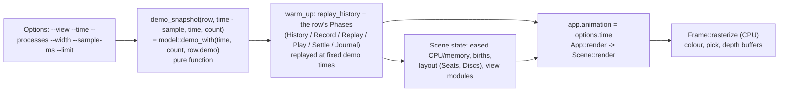

# Theory: Determinism

isotop makes one promise that most real-time graphics programs cannot make: `isotop --demo --view city --time 12
--renderer cpu --width 480 --output a.png` writes the same bytes every time, on every run, and a hash of those
bytes is checked into the repository. This page explains what that promise is made of: which inputs the frame
is a function of, how every source of randomness is seeded from a process's identity, how simulated time is
decoupled from frame time, what the golden hashes in `tests/golden.txt` do and do not certify, and what is
*not* deterministic in a live run and why that is correct. It also takes the information-theoretic view:
a 192-bit digest standing for a frame of 11.4 million bits.


*The three clocks of a live run (from [Background sampler](Theory-Background-Sampler-and-Demand) and
[Scene and display list](Theory-Scene-and-Display-List)). Determinism is the discipline of making the picture
depend on the first two only through values that a headless run can reproduce.*

## History

The problem of making a machine produce numbers that look random, and produce the same ones again on request, is as old as the machines. John von Neumann proposed the middle-square method for the ENIAC's Monte Carlo calculations (sources date the proposal to 1946, and its public description to a conference in 1949): square an $n$-digit number and keep the middle digits. Its flaws were known early. Its period is usually short, and a sequence that reaches zero stays there. The remark with which he excused it appeared in the 1951 National Bureau of Standards volume on the Monte Carlo method: "Any one who considers arithmetical methods of producing random digits is, of course, in a state of sin." He kept the method because it was hundreds of times faster than reading digits off punched cards, and because a sequence that can be run again can be debugged.

Three lines of descent lead to the generators in `simulation.rs`. Marsaglia's xorshift generators (*Journal of Statistical Software* 8(14), 2003) use only shifts and exclusive-ors; Brent's note of 2004 showed that they are linear feedback shift register generators in disguise and inherit those generators' theory. Steele, Lea and Flood's SplitMix (OOPSLA 2014) was written to split a generator into independent streams and shipped in the JDK 8 as `java.util.SplittableRandom`; Steele and Vigna later reported detectable weaknesses in its output function, and its period is limited to $2^{64}$ per stream, which is why isotop uses it for seeds and decoration and nothing statistical. Salmon, Moraes, Dror and Shaw (SC11, 2011) argued for the third style, counter-based generators, in which the random number is a function of a key and a counter and the generator has no state to advance.

The hashes have a plainer past. The FNV hash grew out of reviewer comments that Glenn Fowler and Phong Vo sent to the IEEE POSIX P1003.2 committee in 1991; Landon Curt Noll improved the method during a ballot round, and the three names became its name. It is non-cryptographic by design, and has an IETF Internet-Draft; Noll's repository says it has since become RFC 9923 (unverified here).

The clock has its own tradition. Glenn Fiedler's "Fix Your Timestep!" on the Gaffer On Games site argues for integrating in fixed steps, carrying the remainder, and interpolating the drawn state between the last two; the reference list below dates it 2004, and one mirror of the article is dated 2006. Floating point is the last source of drift: IEEE 754 appeared in 1985 and was revised in 2008 and 2019, and none of them requires the transcendental functions to be correctly rounded, which is why the golden hashes are tied to one platform. Randomised hash-table order is a response to a different problem: Crosby and Wallach (USENIX Security 2003) showed that a predictable hash function lets an attacker degrade a hash table to a list, and the standard library's per-instance seeding is in that tradition.

## 1. The contract

`docs/VIEW_CONVENTIONS.md` ("The realness contract", "Simulation time", "Seeded randomness", "Demo
synthesis") states the determinism clauses of isotop's contract:

* `--demo` synthesizes every field a view consumes, and `--time T` "makes a frame repeatable byte for byte".
* "Simulations advance on wall-clock time, never per frame. All randomness is seeded from process identity
  and `--time`."
* Per-process randomness is `simulation::Rng::for_identity(id, SALT)` with one `SALT` per view. Demo-wide
  randomness is "a pure function of `--time` and indices". Stateless per-frame variation (flicker, jitter) is
  "a hash of a stable id and an event index, never a per-frame RNG advance". Gaussian draws use `Rng::normal`.
* "Two runs with the same `--time` produce byte-identical PNGs."
* `model::demo(time, count)` stays byte-identical across changes; views that need more ask for it through
  `DemoOptions` on their registry row.

The *realness* half of the contract (every element maps to a measured quantity or is declared decorative) and
the *determinism* half are one statement seen from two sides. A picture is a function from measurements to
pixels. If that function has hidden state (an unseeded generator, a per-frame accumulator, a hash-table
iteration order) then some of the picture's information comes from nowhere, from no measurement: numbers are
invented. Determinism is the testable form of "nothing is invented": every bit of decoration is a function of
something the machine told isotop, usually a pid and a start time.

## 2. The frame as a function

A headless frame is the value of this composition (`run` in `main.rs`, `demo_snapshot`, `warm_up`, `App::render`,
`Frame::rasterize`):



Every arrow is a function of its inputs and of the *earlier* arrows. The demo workload is closed-form: for base
process $i$ at time $t$, in `model::demo_with`,

$$
\varphi_i=0.55\,t+1.71\,i,\qquad \text{cpu}_i=\Bigl(\tfrac12+\tfrac12\sin\varphi_i\Bigr)^{4}\,(20+24\,(i\bmod9))+110\,[\,i\bmod47=0\,],
$$

memory $=(12+(71 i \bmod 900)(0.8+0.2\sin(0.2\varphi_i)))$ MiB, `Identity { pid: 1000 + i, start: i + 1 }`. There is
no generator in it. (`phase` is computed in `f32` from `time as f32`, which is the first place the precision of
the arithmetic enters the pixels.) Births and exits (`DemoOptions::churn`) and their causes (`mortality`)
*do* use `Rng`, seeded `Rng::new(hash_identity(Identity { pid: family, start: epoch }, SALT))` with their own
salts, so that a death at demo time $t$ is the same death whichever interval of time one asks about
(`demo_life_over_split_intervals_equals_one_long_interval`).

What the headless path adds to make a *settled* frame is bounded and itself deterministic: the warm-up phases of
a row replay demo samples at times computed from `--time` and `--sample-ms` (`Phase::Replay` samples at
`time - back * step`, `Phase::Record` at whole seconds before `--time`, `Phase::Settle` renders frames at
`time - lead + index * step`), so the state a view has when the real frame is drawn is a function of `--time`
alone.

## 3. Randomness, in the tree

Everything random is in [`src/simulation.rs`](https://github.com/tfpickard/isotop/blob/main/src/simulation.rs);
a test (`no_hand_rolled_hashes_outside_simulation`) scans every other `.rs` file for the multiplier constants
and fails on a copy.

### 3.1 `Rng`: splitmix64

State is one `u64`. `next_u64` adds the increment $\gamma=\texttt{0x9e3779b97f4a7c15}$ (the 64-bit golden
ratio, $2^{64}/\varphi$) and applies a finaliser:

$$
z\leftarrow(z\oplus z\gg30)\cdot\texttt{0xbf58476d1ce4e5b9},\quad
z\leftarrow(z\oplus z\gg27)\cdot\texttt{0x94d049bb133111eb},\quad
z\leftarrow z\oplus z\gg31 .
$$

This is the SplitMix64 generator of Steele, Lea and Flood (2014). The finaliser is a bijection on 64-bit words
with strong avalanche, so a counter advanced by $\gamma$ (a Weyl sequence, which visits all $2^{64}$ values
before repeating) comes out as high-quality noise. `unit()` takes the top 24 bits, `(next_u64() >> 40) as f32
/ 16_777_216.0`, which is in $[0,1)$ and never 1.0 because an `f32` has a 24-bit significand. `normal()` is the
Box-Muller transform, described on [the toolkit page](Theory-Simulation-Toolkit#rngnormal).

### 3.2 Seeds from identity: `hash_identity`

```rust
pub fn hash_identity(id: Identity, salt: u64) -> u64 {
    splitmix_finalizer(splitmix_finalizer(splitmix_finalizer(u64::from(id.pid)) ^ id.start) ^ salt)
}
```

and `Rng::for_identity(id, salt) = Rng::new(hash_identity(id, salt))`. Three properties are deliberate:

1. **Consecutive pids are unrelated** (the finaliser avalanches), so process 1000 and 1001 do not look alike.
2. **A reused pid differs from its predecessor** because `Identity` carries the start time (field 22 of
   `/proc/<pid>/stat`, in clock ticks since boot) and it is mixed in. A test fixes both claims
   (`hash_identity_separates_reused_pids_by_start_time`).
3. **`salt` separates independent uses** of one process (drift versus colour versus phase). Salts in the tree
   are ASCII in hex: Necropolis `0x6e65_6372_6f21`, Ptolemy `0x7074_6f6c_656d_7901` and `..02`, Arbor `0x6172_626f_7231`, Murmuration
   `0x6d75_726d_7572_6174`, Cortex's five, Horizon's two, the demo's churn, signal, record and mortality salts,
   the harness's own.

The seed is a function of `(pid, start, salt)`, and `(pid, start)` is something the machine measured. That is
why the decorative randomness of a view is not "invented": it is a deterministic, reproducible function of
measured identity. A hash of identity is stateless, so it is also independent of how many frames have been
drawn.

### 3.3 The legacy hashes and why they stay

Older views seeded from the pid alone with small multiplicative hashes. `hash::knuth(v) = v * 2654435761`
(Knuth's multiplicative hash, the 32-bit golden-ratio prime; its good bits are the high ones, so callers shift
right, as `kind_color` does with `>> 24`), `xxhash_prime2`, `knuth_xor_rotated_prime2`, `murmur_mix`,
`lattice_flicker`, `fnv1a_32`. They are kept **bit-exact** because replacing one changes pixels, and pixels
are under golden hashes. The comment `// pid only: kept for pixel stability, see A33` marks each site, and the
open issue [#92](https://github.com/tfpickard/isotop/issues/92) is the plan to retire them view by view with
the owner's approval, re-blessing the hashes each time. The one practical difference: the old hashes cannot
tell a pid from its reuse (`hash_identity_separates_reused_pids_by_start_time` asserts
`hash::knuth(first.pid) == hash::knuth(reused.pid)`).

### 3.4 `XorShift32` and the shared stream

`XorShift32` is Marsaglia's 32-bit xorshift with shifts (13, 17, 5) (Marsaglia 2003): $x\oplus=x\ll13$,
$x\oplus=x\gg17$, $x\oplus=x\ll5$, period $2^{32}-1$ over non-zero states, and a zero state stays zero. Flow
seeds one with `GOLDEN_RATIO_32` $=\texttt{0x9e3779b9}$ (in `medium.rs`) and draws from it for every emitter. A single shared
stream is *history-dependent*: what one particle gets depends on how many random numbers every other particle
consumed first, so the picture depends on frame rate, on population changes, and on the order in which a hash
map is iterated. That is the reason Flow is on the list in section 7.

### 3.5 Stateless variation: counter-based randomness

The contract's "a hash of a stable id and an event index, never a per-frame RNG advance" is the
**counter-based** style of generator (Salmon et al. 2011: a random number is a pure function of a key and a
counter). The Matrix rain's glyph flicker is `lattice_flicker(column, row, tick)`; the demo journal hashes a
line counter with `golden_gamma_high`; the Coop's fractions are `unit_from(murmur_mix(seed))`. Because the
function has no state, a frame can be drawn out of order, twice, or after a rewind and still show the same
glyph. A generator with a cursor cannot offer that.

## 4. Time

### 4.1 Four clocks

| clock | type | who advances it | deterministic headless? |
|---|---|---|---|
| demo time `demo_time` | `f64` seconds | `--time` (default 12.0); in a live `--demo` run `origin.elapsed()` at each sample | yes: it is the argument |
| `App::animation` | `f32` seconds | headless: `options.time`, plus `i / fps` per frame in `--benchmark`; live: `+= elapsed` each frame, standing still while paused | yes headless |
| `Snapshot::elapsed` | `f64` seconds | the sampler; in demo, equals demo time | yes |
| `Snapshot::wall` | `f64` Unix seconds | live: the system clock; demo: `DEMO_EPOCH + time`, with `DEMO_EPOCH = 1_791_605_520.0` (2026-10-10T04:12:00Z) | yes |

A view never reads the system clock (it cannot tell a demo run from a live one); calendar-dependent visuals
(the Necropolis moon) read `Snapshot::wall`. The one exception is the Matrix greeting, which reads `$USER`
through `login()` in `matrix.rs`; in a test build `login()` returns nothing and the greeting falls back to
"Neo", so the golden test and the harness do not depend on the machine.
This is listed in [#92](https://github.com/tfpickard/isotop/issues/92).

### 4.2 `stage.dt` and `FixedStep`

A simulation that advances per frame changes with the frame rate; one that advances per wall-clock second does
not. There are two sanctioned ways (derived in [the toolkit page](Theory-Simulation-Toolkit)):

* **`Stage::dt`**, computed once per frame by `FrameClock::step(time, paused)`: 0 on the first frame, while
  paused and when time went back (a rewind or a headless replay); otherwise `min(time - last, MAX_DT)` with
  `MAX_DT = 0.5`. Use it for anything that integrates a smooth ODE (eases, decays, drifts).
* **`FixedStep`** (`FixedStep::new(step, max_steps, max_gap)`), fed `stage.time`: whole steps of a fixed
  size, so the *trajectory* is independent of frame times. Coop uses `FixedStep::new(0.05, 10, 0.5)`
  (`H`, `MAX_STEPS`, `MAX_GAP`); Arbor, Murmuration and Cortex use it with their own constants.

The property tested is not "the same pixels" but "the same state after the same number of steps"
(`fixed_steps_follow_the_same_path_at_ten_and_sixty_frames_per_second`,
`flock_follows_the_same_path_at_ten_and_sixty_frames_per_second`, and the Tesseract's
`the_orientation_eases_alike_at_ten_and_sixty_frames_per_second` for exponential easing). Pause and rewind take
no steps.

### 4.3 The retrofit list

Views that predate the contract do not all meet it. Verified in the tree, and tracked by
[#92](https://github.com/tfpickard/isotop/issues/92) ("changes pixels, needs decision"):

| view | deviation | where |
|---|---|---|
| Flow | `dt` clamped to 0.1 s (runs in slow motion below 10 fps); one shared `XorShift32` seeded `GOLDEN_RATIO_32` | `views/flow.rs` (`(time - flow.time).clamp(0.0, 0.1)`), `medium.rs` |
| Reef | `dt` clamped to 0.1 s | `reef.rs` |
| Cores | `dt` clamped to 0.5 s | `cores.rs` |
| Ripple | its own clock with CFL substeps | `medium.rs` |
| Orbit | galaxy continuity decided by a frame counter (`self.frame + 1 == frames`) | `views/systems.rs` (`Galaxy::revolve`) |
| Matrix | reads `$USER` | `matrix.rs` (`login`) |
| pid-only seeding | `hash::knuth(pid)` etc. at about a dozen sites | `palette.rs`, `reef.rs`, `coop/sim.rs`, `necropolis.rs`, `model.rs`, `render.rs`, `views/orbit.rs`, `views/ripple.rs`, `views/systems.rs` |

Below the clamp (10 fps for a 0.1 s clamp) these views run slower than real time rather than diverging, which
is the safe failure; they are deterministic in a headless run, where frames are generated at a fixed `--fps`.

### 4.4 Hash-table order

Rust's `HashMap` is seeded per instance. A direct check on this machine, three maps built from the same ten
keys in one process, printed in key order:

```text
[8, 3, 2, 4, 0, 5, 1, 7, 9, 6]
[1, 2, 3, 6, 0, 4, 7, 8, 5, 9]
[1, 7, 2, 8, 0, 3, 9, 5, 4, 6]
```

and a different set of three on the next run. Anything that iterates a map and lets the order reach the
output (a sum of floats, the order of overlapping translucent beams, the consumption of a shared random stream)
is nondeterministic. The tree's discipline is to sort: `Seats::assign` visits newcomers in `Identity` order,
`Discs::arrange` sorts pending discs by radius then name, `model::top_n` breaks ties by `Identity`, `SpatialHash`
sorts a cell's points by index, and the two sites that draw `Snapshot::outside` (`Scene` in `render.rs` and `views/flow.rs`) sort it by `Identity`.
Issue [#108](https://github.com/tfpickard/isotop/issues/108) is the case study: Flow rendered a different PNG on
every run (4 of 4) and Orbit two different PNGs across 12 runs (differing in two pixels by at most two levels)
because both iterated `Snapshot::outside`; the cause was found by sorting one site at a time. (The issue text
says the field became a `BTreeMap`; in the tree it is still a `HashMap` and the two consumers sort.) The
spatial hash for cells uses a fixed hasher (`BuildHasherDefault<CellHasher>`), not `RandomState`, so even its
internal order is reproducible.

### 4.5 Floating point

The frame is built from `f32` arithmetic with `sin`, `cos`, `exp`, `powf` and `sqrt`. IEEE 754 fixes `+ - * /`
and `sqrt` exactly; the transcendentals are not correctly rounded by libm, and different libms (and different
architectures) differ in the last bit. A last-bit difference is a different pixel after a `floor`. That is why
the checked-in golden hashes are those of Linux on x86_64, and the comparison runs only there: "Elsewhere every
view still renders, which catches panics, and the comparison is skipped" (the doc comment of
`every_view_matches_its_golden_hash`). `ISOTOP_GOLDEN_FILE=<path>` compares against a local baseline on any
platform. Rust does not contract `a*b+c` into a fused multiply-add on its own, which keeps the CPU path
portable; the GPU path is checked for *tolerance*, not equality (see
[GPU and parity](Theory-GPU-and-Parity)).

## 5. What is checked

| check | where | what it proves |
|---|---|---|
| `Property::Deterministic` | `harness.rs` | for every registered view: two headless runs from the same inputs (the steady run and the rescaled run, before their change) draw the same colour bytes and the same picks |
| `every_view_renders_the_same_frame_twice` | `main.rs` | the golden render of every view, done twice in one process, gives equal hashes. Each render builds fresh `HashMap`s, each with its own hasher seed, so it is also a test of hash-order independence |
| `every_view_matches_its_golden_hash` | `main.rs`, `tests/golden.txt` | the colour, pick and depth buffers of `--demo --time 12 --renderer cpu --width 480` hash (FNV-1a 64) to the stored values (Linux x86_64 only) |
| `bless_mode_rewrites_the_golden_file` | `main.rs` | the bless mechanics, against a temp path |
| 10 versus 60 fps tests | `simulation.rs`, `coop/sim.rs`, `tesseract.rs` | same state after the same number of steps, or the same eased angle |

`tests/golden.txt` has one line per view: `name pixels picks depth`, three 16-digit hex FNV-1a 64 values.
The depth buffer is hashed as `f32::to_bits` little-endian, the picks as `u32` little-endian, the pixels as
raw RGB bytes. `ISOTOP_BLESS=1 cargo test every_view_matches` rewrites the file; a pull request that changes a
hash "says why in its description and carries the renders" (`AGENTS.md`).

## 6. An independent check, and what a hash says

### 6.1 Reproducing the golden file without Rust

The golden pixel hash is the FNV-1a 64 of the 388 800 RGB bytes of the 480 by 270 frame, which is exactly the
image `--output` writes. A PNG decoder is forty lines of standard library, so the checked-in value can be
reproduced by a program that shares no code with isotop:

```python
import sys, zlib, struct

def fnv1a64(data):                      # offset basis 0xcbf29ce484222325, prime 0x100000001b3
    h = 0xcbf29ce484222325
    for b in data:
        h = ((h ^ b) * 0x100000001b3) & 0xFFFFFFFFFFFFFFFF
    return h

def read_png(path):                     # 8-bit RGB, non-interlaced, as isotop writes it
    d = open(path, 'rb').read(); pos = 8; idat = b''
    while pos < len(d):
        n, = struct.unpack('>I', d[pos:pos+4]); kind = d[pos+4:pos+8]; body = d[pos+8:pos+8+n]; pos += 12 + n
        if kind == b'IHDR': w, h = struct.unpack('>II', body[:8])
        elif kind == b'IDAT': idat += body
    raw = zlib.decompress(idat); stride = w * 3; out = bytearray(); prev = bytearray(stride); p = 0
    for _ in range(h):
        f = raw[p]; line = bytearray(raw[p+1:p+1+stride]); p += 1 + stride
        for i in range(stride):
            a = line[i-3] if i >= 3 else 0; b = prev[i]; c = prev[i-3] if i >= 3 else 0
            if f == 1: line[i] = (line[i] + a) & 255
            elif f == 2: line[i] = (line[i] + b) & 255
            elif f == 3: line[i] = (line[i] + ((a + b) >> 1)) & 255
            elif f == 4:
                pa, pb, pc = abs(b-c), abs(a-c), abs(a+b-2*c)
                line[i] = (line[i] + (a if pa <= pb and pa <= pc else b if pb <= pc else c)) & 255
        out += line; prev = line
    return bytes(out)

print('%016x' % fnv1a64(read_png(sys.argv[1])))
```

Run on this machine (Linux x86_64, the platform the golden file is blessed on), for each of the 18 views the golden file lists:

```sh
./target/release/isotop --demo --view $v --time 12 --renderer cpu --width 480 --output $v.png
```

**All eighteen decoded-PNG hashes equal the `pixels` column of `tests/golden.txt`**, for example `city
ed3a2fc287f6ccc8` and `coop 611d7af471cad992`; a second run of the city produced a byte-identical file (`cmp`).
(Matrix greets `$USER`; it matched here, and the test build falls back to "Neo" to be machine-independent.) The picks and
depth hashes cannot be reproduced from the PNG, which carries colour only.

### 6.2 Sensitivity

`--time` is a continuous input. Frames for the city at `--time 12` and at three nearby times, 480 by 270:

| `--time` | differing pixels (of 129 600) | differing bytes | hash bits differing from `--time 12` (of 64) |
|---|---|---|---|
| 12.001 | 2 843 (2.2 %) | 3 431 | 34 |
| 12.01 | 15 182 (11.7 %) | 21 587 | 35 |
| 13 | 118 066 (91.1 %) | 318 255 | 31 |

A millisecond of demo time moves 2 843 pixels (each of the city's windows and pulse lights is animated by the
closed-form workload), and the hash is as different as it can be.

### 6.3 What a 64-bit digest certifies

The frame's colour buffer is 388 800 bytes; the pick buffer is 480 x 270 x 4 = 518 400 bytes; the depth
buffer another 518 400. Together 1 425 600 bytes, **11 404 800 bits**, represented in the golden file by
3 x 64 = **192 bits**: a ratio of 59 400 to 1. The frame is far less than 11.4 Mbit of *information* (the
colour buffer deflates to 63 616 bytes for the city and 21 311 for the Matrix; the PNGs are 79 453 and 26 363
bytes), but it is still some five orders of magnitude more than the digest. What can 192 bits say?

* **Equality, not closeness.** Treat the digest as a random function of the buffer. Then a *different* buffer
  has the same digest with probability $2^{-64}$ per hash ($5.4\times10^{-20}$), and all three agreeing by
  accident has probability $2^{-192}$. The hash answers a one-bit question ("same or not?") with a
  vanishingly small false-accept rate, which is exactly what a regression test needs. It carries no
  information about *how* different: 3 431 bytes or 318 255 bytes differ and about half the hash bits flip
  either way (34, 35, 31 of 64 above, against 32 expected). A hash is a deliberately information-destroying
  map: the distance between two digests is meaningless.
* **FNV-1a is not a random function, but its failure mode is benign here.** Each step
  $s\leftarrow(s\oplus b)\cdot p \pmod{2^{64}}$ with an odd prime $p=\texttt{0x100000001b3}$ is a **bijection** on
  states, for any byte $b$. Hence two buffers that differ in *exactly one byte* always hash differently,
  whatever and wherever the difference. For two or more differing bytes, a collision requires the state
  differences to cancel, which for accidental changes happens with probability about $2^{-64}$ and for an
  adversary can be arranged (it is not cryptographic). The goldens guard against accident, not against attack.
* **Avalanche is weak in the high bits for late changes.** The multiplier is $2^{40}+435$, so a change in the
  last byte reaches only about the low 48 bits of the digest. For golden hashing this does not matter
  (the digest still differs by the bijection property); it matters for using FNV-1a as a *pseudo-random*
  function, which is why the code never does: all randomness goes through the splitmix64 finaliser.
* **What it does not cover.** (1) The *terminal overlay*: labels, popups and status lines are terminal text
  drawn over the image by `terminal.rs`, not part of the `Frame`. (2) The *GPU* path: the golden render is
  `--renderer cpu`; CPU/GPU agreement is a tolerance check (`scripts/compare_png.py`), not an equality.
  (3) Any other `--time`, size, population or `--sample-ms`. (4) *Correctness*: the hash certifies that
  this frame equals the blessed frame, not that the blessed frame is right. Only a person with
  the picture and the mapping table can do that, which is why a PR that moves a hash must carry the renders.
  (5) Behaviour over time: one frame cannot witness the 10 versus 60 fps invariance; that is tested on state.

### 6.4 Entropy accounting

For a live run the picture is a function of the measured data and of the *time* it was drawn. With the contract
met, the information in a frame is bounded by the information in (the snapshot, `animation`, the selection and
camera state), plus nothing: no generator draws from outside the process list. A seeded generator with a
64-bit seed adds at most 64 bits per (process, salt), and that seed is itself a function of `(pid, start)`.
The decorative randomness of a frame is therefore *not extra entropy*; it is a re-encoding of identities
already measured. A violation of the contract would show up as bits in the frame that no table of mappings
accounts for.

## 7. What is not deterministic, and should not be

* **Live data.** `/proc` is a river; two live runs differ by the machine's state at the moment of the sample.
  `--view city --output live.png` samples twice, one `--sample-ms` apart (it sleeps), so even the rates are
  of "now". This is the point of the tool. [Record and replay](https://github.com/tfpickard/isotop/issues/98)
  (F4, open) is the design for making a live session reproducible.
* **Scheduling.** The background sampler, the journal follower and `isotop-events` run on their own threads;
  their results enter the frame loop only as whole values merged at the sample boundary.
* **Frame pacing.** Frame times in a live run are wall-clock and jitter. The animation clock is an `f32`
  sum of per-frame `elapsed`, so its resolution degrades as the run ages: the spacing of `f32` values near
  $t$ is $2^{\lfloor\log_2 t\rfloor-23}$ seconds: 1 ms from 2.3 hours, 7.8 ms from 18 hours, 0.0625 s from 6
  days, 0.125 s from 12 days. A `FixedStep` of 0.05 s therefore sees time quantised coarser than its step past
  about six days, and a 0.1 s frame increment is lost entirely past 24 days (a derived limit, not an observed
  failure).
* **The first live frame.** A live run sets `scene.intro = true`, so the first sample's processes get a birth
  time and grow in over `GROW_SECONDS = 0.9`; a headless run leaves births at negative infinity, so its frame
  is fully grown. Same code path, different declared initial condition.
* **The terminal.** What the terminal does with the image is outside the program.

## 8. Try it

```sh
# byte-identical twice
./target/release/isotop --demo --view orbit --time 12 --renderer cpu --width 480 --output a.png
./target/release/isotop --demo --view orbit --time 12 --renderer cpu --width 480 --output b.png
cmp a.png b.png && echo identical

# the hash of the colour buffer, and the line to compare it with
python3 hash_png.py a.png        # the script above
grep '^orbit ' tests/golden.txt

# a view's stored vs fresh hashes, then bless after an intended change
cargo test every_view_matches
ISOTOP_BLESS=1 cargo test every_view_matches
ISOTOP_GOLDEN_FILE=/tmp/mine.txt ISOTOP_BLESS=1 cargo test every_view_matches   # local baseline, any platform
```

See [Headless and reproducible renders](Guide-Headless-and-Reproducible-Renders) for the full recipe.

## 9. Where in the code

* [`src/simulation.rs`](https://github.com/tfpickard/isotop/blob/main/src/simulation.rs): `Rng`,
  `hash_identity`, `XorShift32`, `hash::*`, `FixedStep`.
* [`src/main.rs`](https://github.com/tfpickard/isotop/blob/main/src/main.rs): `run` (the headless path),
  `demo_snapshot`, `warm_up`, `replay_history`, `run_phases`; tests `every_view_matches_its_golden_hash`,
  `every_view_renders_the_same_frame_twice`, `check_golden`, `golden_render`.
* [`src/model.rs`](https://github.com/tfpickard/isotop/blob/main/src/model.rs): `demo_with`, `DEMO_EPOCH`,
  `demo_life`, `demo_events`, the demo salts.
* [`src/render.rs`](https://github.com/tfpickard/isotop/blob/main/src/render.rs): `MAX_DT`, `FrameClock`,
  `Scene::ease`, `Stage::dt`.
* [`src/harness.rs`](https://github.com/tfpickard/isotop/blob/main/src/harness.rs): `Property::Deterministic`.
* [`tests/golden.txt`](https://github.com/tfpickard/isotop/blob/main/tests/golden.txt).

## 10. Variations and open questions

* **Seed-diffusion test.** Measure the avalanche matrix of `hash_identity` against `hash::knuth`: flip each of
  the 32 pid bits and count output bit flips. `knuth` should show a triangular matrix (input bit $i$ only
  reaches output bits $\ge i$), `hash_identity` a flat 0.5.
* **Frame-rate-independence for everything.** Finish [#92](https://github.com/tfpickard/isotop/issues/92):
  every simulation view with an fps-independence test.
* **A cryptographic golden.** Replace FNV-1a with a vendored SHA-256 and the $2^{-64}$ becomes a guarantee
  against adversarial change; the repository's "no new dependency" rule argues for the 40-line in-tree
  version. Is the extra assurance worth the eighteen longer lines in `golden.txt`?
* **Perceptual golden.** Complement the equality hash with a tolerance metric (mean absolute difference, share
  of pixels off by more than two levels, as `compare_png.py` does for CPU/GPU) so a bless can say *how much*
  moved.
* **A census of salts.** Every salt in the tree is a word in ASCII, in hex, so that nobody has to remember
  which number belongs to whom. The Necropolis salt reads `necro!`, and the harness's reads `haress`. A new salt
  should say what it is.
* **Recording live sessions** (F4) would turn the non-determinism of section 7 into data that can be replayed
  through exactly the path in section 2.

## 11. References

* Steele, G. L. Jr., Lea, D. and Flood, C. H. 2014. "Fast splittable pseudorandom number generators." *OOPSLA
  2014*, ACM.
* Marsaglia, G. 2003. "Xorshift RNGs." *Journal of Statistical Software* 8(14).
* Salmon, J. K., Moraes, M. A., Dror, R. O. and Shaw, D. E. 2011. "Parallel random numbers: as easy as 1, 2,
  3." *Proceedings of SC11*, ACM.
* Knuth, D. E. 1998. *The Art of Computer Programming, vol. 3: Sorting and Searching*, 2nd ed., section 6.4
  (multiplicative hashing). Addison-Wesley.
* Fowler, G., Noll, L. C. and Vo, P. The FNV hash (FNV-1a, 32 and 64 bit); parameters as in the code.
* Fiedler, G. 2004. "Fix Your Timestep!" (Gaffer On Games).
* IEEE Std 754-2019. *IEEE Standard for Floating-Point Arithmetic.*
