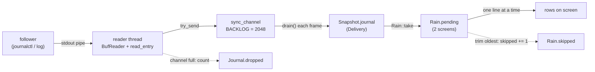

# Theory: The journal

The [Matrix view](View-Matrix) does not draw processes; it draws the machine's log. That makes the journal the one
data source that is *text written by other programs*: untrusted, unbounded, arriving at the log's pace rather than
isotop's, and produced by a follower process that isotop must start, feed from, bound, and stop. This page is the
pipeline from `journalctl` (Linux) or `log` (macOS) to the lines on screen: the formats and their parsers, the
reader thread and its three bounded stages, the linger that keeps the follower alive after you leave the view, the
the `Snapshot.journal` delivery that carries the lines to the view, the deterministic demo lines, and where untrusted text is
neutralised.

## History

The longer account of the Matrix view lives in the repository: [docs/theory/matrix.md](https://github.com/tfpickard/isotop/blob/main/docs/theory/matrix.md).

* **Syslog.** Unix logging as most people met it began in the 1980s with Eric Allman's `sendmail` project, whose logging facility was split out as `syslog`. For years it was a de facto standard with no authoritative specification; the IETF wrote the existing practice down as RFC 3164 in August 2001, and RFC 5424 (2009, edited by Rainer Gerhards) replaced that document.
* **The severity scale.** Syslog's eight levels run from 0 (emergency) to 7 (debug), so the number grows as the message matters less. isotop keeps the sender's number and colours by it (red for 0 to 3, teal for 7).
* **What syslog lacked.** A syslog message is a line of text with a priority and a tag. The protocol has no authentication, so any program can write a line in the name of any other, and the structure of a message is whatever its sender made of it. The text-only form is the reason a log line is, to a reader, untrusted input.
* **The journal.** `journald`, part of systemd, replaced the text file with a binary store of named fields (`MESSAGE`, `PRIORITY`, `_PID`, and the trusted `_`-prefixed fields that the logging daemon, not the sender, fills in). It arrived with systemd in the early 2010s (the exact release is unverified here). `journalctl --output=export` exists because a binary store needs a lossless way out, and the export format's length-prefixed field is what lets a message with newlines survive.
* **The Apple side.** macOS replaced the older Apple System Log with the unified logging system in macOS 10.12 Sierra (2016), after outlining its goals at WWDC that June. The `log` tool is its command-line reader.
* **Why the rain.** The Matrix view draws these records as digital rain because the log is the one data source on the machine that is already a stream of text. The two systems have in common that neither was designed to be watched, only to be read afterwards.

## 1. The sources (theory)

**systemd journal.** `journald` stores log entries as sets of named fields. The ones isotop wants are `MESSAGE`,
`PRIORITY` (a syslog severity, 0 emergency to 7 debug; see RFC 5424), `SYSLOG_IDENTIFIER` (the program's own tag),
`_COMM` (the kernel's `comm` of the sender) and `_PID`. `journalctl --output=export` writes entries in a
byte-exact **export format** designed for lossless transport:

* an entry is a sequence of fields, each ending in a newline, **terminated by an empty line**;
* a text field is `NAME=value\n`;
* a field whose value is binary or contains a newline is `NAME\n`, then the length as a **little-endian 64-bit
  integer**, then exactly that many bytes, then a newline.

Because the binary form carries a length, a `MESSAGE` with embedded newlines, control characters or invalid UTF-8
parses unambiguously; no escaping can be fooled. Without it a log line is a trust problem.

**macOS unified log.** The `log` tool reads the unified logging system. `log show` prints history, `log stream`
follows live; both can emit newline-delimited JSON (`--style ndjson`), one record per line, with fields such as
`eventMessage`, `messageType` (`Fault`, `Error`, `Default`, `Info`, `Debug`), `processImagePath`, `subsystem` and
`processID`. The unified log has no warning level, so nothing is amber there.

## 2. The Linux follower and parser

`platform::journal()` (in `platform/linux/journal.rs`) spawns

```
journalctl --follow --lines=200 --output=export \
           --output-fields=PRIORITY,SYSLOG_IDENTIFIER,_COMM,_PID,MESSAGE
```

with stdin null and stdout and stderr piped. `--lines=200` starts with the 200 most recent entries so the rain begins
full; `--follow` then streams. `read_entry` consumes one entry per call:

* `read_line` reads to the next newline, **keeping at most `FIELD = 4096` bytes** and discarding the rest of an
  overlong line while still advancing the stream, so a megabyte `MESSAGE` cannot grow memory and cannot desynchronise
  the parser.
* A line with `=` is a text field (name before the first `=`). A line without is a binary field's name: read the
  eight length bytes, keep at most 4096 of the value, **read and discard** the remainder with `io::copy` into a sink,
  and read the trailing newline. If the stream ends before `length` bytes, the result is `UnexpectedEof`, an
  error, not a short message.
* Values are decoded lossily (`from_utf8_lossy`); a `PRIORITY` that does not parse as a number reads as 6 (info),
  and is capped at 7.
* Only the five requested fields are kept; others (the export format also carries metadata such as `__CURSOR`) are
  read and ignored.
* An empty line ends the entry. The line shown is `source[pid]: message`, where `source` is `SYSLOG_IDENTIFIER`,
  else `_COMM`, else `"journal"`; `[pid]` is omitted when there is no `_PID`; newlines and tabs in the message become
  spaces.

The size cap is applied slightly differently to the two forms, and a test records it: for a text field it includes
the `MESSAGE=` name, for a binary field only the value.

## 3. The macOS follower and parser

`platform/macos/journal.rs` runs, in `/bin/sh -c` in a **process group of its own**:

```
/usr/bin/log show --last 2m --style ndjson --info; exec /usr/bin/log stream --style ndjson --level info
```

History first (the last two minutes, again so the rain starts full), then the live stream. The shell is the child
while `log show` runs, so killing the child alone would leave `log show` orphaned and running; `stop_journal` therefore
`killpg(SIGKILL)`s the whole group (falling back to `kill` if that fails) and reaps it.

The parser is a small **std-only JSON scanner**, compiled into Linux test builds so its tests run there, not a general
JSON library. It reads one line (at most `LINE = 64 KiB`, the rest discarded), then walks the top-level object, keeping
only `eventMessage` (at most `MESSAGE = 4096` bytes), `messageType`, `processImagePath`, `subsystem` (each at most
`FIELD = 512`) and `processID`. Nested values are skipped whole honouring strings and escapes, so a key buried inside
`backtrace` or inside a string never shadows a top-level one; escapes, surrogate pairs and a lone surrogate or
`\u0000` (which become U+FFFD) are decoded; the first of duplicate keys wins; and parsing **stops at the first
malformed byte keeping what it had**, so a record cut at the length cap still yields its early fields. Banner lines
that are not JSON objects and records with no message (the trailing `finished` record) are skipped.

The displayed source is the basename of `processImagePath`, else `subsystem`, else `"log"`. Severity maps
`Fault` to 2, `Error` to 3, `Default` to 5, `Info` to 6, `Debug` to 7, and anything else (or none) to 5.

## 4. The reader thread and its bounded stages

`Journal::start` (in `journal.rs`) owns the follower and a reader thread:



1. **Pipe and reader.** The reader thread parses entries from the follower's stdout. It sends each with
   **`try_send`**, never blocking: if the channel is full the line is *dropped and counted* in an `AtomicU64`; if the
   receiver is gone the thread returns. A parse error sends one `isotop: journal read failed: …` line (severity 3) and
   ends. At the end of the stream it reads the follower's stderr and sends each non-blank line as `journalctl: …`
   (severity 3), so a failure to authorise, or a missing binary, shows up in the rain instead of vanishing. A spawn
   failure sends `isotop: cannot run journalctl: …` through the same path and leaves no child or reader.
2. **Channel.** `mpsc::sync_channel(BACKLOG)` holds at most `BACKLOG = 2048` lines. This is the backlog "while the
   view is hidden or paused": the main loop only drains it while the demand contains `Source::Journal` and the app is
   not paused, so a flood during a pause fills it and the overflow is counted.
3. **The sample.** Each frame that drains, `feed` in `main.rs` attaches the `drain()`ed lines and `Journal::dropped()`
   (which `swap`s the counter back to 0) to the newest `Snapshot` through `journal::Delivery::add`. See section 4a.
4. **The rain.** The Matrix view (`Rain`, a `ViewModule`) calls `Rain::take` on `snapshot.journal` when it draws, and
   `Rain::push` queues each unseen line. `Rain` keeps at most `max(rows, 16) · 2` pending lines, two
   screens' worth, trimming the *oldest* and counting each as skipped, but not before the first frame has sized the
   grid, so the startup history survives. Lines are written into the screen **one at a time, faster when they
   queue**: the next release is `0.5 / (1 + pending/3)` seconds after the last, and a burst after a gap is limited to
   one second's worth. The legend shows `N queued, M skipped`.

### 4a. `Snapshot.journal` and `journal::Delivery`

The lines do not reach the view by the view calling the journal. They travel on the sample, as `Snapshot.journal`, a
`journal::Delivery`:

* `lines`: the lines attached to this sample, oldest first; `through`: how many lines had arrived in all when the last
  of them did (so the first of `lines` is number `through - lines.len()`); `dropped`: how many had been lost in all by
  then, either because the follower's backlog was full or because a sample held more than it keeps.
* `Delivery::add` takes the new lines and the follower's drop count, advances the running `Totals` that `App` keeps
  (`journal_totals`), and keeps only the newest `journal::KEPT` (equal to `BACKLOG`, 2048) lines of a flood, counting
  the cut ones as dropped.
* `Delivery::unseen(taken)` returns the lines after the first `taken` that ever arrived. `Rain::take` passes its own
  count, so drawing the same sample twice, or an older one after a rewind, queues nothing new.
* `Delivery::retire` empties `lines` once a newer sample replaces this one as the newest (`App::push_sample`); the
  numbering stays, so the history of snapshots that pause and rewind keep holds the lines of one sample at most.
* A sample nothing was attached to carries an empty delivery. `--demo` fills it from `journal::demo`; live runs from
  `Journal::drain`.

Net: the stream is lossy by design and says so. There is no point where the frame loop can block on the log.

## 5. Lifecycle and the linger

The follower costs a process and a thread, so it runs only while it is wanted:

* At startup, if the first view demands `Source::Journal` and the run is live, `Journal::start` is called before the
  first sample. In `--demo` no follower is started.
* Each frame (live runs), `App::journal_wanted` records when the demand last contained `Source::Journal` and says the
  follower is wanted while that was **less than `JOURNAL_LINGER = 30 s` ago**. Leaving the Matrix therefore does not
  kill the follower: a quick look at another view and back keeps the same stream and its backlog. After 30 s the
  `Journal` value is dropped, and coming back starts a new `journalctl` with `--lines=200` again.
* `Drop for Journal` calls `stop`: `platform::stop_journal` ends the follower (on Linux `kill` and `wait`; on macOS the
  group), then waits up to `READER_GRACE = 500 ms` for the reader to see end-of-stream. A reader still blocked after
  that (some process outside the group holding the pipe) is left to end on its own, on end of stream or when its next
  `try_send` finds no receiver, rather than stall the frame loop.

The demand mechanism that sets all this is in [the background sampler](Theory-Background-Sampler-and-Demand#the-journals-linger).
The journal does not go through `Reads`, so it never appears in `Snapshot::sources`.

## 6. Demo lines

`--demo` has no follower. `journal::demo(from, to)` returns the synthetic lines whose index $k$ satisfies
$k\cdot 0.35 \in (from, to]$ (`DEMO_INTERVAL = 0.35 s`, and $k \ge 0$): a **pure function of time**. Line $k$ takes
`h = golden_gamma_high(k)` $= (k\gamma \bmod 2^{64}) \gg 32$ (the splitmix64 increment $\gamma$ times
$k$, wrapping, shifted right 32), picks template `h mod 16` of sixteen, and fills `{n}` with `h mod 9 + 1` and `{p}` with
`1000 + h mod 60000`. The templates look like a real machine, with severities from debug to critical, and two of
them are quotes from the film. A test checks that splitting an interval anywhere yields the same lines as one long
interval, which is what lets a warm-up replay and a live demo agree
([Determinism](Theory-Determinism)).

## 7. Untrusted text

A log message is arbitrary bytes chosen by whoever can write to the journal, including data a remote party can influence,
such as a username in a failed-login message. Two layers stop it from reaching the terminal as a control sequence:

* The rain is **drawn with a bitmap font**, not printed. `glyphs::glyph(character)` maps printable ASCII to a
  7×14 bitmap (the public-domain X11 `7x14` font) and **everything else to `?`**: there is no path from a message
  byte to a terminal escape inside the picture.
* The one place the text is *printed* is the status line (the newest line, ` > …`). All status text goes through
  `terminal::clean_text`, which keeps ASCII graphic characters and spaces, replaces every other character with `?`,
  and truncates to the width.

Lengths are bounded on the way in (4096 bytes of a field, 64 KiB of a macOS line) so the parser cannot be made to
allocate more. The general rule and its test (`process_text_cannot_inject_terminal_controls`) are on
[Text safety](Theory-Text-Safety).

## 8. What a viewer can infer

* The rain is a *sample* of the log, not the log: lines can be dropped (the "skipped" count) and a flood is shown
  at the pace the screen can write.
* Colour is the sender's own severity: red for 0 to 3, amber for 4, green for 5 and 6, teal for 7 (nothing amber on
  macOS).
* On Linux a user outside `adm` or `systemd-journal` sees only their own journal; an empty rain may be permissions, not
  silence.
* Anything the follower or parser could not do shows up as an error line, not as a gap.

## Where in the code

* [`journal.rs`](https://github.com/tfpickard/isotop/blob/main/src/journal.rs): `Journal`, `Line`, `Delivery`, `Totals`,
  `KEPT`, `BACKLOG`, `READER_GRACE`, `demo`.
* [`model.rs`](https://github.com/tfpickard/isotop/blob/main/src/model.rs): `Snapshot::journal`.
* [`platform/linux/journal.rs`](https://github.com/tfpickard/isotop/blob/main/src/platform/linux/journal.rs):
  `journal`, `read_entry`, `read_line`, `FIELD`.
* [`platform/macos/journal.rs`](https://github.com/tfpickard/isotop/blob/main/src/platform/macos/journal.rs): `FOLLOW`,
  `parse_line`, `scan`, `Cursor`, `severity`.
* [`platform/mod.rs`](https://github.com/tfpickard/isotop/blob/main/src/platform/mod.rs): `JournalParser`,
  `stop_journal` contract.
* [`main.rs`](https://github.com/tfpickard/isotop/blob/main/src/main.rs): `JOURNAL_LINGER`, `journal_wanted`, `feed`, `App::push_sample`;
  [`matrix.rs`](https://github.com/tfpickard/isotop/blob/main/src/matrix.rs): `Rain`;
  [`glyphs.rs`](https://github.com/tfpickard/isotop/blob/main/src/glyphs.rs): `glyph`;
  [`terminal.rs`](https://github.com/tfpickard/isotop/blob/main/src/terminal.rs): `clean_text`.

## References

* The systemd documentation "Journal Export Formats", and `journalctl(1)` and `systemd.journal-fields(7)`.
* S. Gerhards, "The Syslog Protocol", RFC 5424 (2009): the severity levels.
* Apple's `log(1)` manual page for `log show` and `log stream`.
