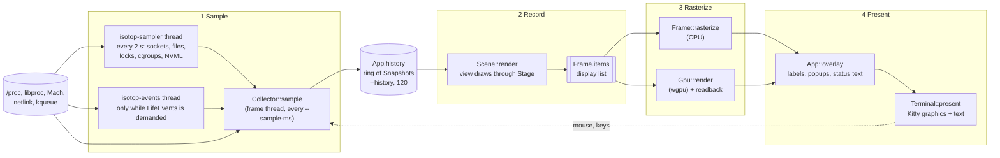
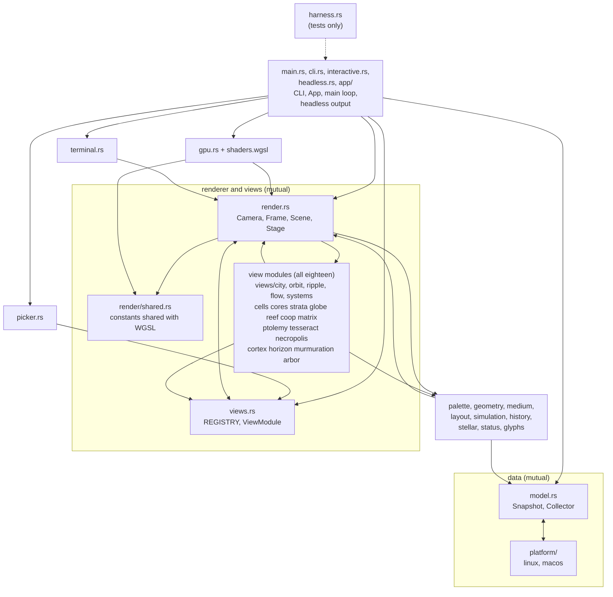

# Theory Overview

isotop is a closed loop with four stages: it samples the operating system, records what it saw as a list of screen-space drawing primitives, rasterizes that list into pixels on the CPU or the GPU, and hands the pixels to a terminal as a graphics image with the text drawn over it as ordinary terminal cells. Everything on this page is the whole machine at the scale of one frame loop; each stage has its own page, linked in the [reading map](#reading-map). The rule that organises the whole project is the one in [Philosophy](Philosophy): a view is only allowed to draw what the sampler measured.

## History

This is the history of the project's architecture, taken from the repository's own log (`git log`; the first commit is dated 2026-10-07). The dates are commit dates; the order matters more than the pace.

* **2026-10-07.** The first day has seven commits: an `Initial commit` that holds only a licence and a `.gitignore`, then one commit of about 8,300 lines that already holds `model.rs`, `render.rs`, `gpu.rs`, `shaders.wgsl` and `terminal.rs`, one file for each stage of this page, then a pseudo-terminal smoke test, a README and an agent guide.
* **2026-10-08.** Strata, Cores, Cells, Globe and Reef are added together, then a Matrix view of the systemd journal. Strata's history ring is made to record in every view, the first appearance of the rule that a view's record hook runs whichever view is shown.
* **2026-10-09.** Operating-system access moves behind a `platform` module (`47d34fa`), and macOS support follows the same day: processes, CPUs, memory and sockets, the terminal probe, the unified-log follower for Matrix, and CI on both platforms. The boundary came first; the second platform made it real.
* **2026-10-11.** Three architecture batches land: golden hashes, CI, lints and the agent guide (#109); typed sources, sampler correctness and "unknown is not zero" (#113); and the view registry, the `Stage` contract, demo options, `FixedStep`, source demand, the view picker and the view harness (#120). From here a view is a row plus a module, and what a view needs from the operating system is declared, not assumed. Ptolemy, Tesseract and Necropolis are the first views written that way (#123).
* **2026-10-12.** Horizon, Murmuration and Cortex (#134), the field primitive, strokes and Arbor (#140), and then #143, "one view path": the eleven views that had been built into `Scene` are moved onto `ViewModule` and the `Hooks` split is removed, so the registry has eighteen rows of one kind. The journal's lines stop being fetched by the Matrix view and travel on the snapshot (`Snapshot.journal`). That day alone has 117 of the 232 commits.

By default the frame loop of [the section below](#the-frame-loop-and-its-clocks) runs at 10 frames a second and samples once a second, so each sample is drawn ten times and the frame thread asks the operating system nothing in between.

## The four stages

| Stage | Question it answers | Main types | Where |
|---|---|---|---|
| **Sample** | What does the kernel say right now? | `Collector`, `Snapshot`, `Process`, `Identity` | `model.rs`, `platform/` |
| **Record** | What should a frame contain, in screen space? | `Scene`, `Stage`, `Frame`, `Item` | `render.rs`, view modules |
| **Rasterize** | Which pixel gets which colour, depth and pick? | `Frame::rasterize`, `Gpu::render` | `render.rs`, `gpu.rs`, `shaders.wgsl` |
| **Present** | How do pixels and text reach the screen? | `Terminal::present`, `Label`, `Popup` | `terminal.rs`, `interactive.rs` |

**Sample.** `Collector::sample` reads `/proc` (Linux) or libproc and Mach (macOS) once per `--sample-ms` (default 1000, range 100 to 10000) and returns a `Snapshot`. It runs on the frame thread, because reading `stat` and `io` for a few hundred processes is cheap. Anything slower runs on the background thread `isotop-sampler`, which wakes every `BACKGROUND_PERIOD` (2 s) and whose results are merged in against the pids the cycle scanned; the optional sources only some views draw are read only while the shown view declares them (`Demand`). A second thread, `isotop-events`, exists only while a view demands `Source::LifeEvents`. The details are in [Theory Sampling Linux](Theory-Sampling-Linux), [Theory Sampling macOS](Theory-Sampling-macOS), [Theory Background Sampler and Demand](Theory-Background-Sampler-and-Demand), [Theory Model and Rates](Theory-Model-and-Rates) and [Theory Life Events](Theory-Life-Events). The snapshot is pushed onto a ring (`App.history`, a `HistoryPlayer`; `--history`, default 120 snapshots) and, through `Scene::record`, into every view's `record` hook and the shared per-process [history](Theory-History).

**Record.** `Scene::render` turns one snapshot plus a camera into a `Frame`: a sky description and a `Vec<Item>` of triangles, lines, sphere impostors, glows, beams, stars, glyphs and pick discs, in the order they must be painted. The scene persists between frames, so it can hold layout, easing and the simulated media. See [Theory Scene and Display List](Theory-Scene-and-Display-List) and [Theory Camera and Projection](Theory-Camera-and-Projection).

**Rasterize.** The same display list is drawn by `Frame::rasterize` (CPU) or by `Gpu::render` (wgpu: Vulkan, Metal or DX12). Both fill three images: colour, depth and a pick buffer that says which process or thing owns each pixel. They are required to agree; [Theory Rasterization](Theory-Rasterization) and [Theory GPU and Parity](Theory-GPU-and-Parity) say how, and how far they do. Hit-testing is in [Theory Picking](Theory-Picking).

**Present.** The pixels leave as a Kitty graphics image, through POSIX shared memory when the terminal can read it and as zlib plus base64 otherwise; labels, the inspector popup and the status lines are terminal text. See [Theory Terminal Graphics](Theory-Terminal-Graphics) and [Theory Text Safety](Theory-Text-Safety).

## Module dependencies

`AGENTS.md` states the rule: dependencies mostly run one way, data first, then shared helpers, then the renderer and the views, then the two back ends, then `main`. The diagram is that rule with the exceptions the document lists; arrows point from the importing module to the imported one. A grep of `use crate::` over `src/` agrees with it for production code (the few imports of `terminal` from `render` and `necropolis` are in tests).

The invariants that follow from this picture, all stated in `AGENTS.md`: nothing imports `main`; `model` and `platform` never import `render`, a view or `terminal`; `gpu` and `terminal` import only `render`; nothing outside `platform/` reads `/proc` or `/sys` or spawns an operating-system tool (terminal I/O and local lookups are the exceptions). The renderer is therefore a pure function of a `Snapshot`, a `Camera` and a time, which is what makes the golden hashes of [Theory Determinism](Theory-Determinism) possible.

## The frame loop and its clocks

`Live::run` in `interactive.rs` is one loop on one thread, each step of it a function (`sample`, `follow_journal`, `render`, `present`, `input`, `finish`). Per iteration, in this order:

1. `elapsed` is the time since the previous iteration began. Unless paused, `app.animation += elapsed`: the animation clock is wall time with the paused intervals removed.
2. If not paused and `last_sample.elapsed() >= --sample-ms`, take a sample (`collector.sample()`, or `demo_snapshot` under `--demo`), call `Scene::record`, push it on `app.history` (dropping the oldest beyond `--history`).
3. Manage the journal follower: it runs while the shown view's demand contains `Source::Journal` and for `JOURNAL_LINGER` (30 s) after. While it is demanded, the lines that arrived are attached to the newest sample as `Snapshot.journal` (a `journal::Delivery`), where the Matrix view reads them.
4. `App::steer`: `CameraController::approach` (`smoothing(elapsed, 0.2)`), then `update_tour`.
5. `App::render`: `Scene::render`, camera fitting if requested, then `Frame::rasterize` or `Gpu::render`. If the GPU reports an error, the app drops the GPU and rasterizes on the CPU from then on.
6. `hover_over`, `overlay` (labels and popups), `Terminal::present`.
7. Wait for input until `frame_start + 1/fps` (`--fps`, default 10, range 1 to 60), handling every event that arrives; once past the deadline, `poll(0)` keeps draining queued input but never sleeps.
8. If the shown view's demand changed, tell the collector.

Three consequences follow, none of them obvious from a frame rate alone.

* **Frame rate is a ceiling, not a clock.** A frame that takes longer than `1/fps` starts the next at once; nothing is dropped and nothing is caught up. Animation advances by real time, so a slow machine sees the same motion at fewer frames per second.
* **`Stage::dt` is the only step.** `Scene` computes it once per frame through `FrameClock::step`, whichever view is shown, and every new simulation steps by it:

  | Situation | `Stage::dt` |
  |---|---|
  | first frame | 0 |
  | paused | 0 (the clock stays where it was) |
  | time went back (a rewind, a headless replay) | 0, and the count restarts from this time |
  | otherwise | `time - last`, at most `MAX_DT = 0.5` s |

  A fixed-step simulation (`FixedStep`, see [Theory Simulation Toolkit](Theory-Simulation-Toolkit)) is fed from `Stage::time` instead and never derives a step of its own. A view that predates the policy may keep a clamp of its own (Flow limits its particle step to 0.1 s) because changing it would change pixels.
* **Easing is exponential and therefore frame-rate independent.** The weight of one step over `dt` seconds with time constant tau is `1 - exp(-dt/tau)`, and two successive steps of `dt1` and `dt2` compose to `1 - exp(-(dt1+dt2)/tau)`, because `(1-a1)(1-a2) = exp(-(dt1+dt2)/tau)`. The camera uses tau = 0.2 s; the scene eases CPU and memory towards each sample with tau = 0.3 s (`Scene::ease`), and clears the eased values if the gap between frames leaves `0..=2` s. The README's 1.5 s CPU smoothing is applied earlier, in the model ([Theory Model and Rates](Theory-Model-and-Rates)).

### Headless runs

`--output file.png` and `--benchmark N` run the same `App::render` without a terminal, on a 16:9 frame (`--width`, default 1920, so 1080 rows). `--time` (default 12) fixes the synthetic workload clock. `warm_up` first replays the shared history for `--demo`, then runs the shown view's warm-up phases from its registry row, so the captured frame is a settled one; the golden test calls the same function. [Guide Headless and Reproducible Renders](Guide-Headless-and-Reproducible-Renders) has the recipes.

## Pause and rewind

`App.history` is a `VecDeque<Snapshot>` of at most `--history` samples. Space toggles `paused` and points `history_index` at the newest; `[` steps back (pausing first if running) and `]` forward while paused. While paused the scene is drawn from `history[history_index]` and at that snapshot's own `elapsed` (`App::render_time`), so a view that keeps its own records must not assume time only moves forward: this is why the conventions require windows in seconds of `snapshot.elapsed` and record hooks that deduplicate on `snapshot.elapsed > last`. Sampling and the animation clock stop while paused. `Stage::dt` is 0 throughout, so simulations hold still.

## The view contract

A view is one module plus one row of `views::REGISTRY`. There is **no plugin system**: views are compile-time modules, and the registry is a static slice.

* The module owns a state struct and implements `views::ViewModule`: `draw(&mut self, stage, processes, snapshot) -> usize` and `legend`, plus defaulted hooks `record` (every sample, whichever view is shown), `key`, `inspector_line` and `card`.
* A view reads only `Stage`, the process slice and `&Snapshot`, and talks back only through `Stage` outputs (`positions`, `bounds`, `places`, `notes`, `tour`, `popup`, `callout`). Whatever the platform could not measure is `snapshot.missing`.
* The row (`ViewInfo`) holds everything else that distinguishes the view: name and title, `Backdrop`, `available`, link rule, flash and haze switches, default pitch, tour participation, header override, `face` and `turn` for the globe, `sources`, `demo` options, view-local `keys`, headless `warmup` phases and a harness `Contract`. `Scene`, `App` and the headless path read the row instead of naming a view.
* Today the registry has eighteen rows, and every one is a `ViewModule`. A row is built with `ViewInfo::new(name, title, backdrop, build)`, where `build` is a `views::Build` (`fn() -> Box<dyn ViewModule>`, usually a closure) that the scene calls to make and own the view's state. `Scene` keeps only frame-wide state (the clock, easing, history, the selection); a view's own state lives in its module. City, Orbit, Ripple and Flow are in `src/views/` (Orbit and Flow share `views/systems.rs`), and Matrix and Coop are module views like the rest. There are no `Hooks` variants and no per-view arms in `Scene`. The first ten rows are never reordered because the digit keys pick them.

The shared test harness (`harness.rs`) runs every row against its `Contract`: the same inputs give the same pixels and picks, the demo shows processes with something to click, every pick names a process, no surviving process moves when CPU and memory change or when a tenth of the processes exit and as many start, and an empty machine draws. [Guide Writing a View](Guide-Writing-a-View) walks through adding a row; [Theory Stable Layout](Theory-Stable-Layout) explains the layout property.

## Reading map

Read the pages in the order of the pipeline, or jump to the stage you care about.

| Stage | Page | What it settles |
|---|---|---|
| Sample | [Theory Sampling Linux](Theory-Sampling-Linux) | `/proc` parsing, `stat`, `io`, pressure, cgroups; what each file costs and what can go wrong |
| Sample | [Theory Sampling macOS](Theory-Sampling-macOS) | libproc, Mach, `proc_pid_rusage`, what macOS cannot report |
| Sample | [Theory Background Sampler and Demand](Theory-Background-Sampler-and-Demand) | the slow-source thread, `Demand`, `Reads`, stalls and health |
| Sample | [Theory Model and Rates](Theory-Model-and-Rates) | counters to rates, smoothing, `Option` for unknown, `top_n` |
| Sample | [Theory Life Events](Theory-Life-Events) | fork, exec and exit from the proc connector, taskstats and kqueue |
| Sample | [Theory Journal](Theory-Journal) | the log follower behind Matrix |
| Record | [Theory History](Theory-History) | the shared per-process ring that views read through `Stage` |
| Record | [Theory Stable Layout](Theory-Stable-Layout) | why a process keeps its place; `Seats`, `Discs`, the golden-angle spiral |
| Record | [Theory Scene and Display List](Theory-Scene-and-Display-List) | the primitives, `Frame`, `Scene` persistence, blending and ordering |
| Record | [Theory Camera and Projection](Theory-Camera-and-Projection) | the orthographic camera, its matrix, easing, fitting and the tour |
| Record | [Theory Colour](Theory-Colour) | palettes, tinting, why colours are what they are |
| Record | [Theory Simulation Toolkit](Theory-Simulation-Toolkit) | `Rng`, hashes, spatial hashes, `FixedStep`, easing, FFT |
| Rasterize | [Theory Rasterization](Theory-Rasterization) | the CPU rasterizer: edge functions, depth, cost |
| Rasterize | [Theory GPU and Parity](Theory-GPU-and-Parity) | the wgpu path, shared constants, readback, known divergences |
| Rasterize | [Theory Picking](Theory-Picking) | the pick buffer and cell-coarse hit-testing |
| Present | [Theory Terminal Graphics](Theory-Terminal-Graphics) | the Kitty protocol as used, the probe, restoration |
| Present | [Theory Text Safety](Theory-Text-Safety) | why process text is untrusted and how it is cleaned |
| Cross-cutting | [Theory Determinism](Theory-Determinism) | golden hashes, seeding, what makes two runs byte-identical |

For the views themselves start at [Home](Home) and the [Gallery](Gallery); [Glossary](Glossary) defines the terms used across pages.

## Where in the code

| What | Where |
|---|---|
| The main loop, `Options`, `Layout`, `App`, headless output, `warm_up` | [`src/interactive.rs`](https://github.com/tfpickard/isotop/blob/main/src/interactive.rs): `run`; [`src/cli.rs`](https://github.com/tfpickard/isotop/blob/main/src/cli.rs): `Options`; [`src/headless.rs`](https://github.com/tfpickard/isotop/blob/main/src/headless.rs): `run`, `warm_up`; [`src/app/mod.rs`](https://github.com/tfpickard/isotop/blob/main/src/app/mod.rs): `App::render`; [`src/app/overlay.rs`](https://github.com/tfpickard/isotop/blob/main/src/app/overlay.rs): `App::overlay` |
| `Collector`, `Snapshot`, `BACKGROUND_PERIOD` | [`src/model.rs`](https://github.com/tfpickard/isotop/blob/main/src/model.rs) |
| `Scene`, `Stage`, `FrameClock`, `MAX_DT`, `Frame`, `Item`, `Camera` | [`src/render.rs`](https://github.com/tfpickard/isotop/blob/main/src/render.rs) |
| The registry, `ViewModule`, `ViewInfo`, `Contract` | [`src/views.rs`](https://github.com/tfpickard/isotop/blob/main/src/views.rs) |
| The view harness | [`src/harness.rs`](https://github.com/tfpickard/isotop/blob/main/src/harness.rs) |
| GPU back end and shader | [`src/gpu.rs`](https://github.com/tfpickard/isotop/blob/main/src/gpu.rs), [`src/shaders.wgsl`](https://github.com/tfpickard/isotop/blob/main/src/shaders.wgsl) |
| Terminal back end | [`src/terminal.rs`](https://github.com/tfpickard/isotop/blob/main/src/terminal.rs) |
| The architecture rules | [`AGENTS.md`](https://github.com/tfpickard/isotop/blob/main/AGENTS.md), [`docs/VIEW_CONVENTIONS.md`](https://github.com/tfpickard/isotop/blob/main/docs/VIEW_CONVENTIONS.md) |

The figure comes from [`docs/figures/theory-frame-timeline.py`](https://github.com/tfpickard/isotop/blob/main/docs/figures/theory-frame-timeline.py); its segment widths in the lower panel are schematic, the loop has no fixed split.

## References

* The project's own `AGENTS.md` (pipeline, architecture, invariants) and `docs/VIEW_CONVENTIONS.md` (view contract, performance budget).
* J. D. Foley, A. van Dam, S. K. Feiner and J. F. Hughes, *Computer Graphics: Principles and Practice*, 2nd ed., Addison-Wesley, 1990.
* T. Akenine-Moller, E. Haines and N. Hoffman, *Real-Time Rendering*, 4th ed., CRC Press, 2018.
