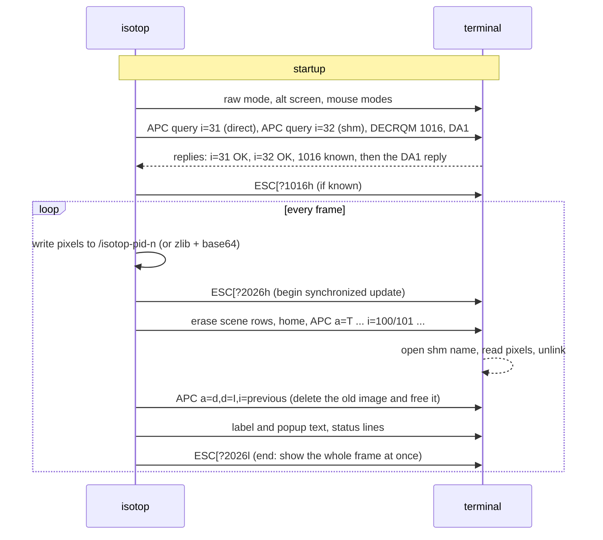

# Theory Terminal Graphics

A terminal is a grid of characters, and isotop wants to show it a 1920-pixel image ten times a second. The Kitty graphics protocol makes that possible: an escape sequence carries (or points to) a block of raw pixels, and the terminal paints them under the text. This page is the protocol as isotop uses it, byte for byte, because the escape stream was captured from the release binary through a pseudo-terminal while these pages were written: the capability probe and why it ends with an ordinary device-attributes query, the two transports (POSIX shared memory and zlib plus base64), double buffering with image ids, the z-index trick that lets popups and labels be ordinary text drawn over the scene, how the terminal is restored, and what tmux lacks.

## History

* **Graphics terminals before bitmaps.** Text terminals that could also draw go back to the vector storage tubes of the early 1970s such as Tektronix's, which kept a drawn line lit without refresh. DEC's VT100 (1978) established the escape-sequence vocabulary that terminals still speak (ANSI X3.64, later ECMA-48). DEC added ReGIS, a geometric language of primitives such as lines and arcs, first on the VT125 in July 1981, and later in the VT240 series.
* **Sixel.** DEC's other graphics format described a bitmap rather than shapes. Sixel was first used to send bitmaps to DEC dot-matrix printers such as the LA50 and later to the VT240-series terminals. The sources consulted here disagree about the year, and none confirmed 1983 (unverified). A *sixel* is a column of six pixels; each column is sent as one printable ASCII character, offset by 63, so the characters `?` through `~` encode 0 to 63. The sixel `?` is six pixels switched off.
* **Image protocols for modern terminals.** With GPU-composited terminal emulators came escape sequences for whole images: iTerm2 defined one for inline images on macOS (details unverified here), and Kovid Goyal's kitty terminal defined the graphics protocol this page uses, which adds image ids, placements, z-order, compression and, importantly for isotop, shared-memory transfer. Its introduction date is not verified here. Other terminals adopted it, among them Ghostty, which Mitchell Hashimoto announced as open source with a 1.0 release in December 2024 and whose documentation lists the Kitty graphics and keyboard protocols.
* **Shared memory.** Passing data between processes by naming a region of memory both can open, rather than copying it through a pipe, is the oldest trick of local inter-process communication; POSIX standardised `shm_open` and `shm_unlink` in the 1990s (IEEE Std 1003.1b-1993, to the best of my knowledge, unverified). The protocol's `t=s` medium uses it so that only the name crosses the terminal's byte stream.
* **Synchronized output.** The `?2026` bracket is one of several proposals to stop terminals showing a half-drawn frame; it is a convention among terminal authors rather than an ECMA or ISO standard.
* In isotop, `?` is also what `clean_text` writes in place of every character it will not forward. In sixel it means nothing is drawn.

## Theory: bitmap graphics through a text channel

The channel is a byte stream of text and escape sequences, parsed by a terminal state machine. Kitty's protocol (Goyal) puts graphics in *APC* sequences, `ESC _ G <key=value,...> ; <payload> ESC \`, which terminals that do not know them are meant to ignore. The control keys select the action (transmit, display, query, delete), the pixel format and geometry, the *medium* the payload travels in, and optional compression; the payload is base64. Two media matter here:

* **Direct** (`t=d`): the pixels are in the payload itself, base64-encoded, optionally zlib-compressed (`o=z`), in chunks of at most 4096 bytes (`m=1` on all but the last). This works over any byte pipe, including SSH, at the cost of copying, compressing and encoding every frame through the pty.
* **Shared memory** (`t=s`): the payload is only the *name* of a POSIX shared-memory object, base64-encoded, and `S=` gives the number of bytes to read. The terminal opens the object, reads the pixels and unlinks it. Only the name crosses the pty; the pixels cross as a page-cache copy. It works only when the terminal and the program share a kernel, which is why it is a local-only transport.

The information-theoretic view is simple. A 1920 by 1080 RGB frame is $3 \times 1920 \times 1080 = 6{,}220{,}800$ bytes, 62 MB per second at 10 fps. Compression is exploiting redundancy (a scene is mostly flat sky); base64 then pays a fixed 4/3 expansion for carrying binary in a 7-bit-safe channel. Shared memory pays neither.

## The code

### Entering: the capability probe

`Terminal::enter` refuses to run unless both stdin and stdout are terminals. Then, in order: raw mode; the alternate screen (`ESC [ ? 1049 h`); the cursor hidden (`?25l`); mouse capture, which in `crossterm` is the five modes `?1000h ?1002h ?1003h ?1015h ?1006h` (button, drag, any-motion, urxvt and SGR encodings). Then `probe()`, and, if the terminal answered the keyboard query, the push of the keyboard flags.

The probe asks four questions and uses one sentinel. It writes a three-byte shared-memory object `/isotop-<pid>-probe` and sends, in one flush:

```text
ESC _ G i=31,s=1,v=1,a=q,t=d,f=24 ; AAAA ESC \          Kitty graphics, direct medium (a 1x1 pixel, 3 zero bytes)
ESC _ G i=32,s=1,v=1,a=q,t=s,f=24,S=3 ; <b64 name> ESC \ Kitty graphics, shared-memory medium (sent only if the object was made)
ESC [ ? u                                                Kitty keyboard protocol: report the current flags
ESC [ ? 1016 $ p                                         DECRQM: is SGR-Pixels mouse reporting (mode 1016) known?
ESC [ c                                                  DA1: primary device attributes
```

`a=q` is the protocol's *query* action: the terminal answers whether it could handle the request, with `i=31;OK` (or an error) in an APC, without displaying anything. A terminal answers queries in order, and *every* terminal answers DA1, so the arrival of a DA1 reply, `ESC [ ? <digits;digits> c`, means any capability reply that was coming has already come. That is why the probe waits for DA1 rather than for the Kitty replies: terminals without graphics support, tmux, and plain consoles answer DA1 at once and the probe returns immediately instead of timing out; the probe's own deadline is 1500 ms, polled in 50 ms steps, reading the file descriptor directly so that a buffered `stdin` does not swallow bytes `crossterm` will need later. Afterwards the probe unlinks its object. The replies decide:

| Found in the reply | Means | Effect |
|---|---|---|
| `i=31;OK` | direct graphics work | otherwise: refuse to start, unless `--force-graphics` |
| `i=32;OK` | the terminal can read shared memory | `shared_memory = true`, unless `--direct` |
| `ESC [ ? <digits> u` | the terminal speaks the Kitty keyboard protocol (`keyboard_reply`) | `Terminal::enter` pushes `KEYBOARD_FLAGS` (disambiguate escape codes, report alternate keys, report all keys as escape codes) so that Shift + Space is distinguishable from Space; `restore_screen` pops them |
| `ESC [ ? 1016 ; 1 $ y` or `; 2 $ y` | the terminal knows SGR-Pixels (set or reset) | enable it with `ESC [ ? 1016 h`; clicks are then pixel-precise ([Theory Picking](Theory-Picking)) |

If graphics are not detected the error names tmux when `$TMUX` is set ("tmux does not pass Kitty graphics through ...") and otherwise says detection failed; the `Drop` of the half-built `Terminal` restores the screen before the process exits. On macOS the wait uses `select(2)` for a terminal, because `poll(2)` does not support devices there.

### One frame on the wire



`Terminal::present` assembles one `Vec<u8>` and writes it with a single locked `write_all` and flush. A captured frame, with the long payload elided, reads:

```text
ESC[?2026h
ESC[1;1H ESC[2K  ...  ESC[31;1H ESC[2K              erase each scene row
ESC[1;1H
ESC_G a=T,f=24,s=320,v=165,i=101,c=120,r=31,z=-1073741825,C=1,q=2,t=s,S=158400 ; <b64 "/isotop-10100-0"> ESC\
ESC_G a=d,d=I,i=100,q=2 ESC\
ESC[26;62H ESC[38;2;150;172;198m renderer-188 269% ESC[0m     one label per busy process
ESC[32;1H ESC[2K ESC[38;2;180;199;218m ISOTOP / CITY / LIVE ... ESC[0m    status lines under the scene
ESC[?2026l
```

The control keys, as `Terminal::present` writes them:

| Key | Value | Meaning |
|---|---|---|
| `a=T` | transmit and display in one action | |
| `f=24` | RGB, 8 bits per channel, no alpha | `Frame::pixels` is exactly this layout |
| `s=`, `v=` | frame width and height in pixels | |
| `i=` | image id, alternating 100 and 101 | double buffering, see below |
| `c=`, `r=` | the number of cell columns and rows to scale the image into | so the frame fills the scene area at any cell size |
| `z=-1073741825` | z-index below $-2^{30}$ | draw under cells that have a background colour |
| `C=1` | do not move the cursor | |
| `q=2` | suppress all responses | no replies to read in the frame loop |
| `t=s`, `S=<bytes>` | shared-memory medium and the byte count | `S` is `frame.pixels.len()` |
| `t=d`, `o=z`, `m=0/1` | direct, zlib, more-chunks flag | inline transport |

**Why a delete follows the transmit.** Each frame is transmitted under a new id (100 and 101 alternate) and the *previous* id is then deleted with `a=d,d=I`; the uppercase `I` also frees the terminal's stored copy of the image data, the lowercase form would delete only the placement. Transmitting before deleting means there is never a moment without an image, and the synchronized-update brackets (`?2026h` and `?2026l`) ask the terminal to hold rendering until the whole frame, image and text, has arrived. A terminal that does not know mode 2026 ignores the brackets and may show the cleared rows briefly.

**Why `z` is below $-2^{30}$.** By the protocol, images with a z-index below $-2^{30}$ (`INT32_MIN/2`) are drawn *under cells that have a non-default background colour*, and any other negative z-index is drawn above backgrounds but under text. isotop uses the lower value so that a popup, which has a background colour, covers the image, while the many label cells that have the default background stay transparent and the scene shows through. The inspector, tags and labels are therefore ordinary text, cheap to draw and impossible to rasterize wrongly; the README states the same in a sentence.

### Transport A: shared memory

`transmit_shared` makes a new object per frame, named `/isotop-<pid>-<serial>` with the serial wrapped at twelve digits so that the name never exceeds 31 bytes (macOS limits a shared-memory name, slash included, to `PSHMNAMLEN`; a unit test pins the longest name to exactly 31). `shm_open` is called with `O_CREAT | O_EXCL | O_RDWR` and mode `0600`: exclusive, so a stale object cannot be reused, and private to the user. On Linux the pixels are copied in with a single `write` (tmpfs accepts it, which avoids faulting in a fresh mapping page by page); elsewhere the object is sized with `ftruncate`, mapped, copied into and unmapped. The terminal unlinks the object after reading it; isotop keeps the last eight names in a queue and unlinks any it still holds beyond that, and every remaining one on exit, ignoring `ENOENT` for the ones the terminal already removed.

Per frame this costs `shm_open`, a copy of $3WH$ bytes and, on the terminal's side, an open, a map, a read and an unlink, while the pty carries only a few hundred bytes of escape text. Because it is one failure from a permanent fallback (any error in `transmit_shared` sets `shared_memory = false` for the rest of the session), issue [#88](https://github.com/tfpickard/isotop/issues/88) (A29) proposes retrying with backoff, a reusable ring, and moving the inline encoding off the frame loop.

### Transport B: inline, zlib and base64

If shared memory is unavailable (SSH, `--direct`, a terminal that failed `i=32`), `present` compresses `frame.pixels` with zlib at `Compression::fast()` (level 1), base64-encodes the result and sends it as chunks of 4096 base64 characters: the first carries the full control string with `t=d,o=z,m=1`, the following ones only `m=` and `q=2`, the last `m=0`. This happens synchronously on the frame thread each frame. In the captured demo run of the City view at a 320 by 165 frame (158,400 raw bytes), the base64 payloads of the first ten frames were 30,460, 43,632, 45,748, 56,176, 59,592, 59,008, 63,356, 65,228, 65,188 and 67,924 bytes, that is, compressed sizes of 22.8 to 50.9 KB, roughly 7 down to 3 times smaller than the raw frame; the payload grows as the scene fills in, because the first frames are the emptiest. The status strip prints `<n> KiB/frame inline`, and `--duration N` prints the presented frame rate and the inline MiB/s on exit, with the explicit disclaimer "display latency not measured".

### The text overlay

Everything that is not the scene is text. `App::overlay` decides *what* (popup, tour callout, hover tag, system labels, busiest-process labels) and lays it out on a `Board` of claimed cell rectangles so labels never overlap each other or a panel (a label keeps a free column from its neighbours; panels may touch). `terminal.rs` draws them: `draw_label` positions with `ESC[row;colH` and styles with 24-bit colour (`Quiet` 150,172,198; `Bright` bold 214,226,240; `Tag` 255,226,170 on a 12,19,31 background), `draw_popup` draws a rounded box with `╭ ─ ╮ │ ╰ ╯` in a border colour on that background, and the status lines are written below the image on the rows that follow the scene, each preceded by `ESC[2K`. All text that may contain process data passes through `clean_text`, which keeps ASCII graphic characters and the space and replaces everything else with `?`, then cuts to the width ([Theory Text Safety](Theory-Text-Safety)); the box-drawing characters are generated by isotop itself, never from input.

The image fits the scene area through the `c` and `r` keys, and `Layout::measure` chooses the frame's pixel size so that its aspect ratio equals the cell area's: width $=\min(\text{native width}, \texttt{--width})$ and at least 160, height proportional to the scene rows times the cell height, clamped to 100 to 1440. It asks the terminal for its pixel size to learn the cell size; if it cannot, it assumes 8 by 16 pixel cells, and a wrong assumption makes the terminal stretch the image to the cell grid.

### Restoring the terminal

`Terminal` implements `Drop`, and the guard is created *before* the probe so that an early error also restores. The captured shutdown is below; its first line, the pop of the keyboard flags, is added from the source (`restore_screen`) and was not in the capture:

```text
ESC[<1u                                                      keyboard flags popped first (only if pushed)
ESC[?2026l  ESC[?1016l  ESC_G a=d,d=A,q=2 ESC\
ESC[?1006l ESC[?1015l ESC[?1003l ESC[?1002l ESC[?1000l     mouse capture off
ESC[?25h                                                     cursor shown
ESC[?1049l                                                   alternate screen left
```

plus disabling raw mode through termios, then unlinking any shared-memory names still queued. `a=d,d=A` deletes every image isotop placed and frees the data. Ctrl-C needs no signal: raw mode disables `ISIG`, the key arrives as an event and `command` returns quit.

What this does and does not cover, from reading the source: it covers normal exit, an error returned from `run` and a panic that unwinds on the main thread (the release profile does not set `panic = "abort"`). It does not cover `SIGTERM`, `SIGHUP` or `SIGKILL` (a search of `src/` finds no signal handler), a build with `panic = "abort"`, or a state in which the main thread keeps running after another thread has panicked. There is no panic hook (`set_hook` does not occur in the tree), which is the first item of issue [#88](https://github.com/tfpickard/isotop/issues/88): install one that restores the terminal idempotently with `Drop` and then calls the previous hook, and add a smoke-test check that forces a panic. Resizing, or toggling the panel with `h`, calls `Terminal::clear` (`a=d,d=A` and a clear screen) and re-measures the layout.

## Terminals

* **Ghostty** is the primary target and the one the project's visual checks are made in. The README states that Ghostty and Kitty read shared memory locally and report SGR-Pixels, and the image-below-backgrounds behaviour above is what the popups depend on. `AGENTS.md` gives a recipe for checking a real Ghostty session without disturbing a desktop (a headless `sway`, `ghostty -e isotop --demo`, and a `grim` capture) and notes that Kitty crashes when headless.
* **Kitty** works. Both are exercised through the probe, not special-cased by name.
* **tmux does not work**, as the README says and the probe's error message repeats. tmux owns the screen and keeps its own cell model; it does not forward the APC graphics sequences to the outer terminal, and even if they were passed through, its redraws would not know to repaint the image. Issue [#99](https://github.com/tfpickard/isotop/issues/99) (F5, open, blocked on #88) is a spike to see whether Kitty graphics can go through tmux 3.3 or later with `allow-passthrough on`, DCS-wrapped, with Kitty's Unicode placeholders (`U+10EEEE` plus diacritics) so that the image survives tmux redraws; it begins by checking that Ghostty supports placeholders at all, detects tmux through `$TMUX`, and must keep overlay text from overwriting placeholder cells. Nothing of this is implemented.
* **The smoke test** (`scripts/smoke_terminal.py`) emulates a graphics-capable terminal on a pty, answering the probe, reading frames both inline and from shared memory, and exercising interaction and restoration. It is the model for the capture used on this page.

## Reading the picture

What reaches the screen is the frame the rasterizer produced, scaled by the terminal to the cell grid. isotop controls neither the terminal's scaling filter nor its latency, and does not measure display latency (the `--duration` report says so). The status strip's `renderer` and `transport` fields say how the frame was made and sent. Text is crisp because it is the terminal's own; the image is not, so a one-pixel line is as sharp as the terminal's resampling lets it be.

## Where in the code

| What | Where |
|---|---|
| `Terminal`, `enter`, `present`, `clear`, `Drop`, `probe`, `write_shared`, `frame_name`, `draw_label`, `draw_popup`, `clean_text` | [`src/terminal.rs`](https://github.com/tfpickard/isotop/blob/main/src/terminal.rs) |
| `Layout::measure`, `PANEL_ROWS`, `App::overlay`, `Board`, the frame loop that calls `present` | [`src/app/screen.rs`](https://github.com/tfpickard/isotop/blob/main/src/app/screen.rs), [`src/app/overlay.rs`](https://github.com/tfpickard/isotop/blob/main/src/app/overlay.rs), [`src/interactive.rs`](https://github.com/tfpickard/isotop/blob/main/src/interactive.rs) |
| Emulated terminal and restoration checks | [`scripts/smoke_terminal.py`](https://github.com/tfpickard/isotop/blob/main/scripts/smoke_terminal.py) |
| Visual-check recipe for Ghostty | [`AGENTS.md`](https://github.com/tfpickard/isotop/blob/main/AGENTS.md), "Visual checks" |

## References

* K. Goyal, *Terminal graphics protocol*, in the kitty documentation (actions, media, chunking, z-index, deletion, Unicode placeholders).
* *XTerm Control Sequences* (E. Moy, S. Gildea, T. Dickey): DA1, DECRQM and DECRPM replies, the mouse modes 1000, 1002, 1003, 1006 and 1015, the alternate screen, 1049.
* ECMA-48 / ISO/IEC 6429, *Control functions for coded character sets* (CSI, APC and string terminators).
* IEEE Std 1003.1 (POSIX), `shm_open`, `shm_unlink` and `mmap`.
* isotop issues [#88](https://github.com/tfpickard/isotop/issues/88) (transport robustness) and [#99](https://github.com/tfpickard/isotop/issues/99) (tmux).
