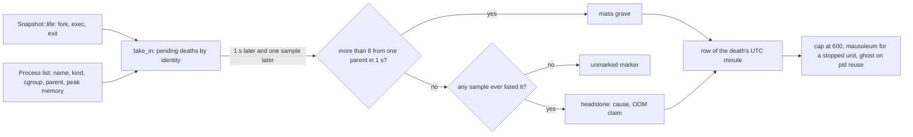

# View Necropolis

A moonlit cemetery of exited processes. Each death becomes a headstone in the row of its UTC minute, the newest row in front and the older ones receding into fog. A stone's height is the process's lifetime CPU time and its width the most memory it ever held; its tint is its kind; its epitaph (on hover or click) says how it died. Zombies stand in open pits in front, waiting to be reaped; a service
whose processes are all gone gets a mausoleum; a ghost rises over a grave when a new process takes the buried pid; the fog thickens with memory pressure; and the moon is the real moon, its phase computed from the date. It is the view about what survives a process's death, and how little.


## The system being modelled

**How a Unix process dies.** A process ends with `exit(status)` or is killed by a signal; the kernel stores a 16-bit *wait status* (the low 7 bits are the signal that killed it, bit 7 says it dumped core, bits 8 to 15 are the exit code) and leaves a *zombie*, a table entry with nothing in it but that status, until the parent calls `wait`
(the parent *reaps* it). Between exit and reap the process is state `Z`. If the Linux OOM killer chose it, the signal is SIGKILL and the cgroup's `oom_kill` counter rises. Beyond the wait status, the kernel's accounting interface (*taskstats*) can deliver a record at exit with the process's elapsed time, CPU time, peak resident memory, I/O bytes, context switches and a flag
for "forked and never exec'd" (AFORK). The Linux process connector delivers fork, exec and exit events (with the status) as they happen; neither needs polling, though both need privilege, and on macOS only kqueue exec and exit events and sample diffing exist.

**Why a graveyard.** Process monitors show the living. The dead are the process table's negative space: every process that ever existed left a short record or nothing at all, and the *rate* of death, the mass deaths of a build job's children, the OOM kills and the services that stopped altogether are the machine's history. A cemetery has the right structure for it:
a place for each death by when it happened, families together, a building for a whole dynasty, and the unmarked graves of those too short-lived to be recorded.

## History

The longer account lives in the repository: [docs/theory/necropolis.md](https://github.com/tfpickard/isotop/blob/main/docs/theory/necropolis.md).

*Necropolis* is Greek for "city of the dead", and the oldest were laid out as cities for the reason cities are: the dead were a community the living meant to stay in relation to.

**The Valley of the Kings.** For roughly five centuries of the New Kingdom (about 1539 to 1075 BCE) the pharaohs were buried in rock-cut tombs in a wadi on the west bank at Thebes, across the Nile from the living city. The move away from pyramids was a bet on concealment, and mostly lost: nearly every tomb was robbed in antiquity. Tutankhamun's, KV62, survived largely by accident, buried under rubble from later digging; Howard Carter's team found its steps in November 1922. KV5, the tomb of the sons of Ramesses II, was noted in 1825, but its extent (well over a hundred chambers) was established only by Kent Weeks's team from 1995.

**Banditaccia, Cerveteri.** An Etruscan city of the dead laid out as a city, with streets and squares, from the ninth century BCE to about the third. Many of its tumuli imitate the interior of a house, with carved beams, couches and hearths. The name does not refer to bandits; it is said to come from the *bando*, the lease under which landowners let ground to families for burials.

**Pantalica, Sicily.** A limestone plateau pierced by thousands of rock-cut chamber tombs, most from the thirteenth to the seventh century BCE. The traditional count is over 5,000; the most recent estimate is just under 4,000.

**The Alyscamps, Arles.** A Roman burial road that became a Christian pilgrimage cemetery, and which Van Gogh and Gauguin both painted in 1888. Cairo's City of the Dead (the Qarafa) is a necropolis people live in.

**Brookwood, Surrey.** London's churchyards were full and dangerous, so a private company laid out a vast cemetery 25 miles out in 1852 and ran the dead there by rail. The London Necropolis Railway ran its first funeral train in November 1854, from a private terminus near Waterloo, with coffins and mourners in separate classes of carriage. A German bomb destroyed the terminus and its rolling stock on the night of 16 April 1941, and the line never reopened. The cemetery still takes burials. Glasgow's Necropolis (1833) and Pere Lachaise in Paris (1804) belong to the same movement, the garden cemetery.

What these share is the design problem the view inherits: a place that has to index the dead (who, when, how, how big a life) so that someone can find one again.

## Theory

### What a death keeps, in bits

A running process holds as many bits as it has resident memory: at most $8\times 2^{20}\,M$ bits for $M$ MiB, so 200 MiB is at most $1.7\times10^9$ bits of state (an upper bound; the Shannon entropy of real memory contents is much smaller, but not zero). At exit all of it is destroyed. What the system retains is the wait status (at most $7 + 1 + 8 = 16$ bits, in practice fewer than 9 bits of information:
256 exit codes, about 127 signals, a core flag), and, where taskstats is available, `ExitRecord`: a command name, a start time, elapsed time, CPU time, peak RSS, bytes read and written, two context-switch counts, the AFORK flag and a thread count, about 80 bytes. Everything the cemetery draws is a function of those few hundred bits and of the *last observed* name, kind, cgroup and parent.
The compression from the live image to the record is a factor of $10^6$ or more; the necropolis is a picture of the surviving part of the signal, a sort of epitaph channel.

The picture then compresses *that* again. The stone's height $h = 0.55 + 0.36\log_{10}(\max(\mathrm{ms}, 3))$ (at most 3.2) turns a lifetime CPU of 3 ms into 0.72, one second into 1.63, an hour into 2.91, and reaches the cap at $10^{7.36}\,\mathrm{ms} \approx 6.4$ hours of CPU. The width $0.62 + 0.15\log_2(\max(\mathrm{MiB}, 1))$ (at most 2.4) gives
1 MiB 0.62, 100 MiB 1.62, and the cap at about 3.7 GiB. Both are logarithmic: the eye reads a *decade* of CPU as 0.36 units of height, the way magnitudes read a flux (see [Math Stellar Photometry](Math-Stellar-Photometry)).

### Sampling and the unmarked grave

A sampler that looks every $\Delta t$ seconds sees a process that lives $L$ seconds with probability $\min(L/\Delta t, 1)$ (if its birth is uniformly distributed). With one-second samples a 100 ms process is seen one time in ten. Processes that die before any sample listed them are the *unmarked markers*: counted, with a kind guess from their parent's, but nameless. They
are the reason the necropolis does not rely on sampling alone: with the proc connector it hears the fork and the exit.


*Probability that a process is ever sampled, against lifetime over sampling interval (figure from [Theory Life Events](Theory-Life-Events)).*

### Pid reuse

Pids are allocated by a counter that wraps at `pid_max` (32 768 by default on many systems, larger on recent ones). A pid is reused only after the counter has gone round, so a ghost appears when a machine creates more than `pid_max` processes while the grave stands: at 1000 forks per second and a 32 768 limit, about once every 33 s. Identity in isotop is the pair (pid, start time), so the reused pid is a different
process, and the grave remembers the old one.

### The moon

The moon's age since the last new moon is computed as

$$
a(t) = \frac{t - t_0}{86400}\ \bmod\ 29.530588853,\qquad t_0 = 947\,182\,440\ \mathrm{s} = \text{2000-01-06 18:14 UTC (a new moon)},
$$

and the lit fraction of the disc as $f = \tfrac12\bigl(1 - \cos(2\pi a/29.530588853)\bigr)$. The first is the *mean synodic month*; the second assumes the moon-sun angular separation (elongation) $\psi$ advances uniformly, with $f = (1 - \cos\psi)/2$, the exact geometry for a spherical moon lit by a distant sun. The real moon's elongation is not uniform: its orbit is eccentric
(0.055) and perturbed by the sun, so the true phase times differ from the mean ones by up to about half a day, the biggest terms being the *equation of centre* and the *evection*.

**Accuracy, computed.** I compared the model with an independent low-precision ephemeris (the Astronomical Almanac's few-term series for the sun's and moon's ecliptic longitude and the moon's latitude; it reproduces known new, quarter and full moons of 2000, 2017, 2018, 2024 and 2026 to within 25 minutes). Over 2000 to 2040:

| Measure | Value |
|---|---|
| True new moon minus model's, 495 lunations | from -17.5 to +10.0 h, mean -3.8 h, rms 8.4 h |
| True quarters minus model's (500 lunations each) | -23 to +16 h, rms 12 h |
| Lit fraction error, hourly samples | rms 0.035, largest 0.103 |

The mean offset is not a defect of the period but of the epoch: 2000-01-06 18:14 is a *true* new moon, 3.9 h after the *mean* new moon of that month, and the model measures from it as if it were a mean one. On the day this page was written, 2026-10-12 00:00 UTC, the model says age 0.62 d and 0.4 % lit (a new moon), while the reference puts the moon 1.4 days past a new moon of
2026-10-10 15:50 UTC at about 2 % lit. The view's legend (`moon: new moon 0% lit`) is therefore good to a day, which is as good as a thin crescent can be told from a new moon by eye.


*Script: `docs/figures/necropolis-moon.py` (the reference series are in the script; the check against known moons is described in its docstring).*

## Mapping

| Visual element | Measured source | Transform |
|---|---|---|
| Row | The UTC minute of the death (`Snapshot::wall` at the exit's time) | One row per minute with deaths, 3.1 apart, newest in front; when a new minute opens a row the others ease back one spacing over 1.2 s. A row is two lines of 26 units, the second 1.5 behind, filled from the left; graves beyond both are counted on the row's label (`+N`); closed rows are frozen |
| Row label | The minute | `HH:MM UTC` for the newest row, `HH:MM` for older ones |
| Stone height | Lifetime CPU: taskstats utime+stime, else the last sampled `cpu_time` | $0.55 + 0.36\log_{10}(\max(\mathrm{ms}, 3))$, at most 3.2 |
| Stone width | Peak memory: taskstats `hiwater_rss`, else the most any sample saw | $0.62 + 0.15\log_2(\max(\mathrm{MiB}, 1))$, at most 2.4 |
| Stone tint | Process kind | Slate (kernel), green granite (system), sandstone (session), lilac marble (containers) |
| Place in the row | Parent and child | In the open row a death whose parent or child is already buried there takes the slot after that family; only the graves after it move |
| Epitaph | Name, pid, lifetime, cause, kind, cgroup, parent | `name-pid`; `lived <lifetime>   <cause>`; `kind \| cgroup \| parent name-pid`. Lifetime from taskstats `etime`, else wall clock minus start |
| Cause | Wait status, OOM counter | The first rule that matches (below) |
| Mass grave | More than 8 deaths from one parent within 1 s | One slab 0.42 high and $2.4 + 0.1N$ long (at most 3.6), `comm x N mass grave (parent-pid)`; counts as one grave |
| Zombie in an open pit | A live process in state Z | A pink figure in a pit before the newest row; a pit is kept for life; reaped, it sinks over 0.5 s and is buried |
| Mausoleum | A `.service` cgroup with no live process and at least 3 standing graves | Its graves leave their rows (the gaps stay); it stands in the lot at the left end of the row of its last death; labelled `unit (unit stopped, N graves)`; later graves join it |
| Unmarked marker | An exit of a process no sample listed | A marker 0.28 high in the corner field, the newest 120 drawn, all counted (`N died between samples`) |
| Ghost | A new process whose pid is that of a standing grave, with a different start | Five stacked glows rising 4 s and fading 2 s, labelled `pid N reused`; at most four at once; not pickable |
| Fog | Memory pressure (stall percentage, 10 s average) | Density $0.4 + 1.2\,p/(p + 10)$ times distance from the front, capped at 0.6; $4 + \mathrm{round}(12\,p/(p+10))$ wisps, at most 16 |
| Sinking rows | Number of standing graves | Above 600 the oldest whole rows are dropped; from 450 the oldest row sinks by up to 1.5 and is fully fogged at 600 |
| Moon | The date (`Snapshot::wall`) | Age and lit fraction above; lit side on the right while waxing |

**Cause of death, first rule that matches** (`Death::of`, with the OOM claim applied before it): SIGKILL (without core) while a cgroup's `oom_kills` rose in the same or the previous sample, "taken by the OOM killer", each rise claiming the largest victim by peak memory; a core dump, "dumped core"; another signal, "killed by SIGTERM" (Linux names, else "killed by signal N"); AFORK with exit 0, "forked, never exec'd"; a non-zero exit, "exited N"; exit 0,
"exited peacefully"; otherwise "died between samples".

**Decorative:** the fence and gate, gravel paths, grass, soil beds, the two bare oaks, the stars, the earthshine on the moon's dark side, the stone *shapes* (round, slab, gothic, cross, and an obelisk for some tall ones: drawn from the identity hash), the engraved lines, a zombie's sway, the fog's base density of 0.4, and the drifting of wisps.



## How isotop realises it

**Intake.** `Necropolis::record` runs on every sample (the view hook `record`), through `take_in`: OOM-kill credits from the cgroup counters (valid for the sample they rose in and the next); ghosts for new identities whose pid names a standing grave; a `Seen` record of each process's name, kind, cgroup, parent, peak memory and last CPU time;
then the exits of `Snapshot::life` (the merged stream of the proc connector, taskstats and sample diffing; see [Theory Life Events](Theory-Life-Events)), each once per identity (`mourned`); and zombies that vanished (reaped) buried as having died between samples if no event came. The row declares `sources: LifeEvents`, so the event thread runs only while the necropolis
is shown (deaths while another view is shown are not seen). `warmup`: a headless demo replays 600 s with `before_start: true` so the reference frame at 12 s shows ten rows; the demo (`mortality: true`) synthesises every cause, a burst, a stopped unit and a reused pid.

**Burial.** `bury` waits `BURIAL_DELAY = 1` s and at least one sample (or 120 s, `REMEMBER`), so a mass grave and an OOM kill are known. Deaths with one parent within `MASS_WINDOW = 1` s, more than `MASS_THRESHOLD = 8` of them, become one mass grave; a death with no `Seen` record is an unmarked marker whose kind is guessed from its fork's parent;
the rest are headstones: `dig` fixes everything the grave shows (names, cause, sizes) at that moment and builds its stone once, in its own coordinates (`stone(shape, width, height, color)`), so a frame only moves, fogs and culls it. `place` puts it in the row of its UTC minute (`minute = floor(wall / 60)`): a new row if the minute is the newest, the open row beside its family if not, the end of a closed row otherwise;
`next_slot` lays it along the two lines.

**Mausoleums and caps.** `entomb` groups standing graves by cgroup (a `.service` leaf on Linux; any group where there are no cgroups) and, when no live process remains in it and three or more stand, moves them into a mausoleum at the left end of the row of the last death. `cap` drops the oldest whole rows (with their mausoleums and markers) while more than `CAP = 600` graves stand; `sinking_rows` eases the two oldest into the fog from 75 % of the cap.

**Fog and sky.** `Fog::new` computes density from `snapshot.pressure[1]`; each face is blended towards the fog colour by its depth fraction. `draw_sky` places the stars and the moon from `snapshot.wall` (the system clock, or `DEMO_EPOCH` plus demo time): `draw_moon` fills a dark disc and then a lit region bounded by the limb and a half-ellipse terminator of half-width $k = 1 - 2f$ times the limb at each height
(a quarter has a straight terminator, a full moon $k = -1$). Waxing is lit on the right, a northern-hemisphere view.

**Picking and parity.** Graves and mausoleums are pickable `Thing`s (kinds `grave` and `mausoleum`) with inspector `Card`s built on demand; zombies are the live process. Stones are triangles shaded by moonlight direction and culled when facing away; at most about 40 triangles per grave. The row sets `links: DrawnByView`, `flash: false` (a reaped zombie sinks instead), `haze: false` (fog stands for memory pressure) and
`tour: false` (the tour visits living processes, which this view does not draw). Epitaph text is sanitised like all process text ([Theory Text Safety](Theory-Text-Safety)).

**Degradation (the legend says so).** Without taskstats (it needs `CAP_NET_ADMIN`): causes come from the proc connector's exit status, sizes from what the samples saw, lifetimes from start times (`no exit records`). Where only sample diffing works (an ordinary container): every cause is "died between samples" and there are no unmarked markers (`no fork events`). Without PSI the fog stays at its base density. On macOS only sample diffing and kqueue see deaths.

## Reading the picture

What I see in the demo render: a grey-violet plot seen from above at an isometric angle, about ten rows of headstones in lilac, sandstone and slate-green, in varied shapes (rounded, gothic arch, slab, small crosses) receding to the back where they disappear into pale violet fog; a pillared grey mausoleum at the left end of a middle row; a small field of tiny stones at the right (the unmarked markers); five pink figures in a line in front, standing in pits (the demo's
zombies); two bare oaks against a starry sky; and, at the top right, a thin dark moon with a bright rim of crescent on its left: a waning crescent, since the demo's clock (`DEMO_EPOCH`) is the eve of a new moon (a test asserts age 28.0 to 28.6 days).

* **Measured:** the cause (a wait status or an OOM counter), lifetime CPU and peak memory (taskstats or last sample), the kind and cgroup of the process as last seen, the minute of death, the count of deaths per minute, the number of zombies, memory pressure.
* **Derived:** the row and position (grouped by family), the choice of mass graves, the mausoleum (a unit with three or more graves and no survivors), the OOM attribution (a heuristic: a SIGKILL in a cgroup whose counter rose within one sample claims its largest victim), the ghost.
* **Decorative:** the shape and engraving of a stone, the oaks, the moon's shading; the *moon itself is the date*, good to about a day.
* **Heights and widths are logarithmic.** Each extra unit of height means about 600 times more CPU time ($10^{1/0.36}$), and each extra unit of width about 100 times more memory ($2^{1/0.15}$); a stone twice as tall as its neighbour is not twice as busy.
* **What the eye cannot tell:** one-minute resolution of death times (and "newest in front" only at the row level), sub-second order inside a row, what a process did while alive, and any death while another view was shown.
* **A "died between samples" grave is not an unknown process dying**: it is a known process whose cause the source could not give; the unmarked marker is an unknown process.

## Try it

```sh
./target/release/isotop --demo --view necropolis --width 1600 --output /tmp/necropolis.png --renderer cpu
./target/release/isotop --demo --view necropolis --time 300 --output /tmp/n300.png
./target/release/isotop --view necropolis     # live; leave it open: deaths are read only while it is shown
python3 docs/figures/necropolis-moon.py       # the moon figure
```

Hover or click a headstone for its epitaph; the legend line ends with `moon: <phase> N% lit`, the graves standing, mausoleums and deaths per minute.

## Where in the code

* `src/necropolis.rs`: `Necropolis` (`record`/`take_in`, `bury`, `dig`, `dig_mass`, `place`, `entomb`, `cap`, `raise_ghost`, `draw`, `legend`, `card`), `Death` (`of`, `text`), `Grave`, `Row`, `Mausoleum`, `Marker`, `Ghost`, `Fog`, `stone`, `mausoleum`, `draw_moon`, `moon_age`, `moon_lit`, `moon_phase`, `lifetime_text`, `stone_height`, `stone_width`; constants `ROW_SPACING`, `CAP`, `MASS_THRESHOLD`, `BURIAL_DELAY`, `NEW_MOON`, `SYNODIC_DAYS`, `FOG_*`.
* `src/platform/mod.rs`: `Cause` (`of_status`, `signal_name`), `ExitRecord`, `LifeEvent`, `LifeKind`, `LifeSource`; `src/model.rs`: `Life` (the merge), `Snapshot::life`, `Snapshot::wall`; `src/platform/linux/events.rs`: the proc connector and taskstats thread; `src/platform/macos/events.rs`: kqueue.
* `src/layout.rs`: `Seats` (pits); `src/palette.rs`: `stone_color`; `src/views.rs`: the `necropolis` row.
* Tests: `exit_codes_and_flags_map_to_the_right_cause_of_death`, `a_sigkill_during_an_oom_kill_is_taken_by_the_oom_killer`, `many_deaths_from_one_parent_within_a_second_share_a_mass_grave`, `a_ghost_rises_when_a_new_process_reuses_a_buried_pid`, `the_cemetery_caps_at_six_hundred_graves_and_the_oldest_rows_sink_into_fog`, `a_service_whose_last_process_exits_gets_a_mausoleum`, `the_moon_phase_matches_known_new_and_full_moons`.
* Design: `docs/briefs/views-2026-10.md` (section 6), `docs/mockups/necropolis.jpg`. Compile-time module; no plugin system.

## Variations and open questions

1. **A better moon.** Replace the mean lunation by Meeus's corrected phase series (a dozen periodic terms); the error drops from hours to minutes. Is it worth the lines? The current error is invisible on a disc of 30 pixels.
2. **A real epoch.** Start from the mean new moon of January 2000 (about 3.9 h before the true one used now) to centre the error on zero.
3. **Hemisphere.** Mirror the lit side for the southern hemisphere, using the time zone (as `geo.rs` does for home).
4. **Epitaph channel capacity.** How many distinct epitaphs can a viewer tell apart by stone (height decile, width decile, tint, shape)? Is the stone a 6-bit or a 10-bit code?
5. **Lifetime distributions.** Plot lifetime against CPU on a per-row Hertzsprung-style diagram; a machine's dead processes may fall on a main sequence.
6. **Taskstats without privilege.** Read `/proc/<pid>/stat` just before death for processes with a known exit time to approximate `etime` when taskstats is not available.
7. **Zombie ageing.** Colour a pit by how long the zombie has waited.
8. **Degrees of death.** Whether a process that is remembered only by its pid is more or less dead than one the kernel has also forgotten; the view buries both in the same minute.

## References

* Linux manual pages `wait(2)`, `signal(7)`, `proc(5)`, and the kernel documentation of taskstats (`Documentation/accounting/taskstats`) and of the process connector (`cn_proc`).
* The cgroup v2 documentation (`memory.events`, `oom_kill`) and the OOM killer.
* J. Meeus, *Astronomical Algorithms* (2nd ed., Willmann-Bell, 1998), chapter 49 on the phases of the moon; *The Astronomical Almanac* (US Naval Observatory and HM Nautical Almanac Office), the low-precision formulae for the sun and moon.
* C. E. Shannon, "A mathematical theory of communication", *Bell System Technical Journal* 27 (1948).
* C. D. Friedrich, *Abbey among Oak Trees* (1809-10), the mockup's stated look (`docs/briefs/views-2026-10.md`).
* [Theory Life Events](Theory-Life-Events), [Theory History](Theory-History), [Theory Stable Layout](Theory-Stable-Layout), [Theory Text Safety](Theory-Text-Safety), [Math Stellar Photometry](Math-Stellar-Photometry).
